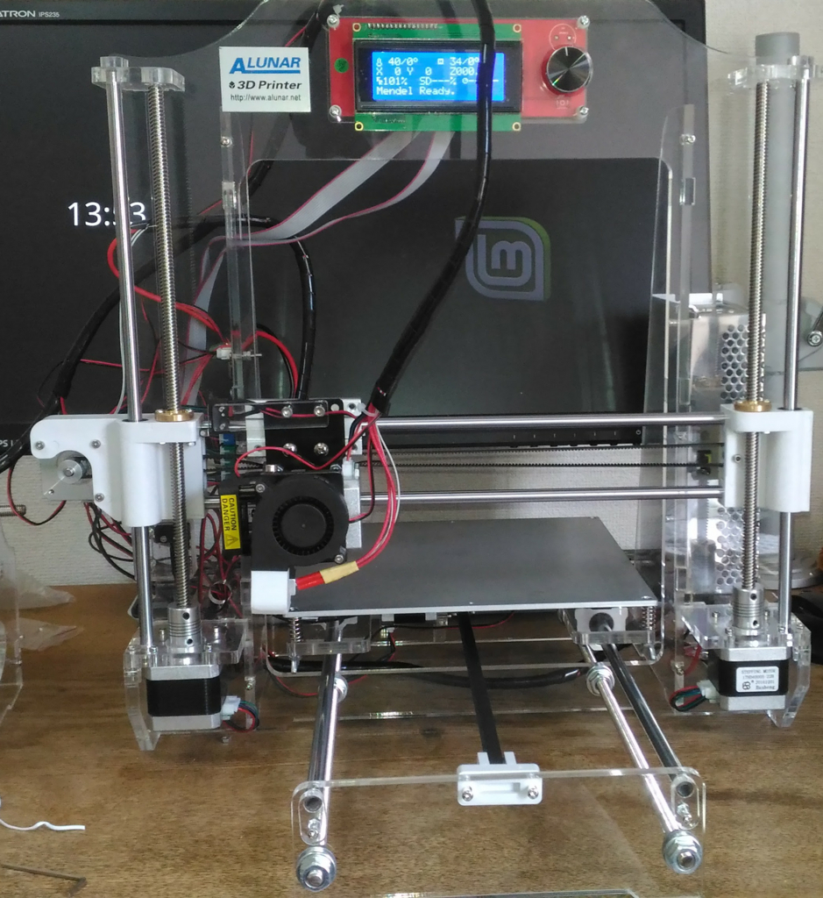
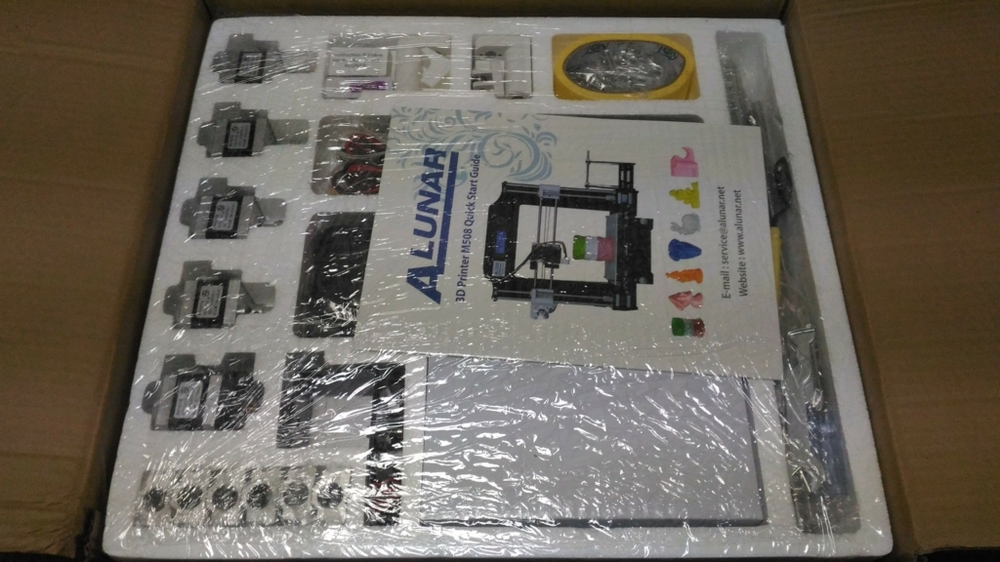
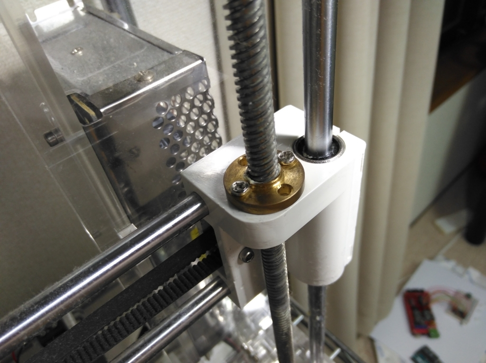
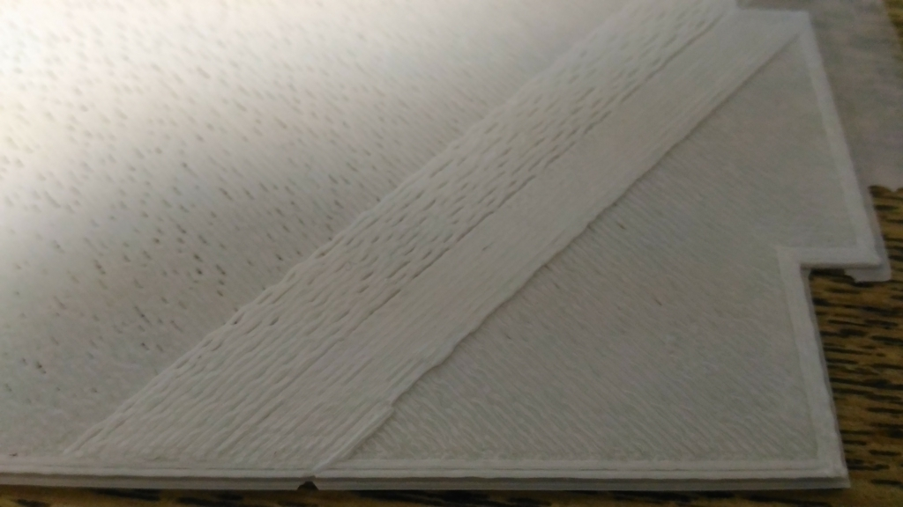
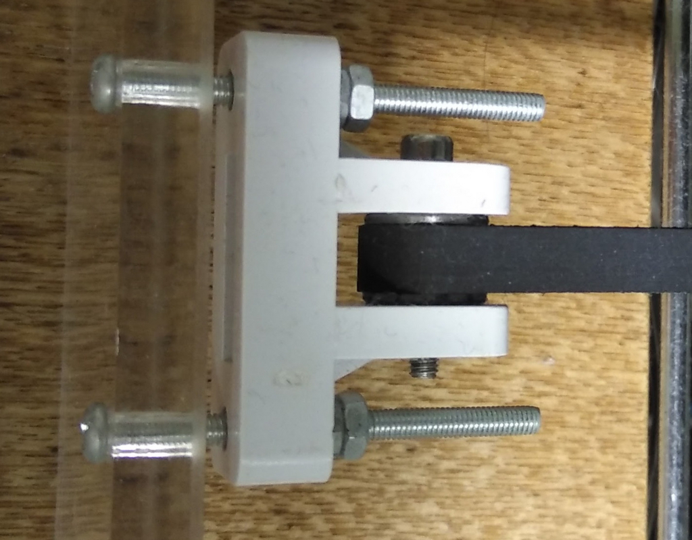

**2018/02/10記事末尾に追記あり**

 半年ほど前に3Dプリンターを購入して以来、色々作って遊んでいます。購入したのは、中国のAlunar社が販売する「M508」という機種で、RepRap系の格安3Dプリンターの一種です。

この手の自作3Dプリンターキットについては、ネット上の日本語情報が十分ではなく、購入は何かと不安になる人が多いと思います（シンプルな機械なので、実際には全く難しいものでは無いのですが・・・）。そこで、散発的な内容ではありますが、情報が多いに越したことはないと思うので、いくつか気になった点を載せておきます。

### キット内容

 パーツ一式。組み立て説明書・組み立てビデオが記録されたSDカードが同包されています。**部品リストも付属していますが、 実際の中身と全然合っていない**ので特に意味は無いです（ネジがやたらと余る）。説明書もところどころ現在のモデルとは異なる点があるので、基本的にはビデオを見ながら組み立てるのが良いと思います。私の場合、組み立てに要した時間は半日ほど。ビデオを見て特に迷う点はありませんでしたが、Z軸がうまく動かない問題（後述）に引っかかって、かなり時間を使いました。それをクリアしてみれば、一発で印刷に成功して拍子抜けでした。

### 組み立て時の注意点①

多くの人が書いていますが、Prusa i3タイプの3Dプリンターはプリンターヘッドが2本のZ軸によって支えられているため、それらの位置関係にシビアです。左右の高さに少しズレが生じただけで、すぐにステッピングモーターが止まってしまいます。全く歪みなくフレーム・Z軸を構築することは難しいので、むしろ逆に受け軸に多少遊びを持たすほうが楽です。写真に写っている受け側金具（金色）の2つのネジを少し緩めると、まともに動くようになりました。滑りを良くするために、軸にグリスを塗るのも効果的でした。

### 組み立て時の注意点②

これまた多くの人が書いているとおり、Prusa i3の造形精度は、X, Y軸のベルトテンションに大きく左右されます。組み上げたてのプリンターは、ベルトテンションが不足していることが多いようです。例えば下の図は、印刷途中にベルトテンションを変えたもの。右の方の印刷部位は、左の方と比べてベルトテンションを上げたもので、造形精度が高くなっていることがわかります（もっとうまく調整すれば、この写真よりもさらに精度は上がります）。

Alunar M508は、X軸・Y軸ともにベルトテンショナーが付属していないので、ベルトのテンション管理で楽をしたいのなら自分で工夫する必要があります。Y軸については、下の写真のように、ベルト固定具を簡易的なテンショナーとして使えばok。ベルト固定具（白）は、説明書ではフレーム（透明）に密着させることになっていますが、長めのネジを使ってフレームとの距離を調整するようにすれば、簡易的なテンショナーになります。引っ張りぱなしなのでテンションを一定に保つ能力はありませんが、これで十分使い物になります。 

X軸については、「X軸ベルトテンショナー」で検索すると様々な3Dプリントモデルがヒットするので、それら印刷して使うと良いです（Thingverseにも色々と置いてある）。ただし、フレームの剛性が低いせいで、あまりテンションを上げ過ぎるとZ軸がうまく動かなくなってしまうので注意。X軸に関しては、テンショナーを使わずに手動で合わせても良いかもしれません。

### Alunar M508の立ち位置

機種名は「Alunar M508」となっていますが、実際のところは廉価帯RepRap系3Dプリンター「Prusa i3」の部品セットそのものです（正確には、そのマイナーチェンジ版であるPrusa I3 X）。Prusa i3系の部品セットは、他にもHICTOP, UNICUBICといったアジア系の会社から販売されていますが、どれも構成に大差は無い・・・と思います。RepRap系のプリンターは、とにかく情報量の多さ（英語が多いですが）と自由度の高さ（ソフト・ハード両面で）が魅力です。Reprap系の同系統機種であれば中身はほぼ同じなので、他社のプリンター情報であっても参考にできます。

この機種の重要な長所は、ヒートベッドを有している点です。熱収縮が大きい材料（ABS等）の使用が可能になるだけでなく、PLA等の造形精度も向上するので、どのプリンターを選ぶにせよ、ぜひ押さえておきたい機能です。

メインボードは、Arduino Mega 2560 と Ramps 1.4 が一体化した廉価ボード。モータードライバ等のチップは全て基板に直付けされているので、基板改造が前提な人（例: モータードライバを変更して静音仕様にしたい）には不向きかもしれません。

いずれにせよ、手頃な価格（2万円〜4万円）でありながら、10万円以上の高価格帯製品にも匹敵するものが作れる上、改造してさらに使いやすくすることも可能なので、ぜひ多くの人に触ってみて欲しいと思います。

**2018/02/10追記** ちなみに、今再び3Dプリンターを買うとしたら、**Alunar M508は選びません**ね。私が購入した当時（2017年4月）と比べて、今は他社からも魅力的な製品がたくさん出ています。未だ最安クラスの価格は魅力ですが、「オートレベリング機能がない」「フレームの剛性が低い」といった点は今の基準では若干物足りなく映ります。

色々改造して愛着がわいたので、買い替える気は無いですけどね。GIANTARM MC2やPxmalion CoreI3あたりが気になるななぁ・・・。
