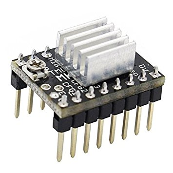
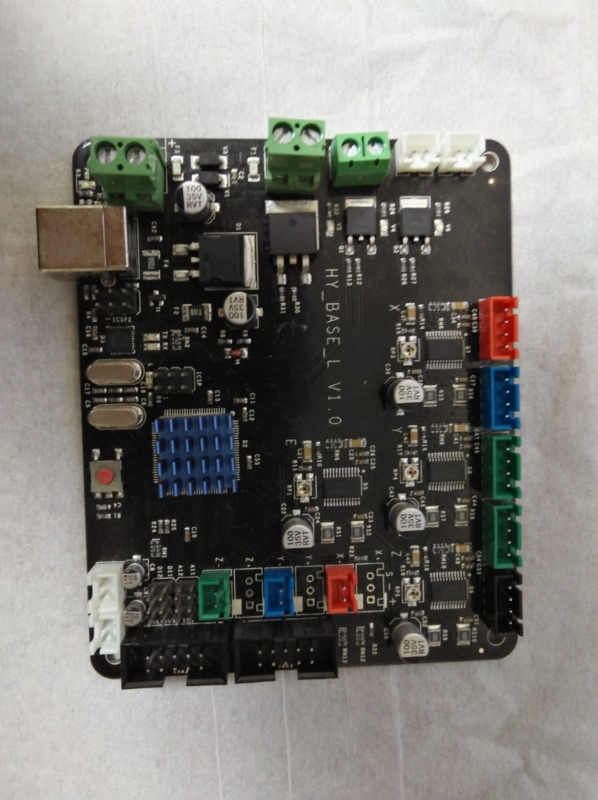
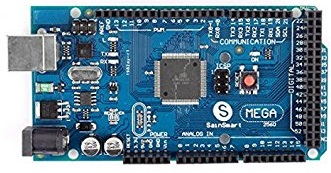
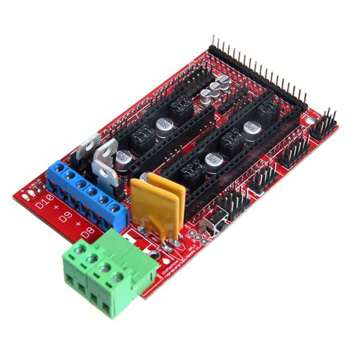
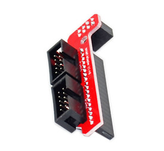
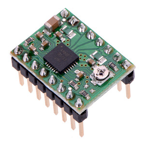
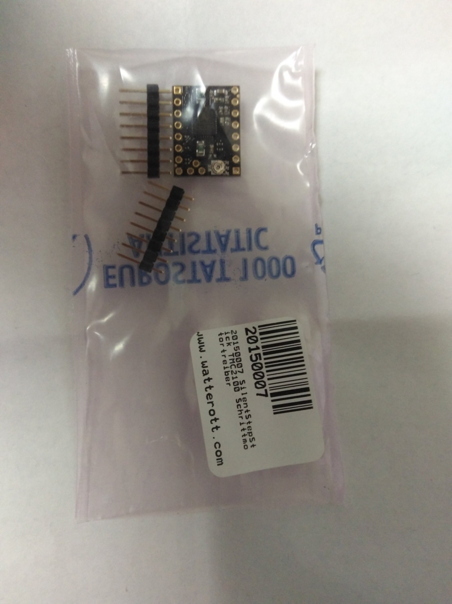
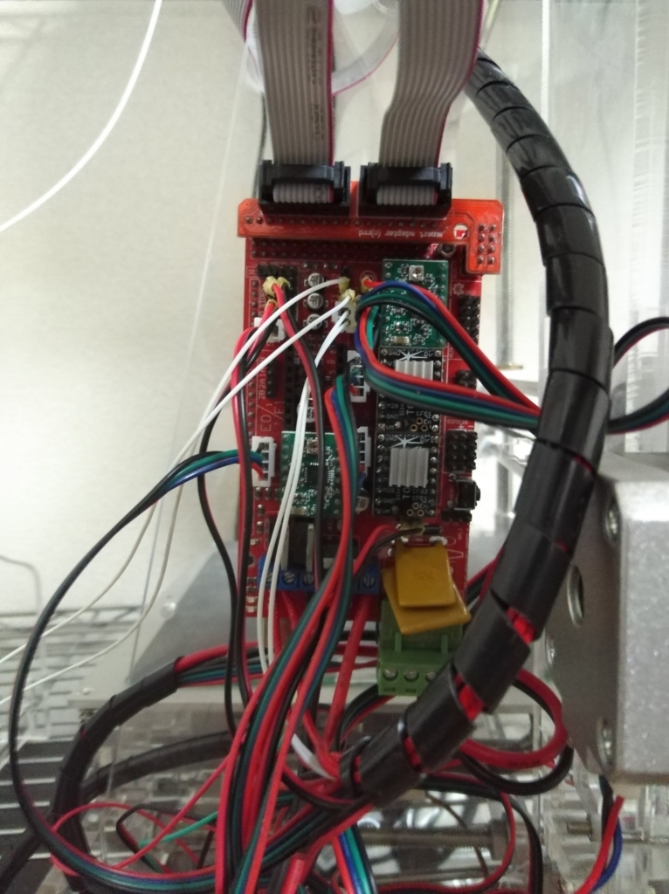
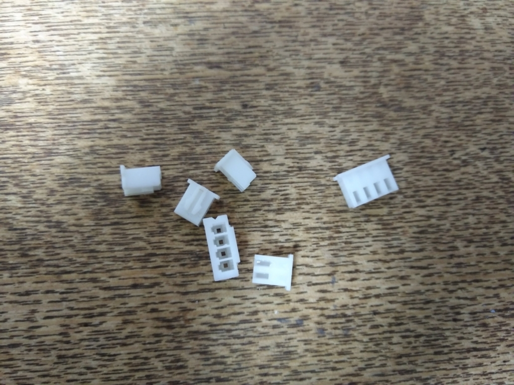
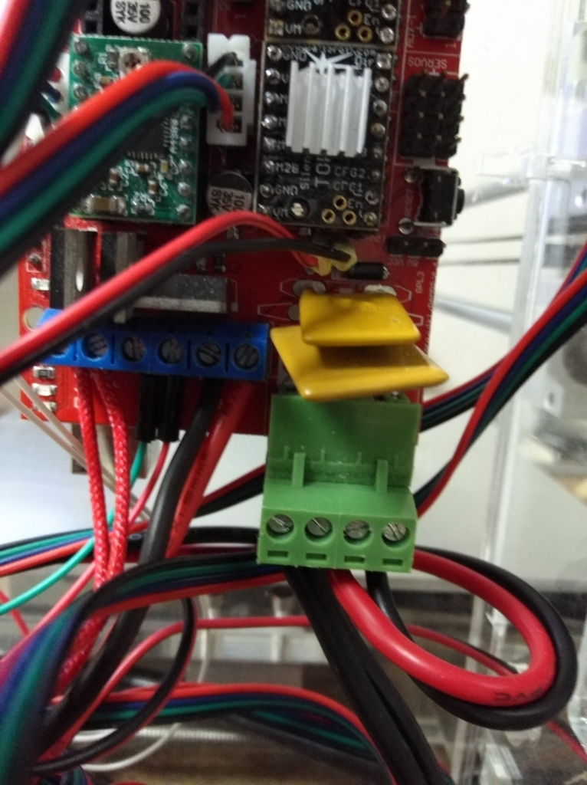

## 動機とか

下の記事で紹介したAlunar M508 (RepRap Prusa i3)を使って色々作ってます。

[Alunar M508 (RepRap Prusa i3) についての情報](/blog/alunar-m508-info/)

が、だんだん気になってきたのがその動作音。おそろしくうるさい訳では無いのだが、6畳ワンルームに住む身ととしては、夜中にウィーンとかﾋﾟﾛﾋﾟﾛﾋﾟﾛ…とか延々鳴らされるのは正直キツイ。3Dプリンターの音の主原因はステッピングモーターの駆動音（X軸とY軸）であり、**TMC2100**というモータードライバを使うのがこの問題の定番の解決法。

なんでも、Rampsボード上に取り付けられたモータードライバを交換するだけで、モーター駆動音がほとんど無音になるとか。

ところが我がAlunar M508は、廉価系RepRapプリンターの例に漏れず、コストダウンのために**メインボードがプリンター専用の一体型**となっており、モータードライバの交換は出来ない。

仕方がないので、一からメインボードのパーツを集めて改造することにした。

## 必要なパーツ

必要になったのは以下のパーツ。合わせて4000円弱くらいで準備した。

1.  Arduino Mega 2560 （or その互換品） メインボードの大元となるArduino。互換品なら1000円弱くらいで買える。 
2.  Ramps 1.4 RepRapのためのArduinoシールド。500～1500円くらい。 
3.  3D Printer Smart Controller Connector Adapter For RAMPS 1.4 忘れがち。というか私は忘れた。100円で買ったら台湾から送料無料で送られてきてビビった。 
4.  普通のモータードライバ（A4988など）× 2 Z軸・E軸用。これらの軸は騒音には寄与しないので、普通のモータードライバでok。1つ200円くらい。 
5.  TMC2100 driver × 2 今回のメイン。X軸・Y軸用に2つ購入。一つ1000円くらい。 

3Dプリンター関連全般に言えることだが、とにかく**買う場所によって値段がびっくりするくらい異なる**。Banggoodとかebayのような海外通販で3Dプリンターセットとして売られているものを買うと安いと思う。

[Geekcreit® 3D Printer RAMPS 1.4 Controller + MEGA2560 R3 + A4988 With Heat Sink Kit](https://www.banggood.com/3D-Printer-RAMPS-1_4-Controller-MEGA2560-R3-A4988-With-Heat-Sink-Kit-p-984594.html?cur_warehouse=USA)

\[追記\]使ったことは無いけれど、ここも安いみたい。しかも国内。

[デイシン Dasyn - 3D 印刷用品｜Yahoo!ショッピング](https://store.shopping.yahoo.co.jp/dasyn/3db0f5bafe4.html)

## 組み立て

Alunar M508のメインボードを外して、Arduino Mega 2560 + Ramps 1.4に付け替える。配線方法はここらあたりを参考にした[Description for Arduino 2560 with RAMPS 1.4 | Technical descriptions | Documentations | my home fab](https://www.my-home-fab.de/en/documentations/technical-descriptions/description-for-arduino-2560-with-ramps-1.4)。

Z軸モーター・温度センサー・接触センサー等はもとのコネクターのスリーブが邪魔なので、取ってやる。 TMC2100は普通のモータードライバとは回転方向が逆なので、モーターのコネクターの向きも逆にすること。また、Alunar M508のメインボードは、主電源とヒートベッド用電源が一体化されているが、Ramps1.4ではそれぞれ別系統なので、電源コードを一本追加する必要がある。 他でも書かれているが、TMC2100取り付けの注意点は3点。

1.  足を半田付けする向きを間違えない。
2.  静音化モードを有効化するためにCFG1とCFG2の足を折る。
3.  ドライバの取付方向を間違えない。

## ファームウェアの書き込み

3Dプリンターとして動かすために、Arduino Megaにファームウェアを書き込む。純正Marlinを使っても良いのだが、パラメータを設定するのが面倒なので、Alunar M508用に設定されたファームウェア（購入時に付属のSDカード内に保存されている）を使った。

ファームウェアの書き込み手順が書いたpdfもSDカード内に入っているため、それに従えばok。手順と言っても、Ardiuno IDEでMarlinファイルを開いて書き込むだけだが。

**コンパイル・書き込み時にはArduino IDE1.5.4（同様にSDカード内に同包されている）を使うこと**。最新バージョンのArduino IDEではコンパイル時にエラーを吐いてしまう。

また、私のようにArduino Megaの互換品を使う場合は、別途ドライバのインストールが必要。私が購入したのはCH340/CH341系のボードだったので、[CH341SER.ZIP下载页面-江苏沁恒股份有限公司](http://www.wch.cn/download/CH341SER_ZIP.html)からドライバーをダウンロードして使った。

## 結果

モーター駆動に関しては**本当に無音**。結構感動します。比較用の動画を撮っておけば良かったな。でも今度はビビリ音やファン音が気になってくる罠・・・。 TMC2100の持病である脱調問題に関しては現在調整中。電圧の調整 + 冷却の工夫でなんとかなるかな？といったところ。
