**2018/05/18追記: 以下の内容は3年前に書いたもので、Blender2.80以降では一部当てはまらないらしい。そのうち内容をアップデート予定。**

Atomic Blenderというアドオンが便利。 [Extensions:2.6/Py/Scripts/Import-Export/PDB - BlenderWiki](https://wiki.blender.org/index.php/Extensions:2.6/Py/Scripts/Import-Export/PDB)

Atomic Blender - Utilities Panelと組み合わせて使う。 [Extensions:2.6/Py/Scripts/Import-Export/Atomic Blender Panel - BlenderWiki](https://wiki.blender.org/index.php/Extensions:2.6/Py/Scripts/Import-Export/Atomic_Blender_Panel)

ただし後述のように、**バグらしき挙動もある**ので注意が必要。

### できること

.pdbファイルをBlenderにインポートして、3Dモデルとして扱うことができる。

### インストール

1.  Atomic Blenderのインストール（Blenderのデフォルトパッケージに含まれている）
    1.  Blenderの「ユーザー設定」→ 「アドオン」から「Atomic Blender」を検索してチェックボックスをonにする。
    2.  Blenderを再起動する。
2.  Atomic Blender - Utilities Panelのインストール
    1.  [Extensions:2.6/Py/Scripts/Import-Export/Atomic Blender Panel - BlenderWiki](https://wiki.blender.org/index.php/Extensions:2.6/Py/Scripts/Import-Export/Atomic_Blender_Panel)から、io\_atomblend\_utilities.zipを適当な場所にダウンロード。
    2.  Blenderの「ユーザー設定」→ 「アドオン」から「ファイルからアドオンをインストール」を選択し、上でダウンロードしたファイルを指定。
    3.  「Atomic Blender - Utilities script」がアドオンに現れるので、チェックボックスをonにする。
    4.  Blenderを再起動する。

### 使い方

**2017/10/16　原子半径・スティック径の設定方法について追記・修正しました。**

1.  目的の分子モデルを.pdb形式で用意する。

2.  「ファイル」→「インポート」から「.protein data bank(.pdb)」を選択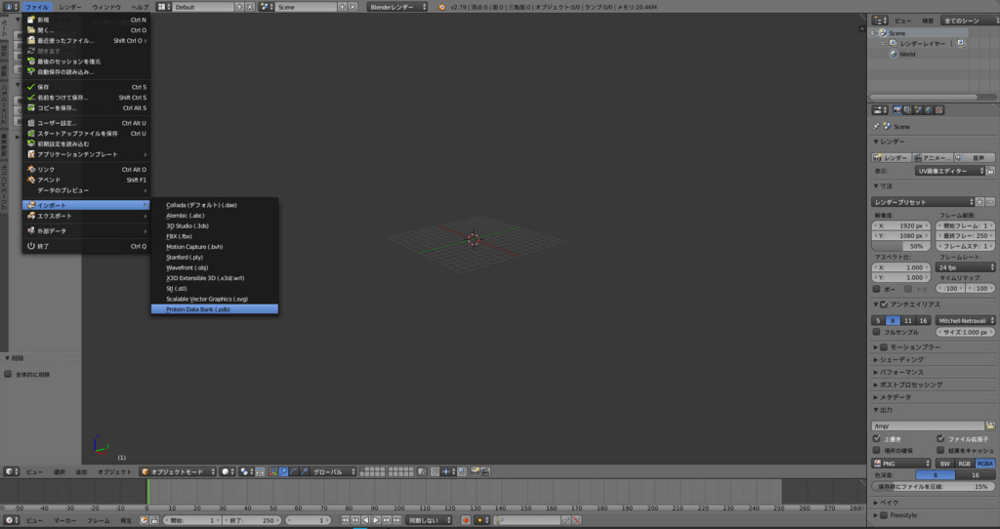

3.  .pdbファイルを選択する。左下のパネルで、インポート時のオプション（球の種類・球径の定義方法・結合棒の有無など）が選べる。大半のオプションは、後でUtilities Panelから選び直せる。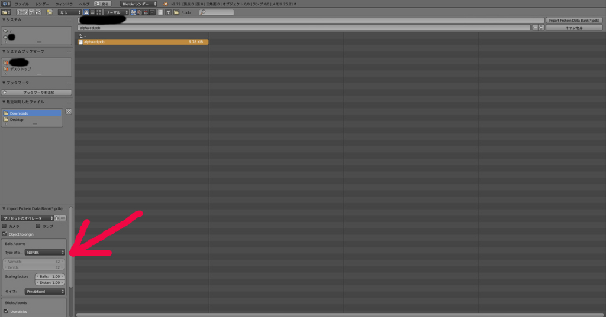デフォルト（原子半径 = pre-defined, 結合棒あり）だとこんな感じで読み込まれる。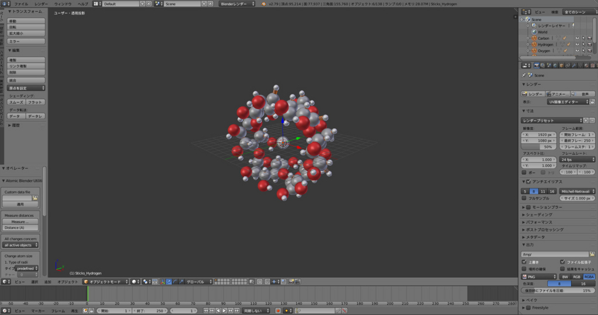

ここで重要な注意点。**球径の定義は「pre-defined（デフォルト）」「van der Waals（ファンデルワールス半径）」「atomic（原子半径）」「ionic（イオン半径）」の4つから選ぶことになっているが、明らかに挙動がおかしい**。どうやら ・pre-defined → 共有結合半径と原子半径が混じっている。よくわからない。 ・atomic → 共有結合半径（covalent radii） ・van der Waals → 原子半径（atomic radii） ・ionic → イオン半径（価数ごとに設定可能. これは正常に動作している） というあべこべなことになっているようだ。**ファンデルワールス半径のデータに至っては、そもそも入っていない**。

よって、ファンデルワールス半径を使いたい場合は、多少細工をする必要がある。そのためには以下の2つの方法がある。

<u>（a）原子ごとに半径を手動入力する</u> .pdbファイルをインポート後の画面左下にAtomic Blender Utilities Panelが出現するが、その中に「Change Atom size」-「2. Radii in pm」という項目がある。オブジェクトを全て選択した状態でここに元素名（<u>頭文字は大文字</u>）を入力 → 半径を入力 → Enterしてやれば、元素ごとの半径を設定できる（単位はpm）。

<u>（b）カスタム設定ファイルを利用する</u> 元素ごとに毎回上の操作をするのが面倒な場合は、あらかじめ設定ファイルを作成しておけば良い。アドオンフォルダ[\*1](#f-5a340859 "環境によって微妙に異なるが、Windows 7ならC:\Users\%username%\AppData\Roaming\Blender Foundation\Blender\")の中の「io\_mesh\_pdb」フォルダの中に、「**atom\_info.dat**」というファイルがあり、これが設定ファイルの雛形となっている。この設定ファイルを用いることで、原子番号・元素名・原子の各種球径・色・価数などの設定情報を一挙に更新することが出来る。中身は簡単で分かりやすいテキストファイルなので、テキストエディタで適当に書き換えてやれば良い。私は「Radius used」の項目をファンデルワールス半径に書き換えて使っている。このカスタム設定ファイルは、**Utilities Panelの「Custom data file」から開く→「適用」とすることで読み込む**ことが出来る（<u>デフォルト設定には出来ないので、毎回読み込む必要がある</u>）。設定ファイルは、記法さえ守られていれば、保存場所・名前は任意のもので良い。

その結果が下の図。見慣れたCPKモデルになる。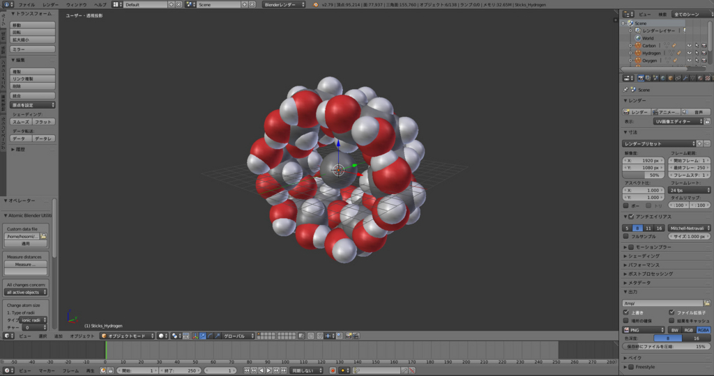

4.  Ball and Stickモデルなど球径を任意で設定したい場合は、「2. Radii in pm」（上述）または「3. Radii by Scale」で設定することになるが、「3. Radii by Scale」の使い方は**大変紛らわしい**ので注意。この項目では「縮小」「拡大」ボタンを使って球径の操作を行い「拡大縮小: 」の後ろの数字はその際の変化率である。<u>「拡大縮小: 」の後ろの数字を変えることで球径を変える訳ではない</u>。

同様の注意点は、結合棒の太さ調節（「Change Stick Size」）にも当てはまる。また、**結合棒の太さの変化はやたらと見づらい**。拡大すると分かるが、各結合棒の位置に、板状のダミーオブジェクト（後述）がくっついているためである。ビューポートの表示を一時的に「レンダー」とすると見やすくなる。

5.  インポート直後は、中心にある球と結合棒まわりの謎の板がダミーオブジェクト(?)になっており、原子の見た目情報を種類ごとに一括管理している。**この状態では、各原子はメッシュとして実態化されていない**。球や結合棒のプロパティを設定したら、オブジェクトを選択した状態で「**Ctrl + Shift + A**」を押して、実体化させる（ダミーオブジェクトも実体化してしまうので、消しておく）。あとは通常のBlenderオブジェクトとして扱うことができる。

一度実体化してしまうと原子の種類ごとにまとめて扱うことが難しくなるので、予め原子種毎ににレイヤーを分けておくのがおすすめ。実体化前は右上のアウトライナーから各元素を選択できるので、そこから「M」キーでレイヤー移動すれば良い（下図は結合棒・炭素・酸素・水素でレイヤーを分けた様子）。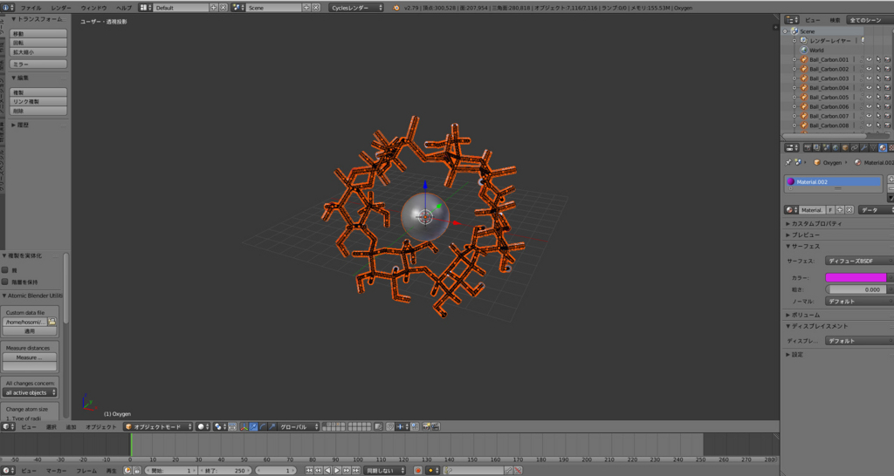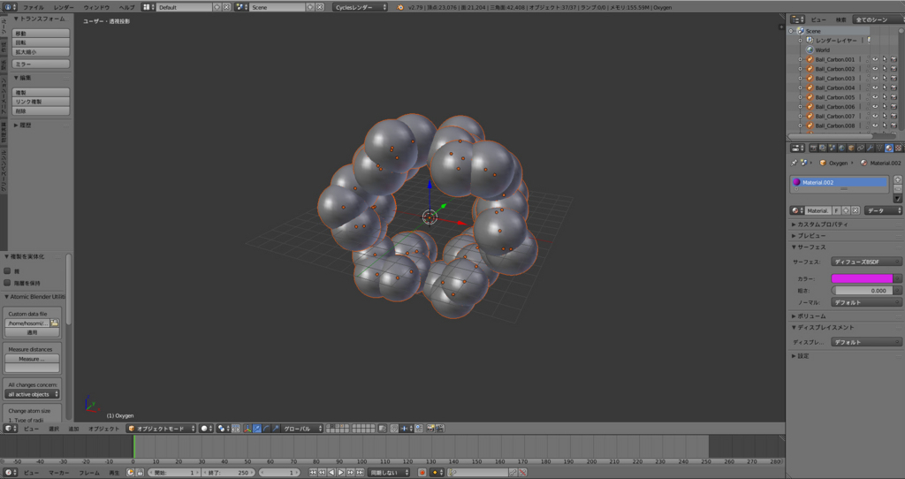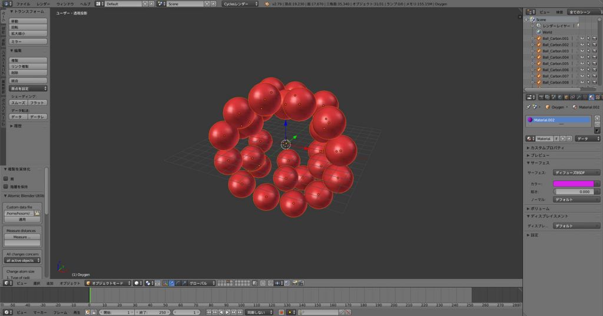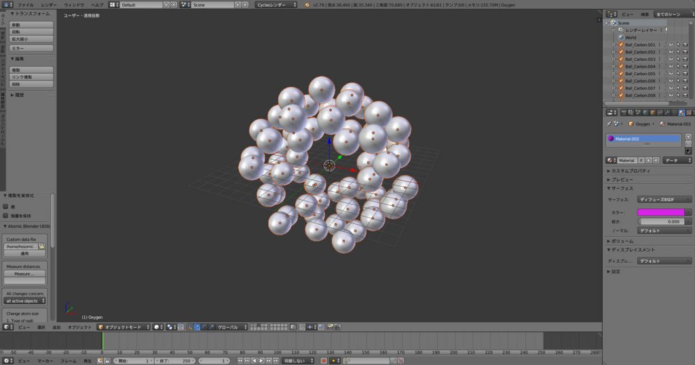

### おまけ

とりあえずデフォルトでレンダリングするとこんな感じ。あとは好みに合わせてマテリアルを調節。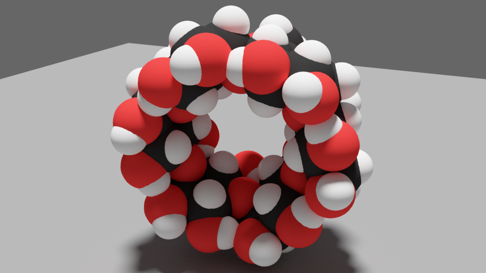

背景が邪魔なときは「レンダー」タブの「透過」にチェックを入れましょう。下はBall and Stickモデルの例。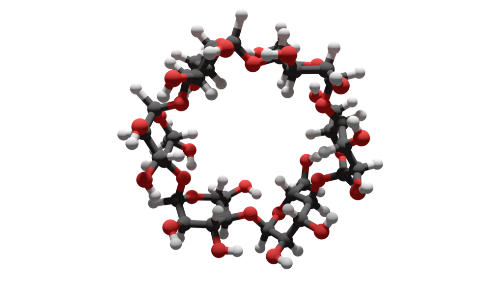

ちなみに私のお気に入りマテリアルは、Cyclesレンダーの「ディフューズBSDF」+「光沢BSDF」（混合比 = 0.1, 粗さ = 0）。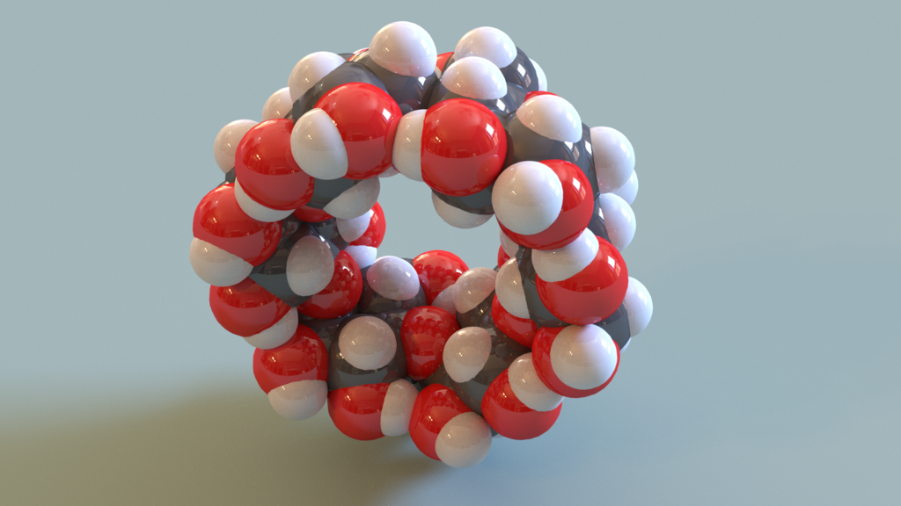

ご質問等ありましたら、コメント欄から是非どうぞ↓

[\*1](#fn-5a340859):環境によって微妙に異なるが、Windows 7ならC:\\Users\\%username%\\AppData\\Roaming\\Blender Foundation\\Blender\\"バージョン番号"\\scripts\\addons　Linuxなら、/usr/share/blender/"バージョン番号"/scripts/addonsであることが多い
