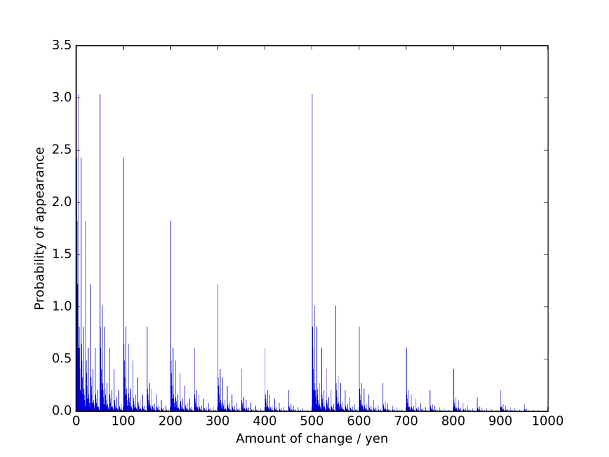
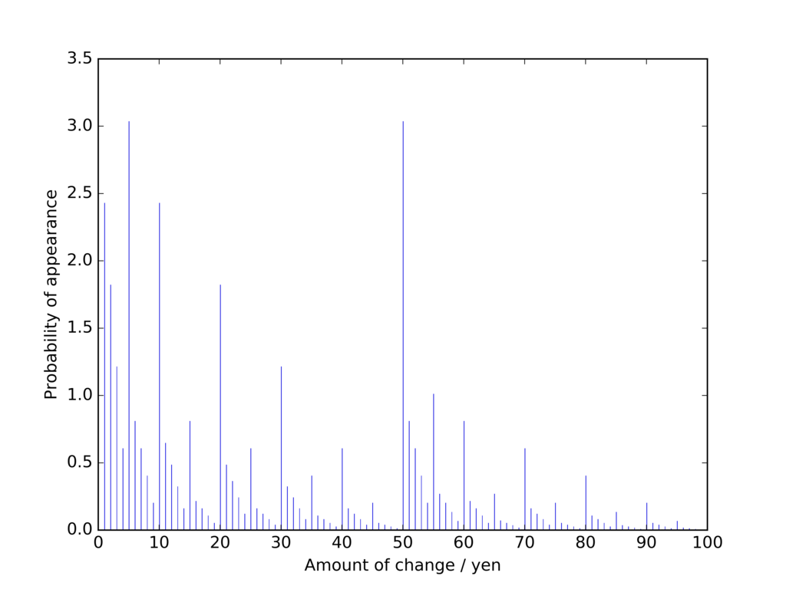
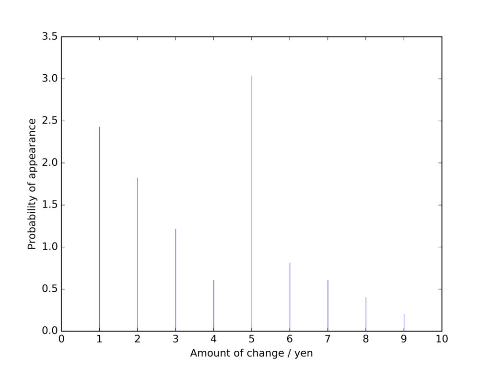
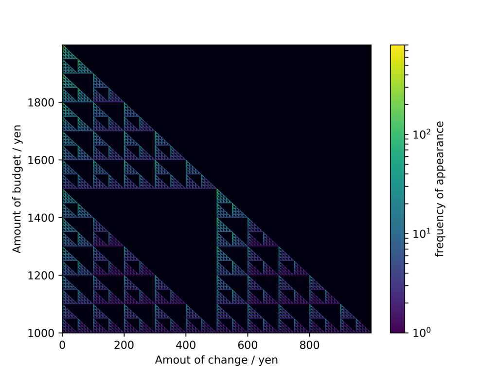

## 導入

世の中には、「持ち歩く小銭はいつも最小量じゃなきゃ嫌」という人種が一定数存在します。54円の会計に110円出したり、756円の会計に1311円出したりするような人たちです。

私自身がまさにそういう人間なのですが、ある日ふと 「いつも同じような額のお釣りを貰ってないか・・・？」 と思い至りました。500円, 150円といったキリのいい数字はもちろん、少しはみ出した502円、151円というお釣りも比較的高い頻度で受け取っている気がします。

小銭を少なくするにはキリのいい数字にお釣りを合わせていくことになるので、ある種当然の話ですが、**じゃあお釣りはどういう金額になっていることが多いのか？**と聞かれると、意外とややこしい。例えば「301円と302円どっちが多い？」 「15円と25円どっちが多い？」等々・・・一筋縄では行きません。

## お釣り頻度シミュレーション

こういう時は思考停止して全パターン計算してみるのが一番。というわけで、pythonを使ってお釣り金額のシミュレーションをしてみることにしました。話は簡単で、**「1000〜1999円の範囲での任意の所持金額」**を持っている時に**「1〜1000円の範囲での任意の会計額」**に対して「**釣り銭枚数が最小となるような払い方をした場合のお釣り金額**」を計算して全パターン数え上げるわけです。実際のコードは以下の通り。

```python
<pre><code class="python"># coding: utf-8 import numpy as np
#金額→貨幣の組み合わせ変換
def sum2set(x): 
    num_1000 = x // 1000 
    rem_1000 = x % 1000 
    num_500 = rem_1000 // 500 
    rem_500 = rem_1000 % 500 
    num_100 = rem_500 // 100 
    rem_100 = rem_500 % 100 
    num_50 = rem_100 // 50 
    rem_50 = rem_100 % 50 
    num_10 = rem_50 // 10 
    rem_10 = rem_50 % 10 
    num_5 = rem_10 // 5 
    num_1 = rem_10 % 5 
    best_set = np.dstack((num_1000,num_500,num_100,num_50,num_10,num_5,num_1)) 
    return best_set 

budgets = np.arange(1000,2000,1)[np.newaxis,:] #所持金額リスト（横行列） 
prices = np.arange(1,1001,1)[:,np.newaxis] #価格リスト（縦行列） 
zeros = np.zeros(len(prices), dtype = int)[:,np.newaxis]

budgets_set = sum2set(budgets-zeros) #支払い前時点での、各貨幣の枚数計算 
balances_set = sum2set(budgets-prices) #支払い後の各貨幣のベストな枚数を計算 
changes_set = balances_set - budgets_set #支払いによる貨幣の出入りを計算 
changes_set[changes_set &lt; 0] = 0 
set2sum = np.array(np.tile([1000,500,100,50,10,5,1],(1000,1))) 
changes = np.sum(changes_set*set2sum, axis=2) #各貨幣の枚数→金額の変換

#出現頻度の算出 
frequency = [(changes == i).sum() for i in range(0,1000)]

#結果をファイルに書き込み
with open ("./result.txt", "w") as f: 
    f.writelines((str(item)+"\n") for item in frequency)
```

計算方法はごく単純。「支払い後に財布に残る金額」をまず計算、それを元に「支払い後の各貨幣のベストな組み合わせ（= 貨幣の合計枚数が最小となるような組み合わせ）を計算して「現在持っている各貨幣の枚数の組み合わせ」との差分（の正の部分）をとって、「お釣りとしてもらう各貨幣の枚数」を得ています。要するに、**支払い前より支払い後に増える貨幣の種類とその枚数を数えてやればいい**わけですね。それらの総和がそのまま貰うお釣りの額になります。

上のような支払い方をする人間は、持ち歩く小銭の量がつねに最小。ということは、所持金額が決まれば、所持している金種の組み合わせ（1000円札がx枚、500円玉がy枚、・・・）が一意に決まるので、計算がラクチンです。また、1000円以上の買い物についても、所持金額を1000円上にシフトしてやれば、硬貨の部分に関しては同じ状況になります。したがって、上の状況を考えるだけで、（硬貨については）すべてのお釣りパターンを網羅できたことになるわけです。

しかし「価格1000通り」×「所持金額1000通り」 = 全1000,000通りのシチュエーションについて、7種類ある金種の内訳を考える訳ですから、それなりの計算量。多重リストで頑張るにはちと荷が重かったので、NumPyの力を借りてひとつやってみました。

## 結果

結果のグラフが下図です。



横軸がお釣り金額で、縦軸がその金額のお釣りをもらう確率（%）です。スケールの都合上グラフから省きましたが、まず**お釣りなし（0円）の確率が最も高く、出現確率は9.1%**。次いで、**5円・50円・500円を貰う確率が突出して高い（3.0%）**ことが分かります。その次に確率が高いのが1円・10円・100円。そのまた次が2円・20円・200円・・・と続きます。なんとなく法則性が見えてきましたね。もう少し分かりやすくするために、1円〜100円を拡大してみましょう。



1〜1000円の場合と**ぴったり相似**なグラフが得られました。先ほど同様、各々の桁では**0→5→1→2→3→6→4・7→8→9という序列**を基本としつつ、フラクタルな形で下の桁の影響が現れてきています。



とどめは1〜9円のグラフ。この形がスケールを変えながら、幾度も重なっていたわけです。

というわけで、予想外にお釣りの出現頻度に偏りがあることが分かりました。一番レアなのはお釣り金額999円の場合で、**出現確率は0.0001%**。50円や500円を貰う場合と比べると、実に1/30000の確率です。序列のメカニズム自体は単純ですが、それが各桁で相似的に組み合わさることで、フラクタルな分布を形成するのが面白いですね。

## さらに考える ～ 所持金で決まる出現頻度 ～

このように、「財布の中の貨幣数を出来るだけ少なくしたい人達」が受け取るお釣りの金額はやたらと偏っていることが分かりました。**この結果について、もう一歩考えを進めてみましょう**。

よく考えてみると、貰うお釣りの額は、支払い前の所持金額にかなり依存していることが分かります。例えば、所持金額が1499円の時はいくらでも支払い方を工夫できるので、確実にキリのいい額のお釣りが貰えるでしょう。一方、1000円札一枚しか持っていない時は、支払い方に工夫のしようが無く、お釣りの額は完全にランダムになるだろうと予想できます。要するに、**「支払い前の所持金額と貰うお釣り金額との組み合わせ」にはかなりの偏りがあり、何らかの規則に従ってその出現頻度が変化する**、と考えられます。

という訳でやってみます。コードとしては、以下のコードを上のものに付け加えるだけです。

```python
#各所持金額-お釣り金額の組み合わせの出現頻度を表す二次元行列
frequency_array = np.array([[(changes[:,j] == i).sum() for i in range(0,1000)] for j in range(0,1000)]).reshape(1000,1000)
```

ずいぶんforループに依存したコードになってしまいましたが、とりあえず結果は出ます。得られた二次元行列を二次元カラーマップ上に表してみました。縦軸が支払い前の所持金額、横軸が貰うお釣りの金額で、それらの組み合わせが出現する頻度の違いが色で表されています（黒: 頻度なし、青: 頻度低 → 黄：頻度高）。



これまた綺麗なフラクタル図形が得られました。所持金額がキリの良い数字の場合はもらうおつりのバリエーションが豊富であり、逆に財布の中の金種が豊富であるほど、お釣りとして貰う額が限定されてくることがよく分かります。
