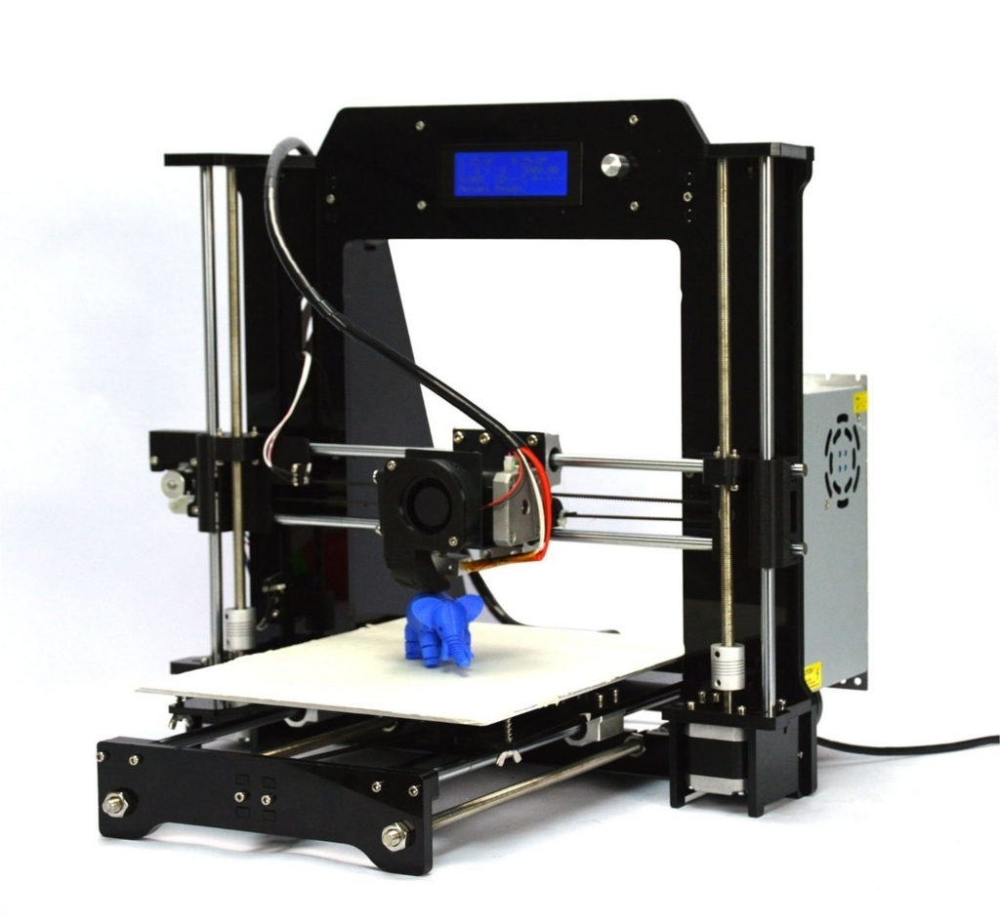
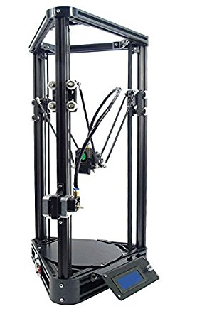
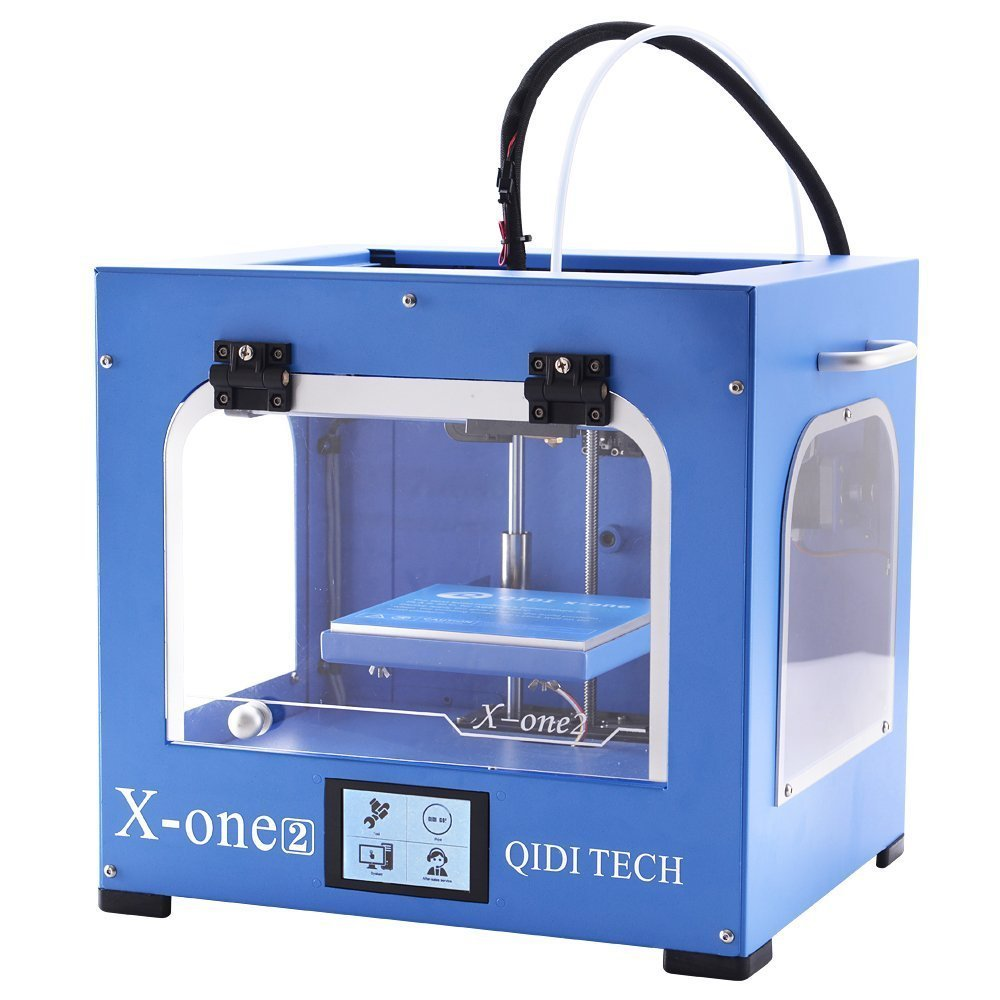

## 概要

[別記事](/blog/alunar-m508-info/)でも書いたとおり、半年ほど前に買ったRepRap系3Dプリンターを改造して遊んでいます。

今回は、実際に使ってみて感じたことをもとに、廉価帯の3Dプリンターの選び方を書いてみようと思います。あまり分かったようなことは言えないんですが、初めて買う人の参考になればと。

対象としているのは、<u>2万円〜5万円</u>くらいの最廉価帯製品。「**もし自分がもう一度3Dプリンターを買うなら、ココを見る**」という点をピックアップしています。

## ヒートベッドがあるか

重要度: ★★★★

個人的には**最重要項目**。ヒートベッドとは、ステージを温めて出力した造形物が急に冷えることを防ぐための装備です。これが無いと、温度によって大きく伸縮する素材（ABSなど）が使えません。また、必ずしもヒートベッドを要しない素材（PLA等）でも、やはり造形精度に影響します。ヒートベッドの有無であまり値段が変わらないのもポイント。真っ先に押さえておきたい項目です。

## オートレベル機能があるか

重要度: ★★★

精度よく造形物を出力するためには、ヘッドとステージとの距離が大事です。これをきっちりと調整するためにレベリングという作業が必要なのですが、**印刷頻度が高いとなかなか面倒な作業**です。これを自動でやってくれるのがこのオートレベル機能。以前は高嶺の花でしたが、最近は廉価製品でも備えている機種が増えてきました。かなり便利なので、できれば付けておきたいところ。

## フレーム素材

重要度: ★★

組立式の場合には考慮に値します。基本的に選択肢は金属 or アクリル。**どちらかというなら金属 > アクリル**です。違いは剛性。組立時も、完成後も、やはり剛性が高い方が何かと扱いやすく感じます。まぁこれは素材だけでなく形状や厚みにも依存しますし、完成品ならあまり重要では無いのかも。

## フードがあるか

重要度: ★★

ヒートベッドと同じく、造形物の温度を保つ設備です。防音も兼ねています。温度によって大きく伸縮する素材（ABSなど）をメインで扱うならば、できれば押さえておきたい機能。ただ、特許の関係か、組み立て式にはまず付いていないのが残念なところ。要は覆ってやれば良いので、自作で後付けしても良いかも？

## プリンターのタイプ

重要度: ★★★★

本当はとっても大事なんですが、値段を抑えるとあまり選択肢が無いポイントでもあります。廉価帯で売られているのは主に以下の3モデルです。

### 1\. Prusa系

最も一般的なタイプ。**X, Z座標をヘッド位置で、Y座標をステージ位置で決める**。もろもろのバランスが良い。情報の多さと価格の安さもメリット。最近はZ軸のモーターを１つに統一した亜種（Pxmalion CoreI3とか）も出ているようで、そちらも使いやすそう（[別記事](/blog/alunar-m508-info/)でも書いたように、2つのステッピングモーターでZ軸を動かすのは結構面倒なのです）。

### 2\. Delta系

三角形をしたタイプ。**X, Y, Z座標すべてをヘッド位置で決める**。Prusaと比べると「造形速度が速い」「造形サイズを拡張しやすい（特に縦）」といった長所がある。反面、「本体サイズが大きくなりがち」「レベリング手順が複雑」「外周部の造形精度が低い」といった点が欠点。とにかく縦にデカいものをつくるのが得意。

### 3\. Ulticampy系 (？)

この括り方で良いのか自信無し。Ultimaker社やQIDI Technology, HICTOP等から発売されているタイプ。**X, Y座標をヘッド位置で、Z座標をステージ位置で決める**。構造的な堅牢さゆえに造形精度が高く、さらに造形速度も速い。加えて「奥行きがコンパクト」「フルカバー構造と相性が良い」といった長所もある。一応RepRapファミリー（UltimakerをベースにしたUlticampyが登録されている）ではあるが、商用ライセンスは押さえられているので、お値段は高め。ステージを大きくしづらいのだろうか？造形面積が小さい製品が多い気がする（大きいのもある）。

選び方を雑に言えば、以下の様な感じ。

-   大きなものは作らない & 予算が足りる → Ulticampy系
-   縦に大きなものを作りたい → Delta系
-   ↑のどちらでもない → Prusa系

なんか消去法的な扱いになっていますが、コスパを考えると、わりと多くの人がPrusa系に行き着く気がします。加えて、自分で色々といじりたい人にとっては情報量の多さもなんだかんだ魅力です。自作する気概のある人はまず最安クラスのPrusa i3から入っても良いかも。

## 組み立て済みかどうか

重要度: ★

最近は廉価帯でも組み立て済みの製品がいくつか売られています。時間も手間も節約できますし、何より安心感があると思います。十分合理的な選択肢だとは思います。

ただ、そもそも3Dプリンターを買うような人達って、基本的にものづくりが好きな人種だと思うんですよ。そういう人達にとって、組み立て式であることのデメリットってそこまで無いんじゃないかなぁと。組み立てることで、3Dプリンターの構造への理解も深まりますし。

とりあえず、「一般に思われているよりは遥かに単純な機械」ということは伝えておきたいです（これが言いたかっただけ）。
