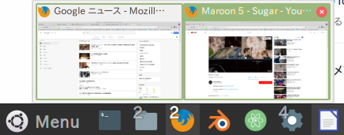
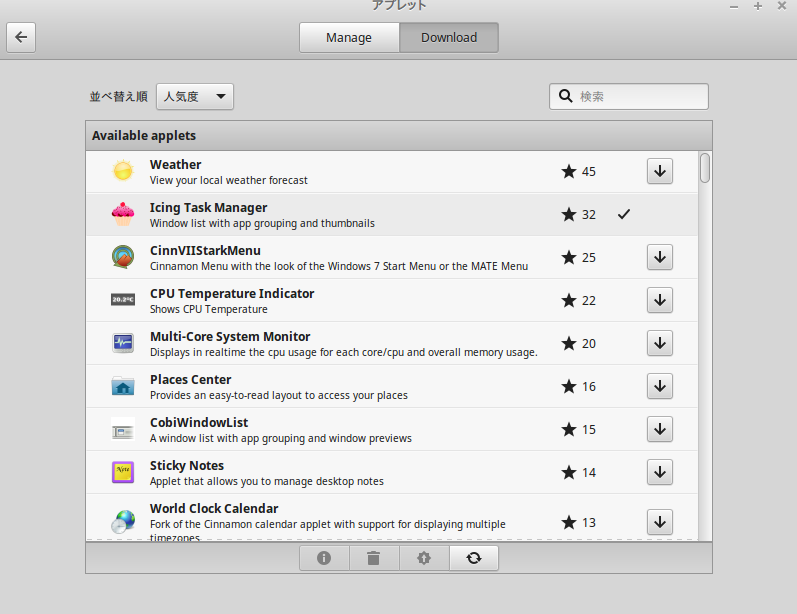
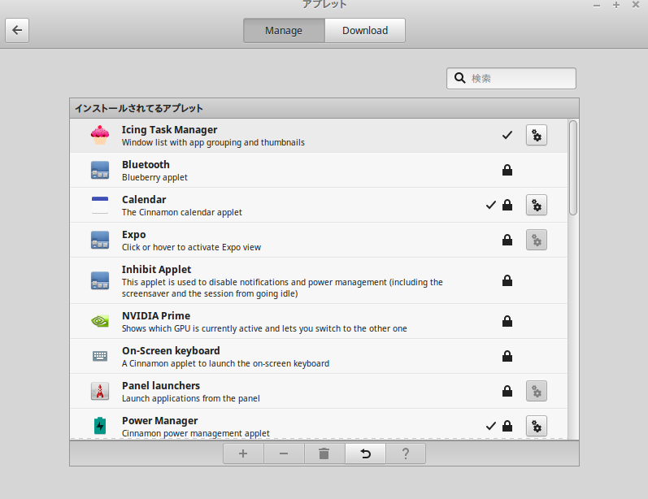

## Icing Task Managerとは

Linuxのデスクトップ環境として、近年人気が高まっているCinnamon。洗練されたデザイン + アプレットを用いた高い拡張性に加えて、比較的クラシックなスタイルを売りにしていて、Windowsユーザーにも馴染みやすいインターフェイスと言える。

一方、そのようなWindowsからの移行ユーザーを想定した場合、タスクバーの挙動には物足りなさを感じるかもしれない。Windows 7以降で採用されている「スーパーバー」（アプリの起動ランチャーとウィンドウリストを兼ねたタスクバー）に相当するアプレットが、デフォルトのCinammonには用意されていないためだ。

そこで今回は、そのような機能を追加するためのアプレット「**Icing Task Manager**」を紹介する。

[Applets : Icing Task Manager](https://cinnamon-spices.linuxmint.com/applets/view/269)

このアプレットは「**Window List With App Grouping**」という別のアプレットのフォーク版だが、全体的にIcing Task Managerの方が完成度が高く、オススメ。Cinnamonの拡張アプレットとしても、2018年1月現在2番目の人気を誇っており、かなり好評のようだ。

## できること

基本的には、Windowsにおける「スーパーバー」の挙動をCinnamonで再現したものと思ってもらえれば良い。ランチャー機能・ウィンドウリスト機能・マウスオーバーによる起動ウィンドウのサムネイル表示・アクティブウィンドウのフォーカス表示・etc…といった機能に対応している。下の画像は、Firefoxアイコンにマウスオーバーした際のもの。

以下のような細かい機能にも対応している。

-   起動中のアプリのウィンドウ数表示
-   サムネイル内での動画等の再生
-   アプリ独自の右クリックメニュー（例えばFirefoxの場合は、プライベートモードでの起動等）の表示

## インストール方法

簡単。 Cinnamonパネル上で右クリック → 「パネルにアプレットを追加」 → 「Download」タブ から「Icing Task Manager」を検索して、↓ボタンでインストール。

「Manage」タブで「Icing Task Manager」を選択した状態で、「+」ボタンを押すことで、パネルに「Icing Task Manager」アプレットを貼り付ける。アプレットの位置は、Cinnamonパネル上で右クリック →「パネル編集モード」からドラッグアンドドロップで変更。 アプリを開いた状態で、右クリックから「pin to panel」を選ぶことでアプリをタスクバーに登録できる。

## 設定

「Manage」タブ から「Icing Task Manager」のギアマークをクリック。

このへんは好みだと思うが、筆者は以下のような設定変更をしている。

-   「Theming」から「Show active app indicators」を「ON」
-   「Context Menu」から「Show new window option」を「ON」

かなり細かく設定できるので、いろいろ試してみると良いと思う。
