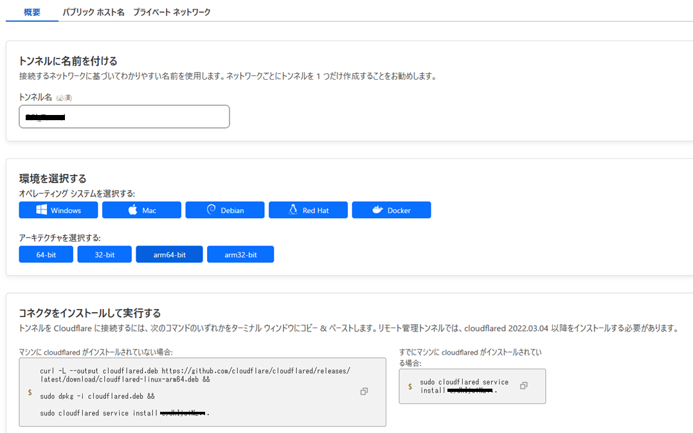

## 概要

このブログはもともとConoha VPSで運用していましたが、更新頻度も少なく、耐障害性を気にするような大層なものでもないため、月々のVPS料金の節約のために自宅サーバー（Raspberry pi）へと切り替えることにしました。固定IPがもらえる環境ではないので、(Cloudflare Tunnel)を使ってサーバーを公開しています。以下はその設定手順です。

## 環境

-   ドメイン名: blog.haborite.com
-   ネットワーク: IPv6 + DS-Lite
-   サーバー機（自宅）: Raspberry pi 4 (Ubuntu 24.04)
-   Nginx
-   Wordpress 6.7.1 (with MariaDB and PHP8.3)

## 手順

### Cloudflare Tunnelの設定

[https://zenn.dev/takajun/articles/fbd783e459c722](https://zenn.dev/takajun/articles/fbd783e459c722)

上記のサイトの手順1～4を参考に以下を行った。

-   Cloudflareアカウントの作成
-   ドメインの登録
-   トンネルの作成（トンネルの「パブリックホスト名」のところではType には HTTPを、URL としてlocalhost:80 を指定）
-   自宅サーバーへのcloudflaredのインストール

Cloudflaredのインストールについては、dockerは使わずにUbuntuへの直接インストールを行った。トンネルの設定画面でOSとアーキテクチャを選択すればコマンドが表示されるので、コピペして実行するだけでok（下図）。インストール –> トンネルの設定 –> デーモン化まで全部やってくれる。



### Nginxの設定

基本的には典型的な「Nginx + Wordpress」構成だが、一点`listen localhost:80`にし忘れないことがポイント。`listen 80`ではダメ（私はここで沼った）。  
例:

```bash
$ sudo vim /etc/nginx/conf.d/wordpress.config
```

```nginx
server {
    listen localhost:80;
    server_name blog.haborite.com www.blog.haborite.com;
    root /var/www/html/wordpress;
    index  index.php index.html index.htm;
    client_max_body_size 100M;

    location / {
        try_files $uri $uri/ /index.php?$args;
    }

    location ~ \.php$ {
        include fastcgi_params;
        fastcgi_intercept_errors on;
        fastcgi_pass unix:/var/run/php/php-fpm.sock;
        fastcgi_param SCRIPT_FILENAME
        $document_root/$fastcgi_script_name;
    }
}
```

### wp-config.phpの編集

必要になる条件がちょっと分からないが、自分の場合はWordpressの`wp-config.php`内で明示的にHTTPS通信であることを明記する必要があった。

1.  カスタム値の設定場所（「Add any custom values……」の直下）に以下のとおり追記。

```php
/* Add any custom values between this line and the "stop editing" line. */
$_SERVER['HTTPS'] = 'on';
/* That's all, stop editing! Happy publishing. */
```

2.  場合によっては、下記の追記も必要になるかもしれない。

```php
define('WP_HOME','https://blog.haborite.com');
define('WP_SITEURL','https://blog.haborite.com');
```

### （おまけ）URLの置換

もしドメインを変えるなら、WordPress内のURLを`wp-cli`で一括置換する。

```bash
$ wp search-replace "古いURL" "新しいURL" --skip-columns=guid
```

### （おまけ）Google Search Consoleの設定

もしドメインを変えるなら、サチコンの設定も忘れずに。

1.  [Google Search Consle](https://search.google.com/search-console)にログイン
2.  「ドメイン」を選んでドメイン入力。サブドメインは入れないこと。（`haborite.com`であり`blog.haborite.com`ではない）
3.  「Cloudflare」用の手順が用意されているので、それに従って登録。ドメイン自体は他社で契約していても、ここで設定するのはCloudflare。
4.  サイトマップ登録
