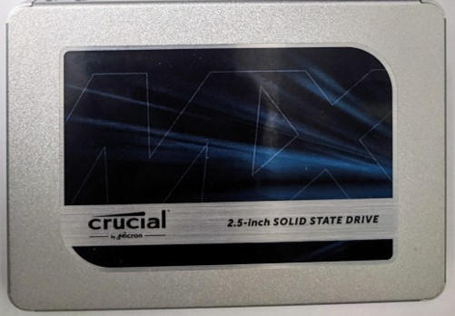
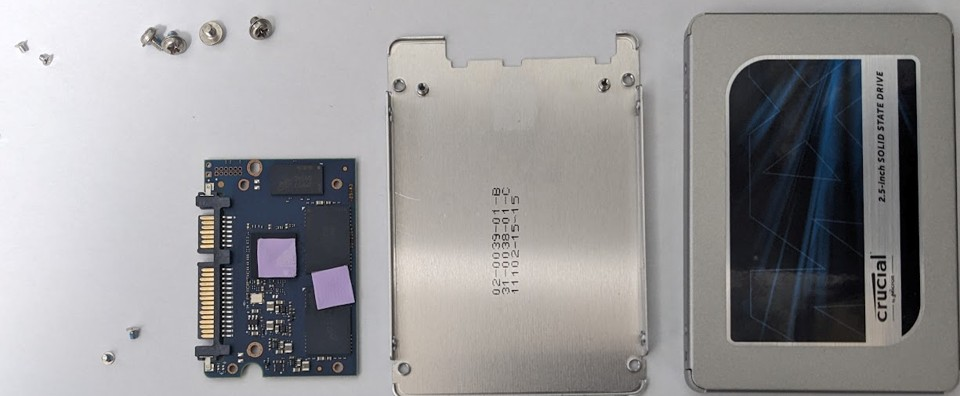
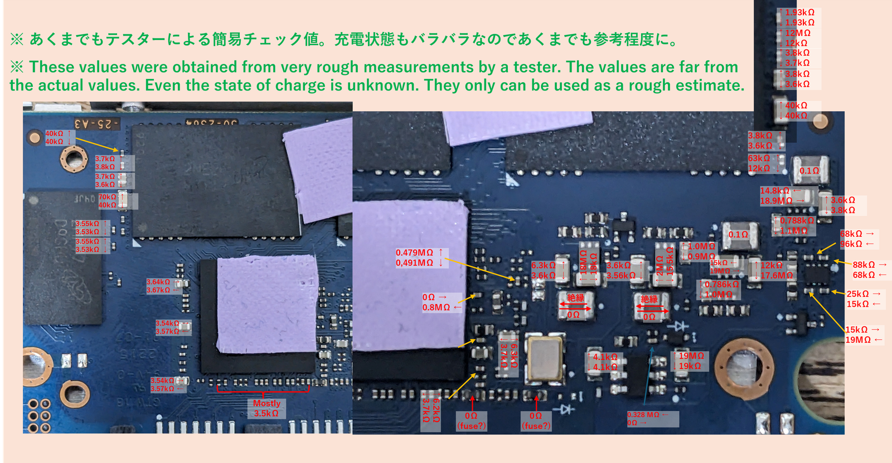
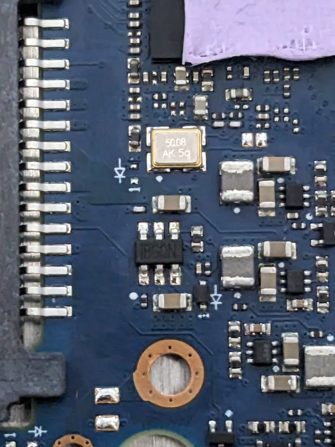
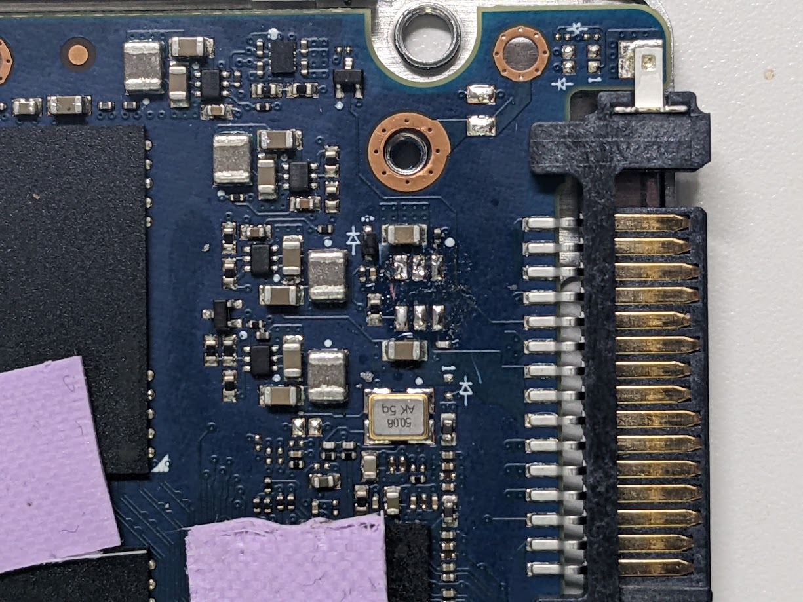
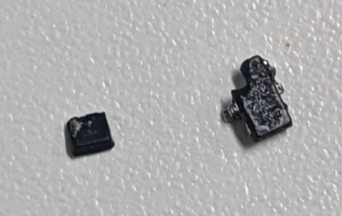
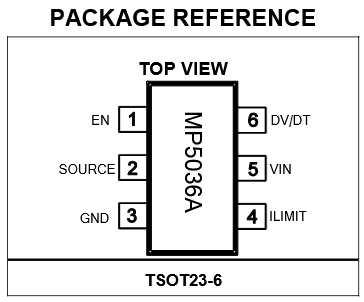
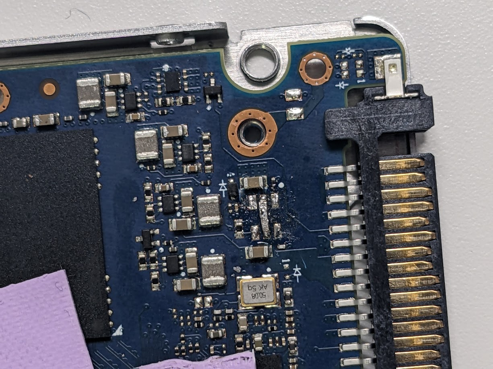

## 経緯

[こちらのポスト](https://fedibird.com/@haborite/113928641183538080)参照。

デスクトップPCにデータ保存用として接続していた2.5 inch SATA SSD (Crucial製 MX500, 1TB)が**突然OS / BIOSから認識されなくなった**。 故障の兆候は無かったことから、電気的な故障が疑われた。

中身のデータを諦めきれず、修理を試みたところ、起動とデータのサルベージに成功した。以下内容を記録しておく。

## 修理対象のSSD

[crucial MX500 CT1000MX500SSD1/JP](https://kakaku.com/item/K0001028335)

ロングセラーの定番品だと思って油断していたのが運の尽き

## Disclaimer

当然ですが、同じ状況の人が同じように下記の手順を行っても上手く行く保証は全くなく、データ破損の深刻化や事故につながる恐れは多いにあります。その際も筆者は一切の責任を負いかねますのでご了承ください。

## 分解とコンデンサ抵抗確認

まずはSSDを分解。側面のプラスネジ4本外せば40秒で開けられる。ツメもシールも無い。

この機種においてコンデンサ不良が頻発しているとの情報を事前に得ていたため、まずはチップコンデンサの状態を確認した。

本来は静電容量を測定すべきだが、我が家にはそんなことが出来る測定器は無いので簡易テスターで明らかにおかしな点が無いかチェックした。**当然だが、充電状態もバラバラで全く正確な値ではないことに注意**。あくまでも「明らかにおかしな挙動」が無いかの簡易チェック。

*Resistances of capacitors on crucial MX500 CT1000MX500SSD1/JP*

結論から言えば、上図のとおり、**おかしな抵抗値を示すコンデンサは無かった**。実は正常稼働する同一型番のSSDをもう一台持っていたのでそちらでも確かめたが、おおむね同じような挙動であった。したがって、次にIC等のチェックを行った。

## 「IBGQN」チップの不良

次に目を付けたのが、背面に「IBGQN」と書かれた写真真ん中のチップ。

理由は、(1) 今回の故障個所は比較的上流側と予想されていたこと + (2) 上段真ん中のピンと他のピンとの間の抵抗値が、正常SSDと比較して明らかに低い値を示していたため。理由(2)についてはパスコンの充電状態が異なっていただけである可能性があり、同定方法は誤っていたかもしれないが、結論自体はビンゴだった。「IBGQN」でググったところ、同じ問題を扱っている[Redditのスレッド](https://www.reddit.com/r/ElectronicsRepair/comments/1i2gze0/can_you_help_me_identify_this_component_crucial)に辿りつき、ここで必要な情報はすべて得られた。

[Redditの書き込み](https://www.reddit.com/r/ElectronicsRepair/comments/1i2gze0/comment/m7f14zr/?utm_source=share&utm_medium=web3x&utm_name=web3xcss&utm_term=1&utm_content=share_button)から、このICの型番は「**MP5036A**」であり、電流制限スイッチ（要は過電流保護回路）であることが分かった。**電流制限スイッチが何らかの理由で常にoffの状態となり、下流のICに電源が供給されなかった**ようだ。このCrucial MX500においてはありふれた故障箇所であるらしい。過電流保護回路としては役割を全うしているような本末転倒のような微妙なところ。

## 電流制限スイッチの除去とバイパス

不良ICを取り外した。犠牲ハンダを盛ってみたりもしたが、手持ちのショボい家庭用はんだごてではうまく外すことが出来ず、最終的にニッパーで挟んで破壊除去した。回路に傷をつけかねず、もちろんbad wayである。

私としてはデータを救出できれば良く、この個体を末永く使うつもりはないので、過電流保護回路が壊れているのならそれを**バイパスしてしまうのが手っ取り早い**。というわけで、電流制限スイッチ**MP5036A**を除去し、導線で出力と入力を直結させた。下図のデータシートで言うところの「SOURCE」と「VIN」だ。

半田が汚くて恥ずかしいが、家庭用半田ごてということで許して欲しい。 テスターで短絡チェックをすれば完了（VIN – GND間で十数kΩ程度の低い抵抗値を示したとしても、パスコンの充電挙動が得られていたら問題ない）。 [参考スレッド](https://www.reddit.com/r/ElectronicsRepair/comments/1i2gze0/comment/m7f14zr/?utm_source=share&utm_medium=web3x&utm_name=web3xcss&utm_term=1&utm_content=share_button)ではもう少し慎重なチェック方法も述べられている。

## 結果

Windowsから認識成功。データを救出。めでたしめでたし。

## 参考URL

### 直接参考にしたサイト

今回上手く行ったのはほとんど以下のRedditスレッド（特に[fzabka氏](https://www.reddit.com/r/ElectronicsRepair/comments/1i2gze0/comment/m7f14zr/?utm_source=share&utm_medium=web3x&utm_name=web3xcss&utm_term=1&utm_content=share_button)の書き込み）のおかげ。もし私と同じ状況で困っている人がいたら、以下のサイトを参考にした方が早いと思う。

-   [https://www.reddit.com/r/ElectronicsRepair/comments/1i2gze0/can\_you\_help\_me\_identify\_this\_component\_crucial](https://www.reddit.com/r/ElectronicsRepair/comments/1i2gze0/can_you_help_me_identify_this_component_crucial)

### MP5036Aデータシート

-   [https://www.monolithicpower.com/en/documentview/productdocument/index/version/2/document\_type/Datasheet/lang/en/sku/MP5036A/](https://www.monolithicpower.com/en/documentview/productdocument/index/version/2/document_type/Datasheet/lang/en/sku/MP5036A/)

### その他参考になったサイト

-   [https://www.hddoracle.com/viewtopic.php?p=22537#p22537](https://www.hddoracle.com/viewtopic.php?p=22537#p22537)
-   [https://drive.google.com/file/d/1OiaIZC5fkrKeoYAY8KxcsXS2wUoqq0bW/view](https://drive.google.com/file/d/1OiaIZC5fkrKeoYAY8KxcsXS2wUoqq0bW/view)
-   [https://drive.google.com/file/d/1khl1nmaWnhzHS6vVAVEEoKNU\_dRXYFFH/view](https://drive.google.com/file/d/1khl1nmaWnhzHS6vVAVEEoKNU_dRXYFFH/view)
-   <iframe src="https://www.youtube.com/embed/TQdkhFGCcgs" title="YouTube video" loading="lazy" allowfullscreen="" style="width:100%;aspect-ratio:16/9;border:0"></iframe>
