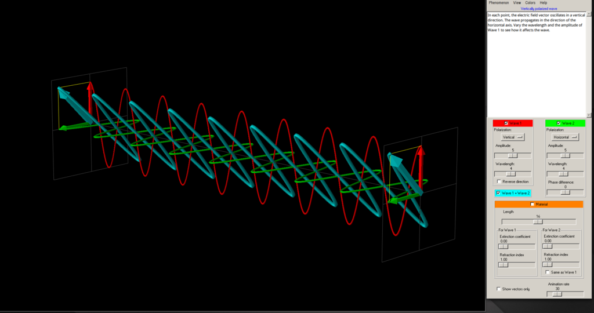
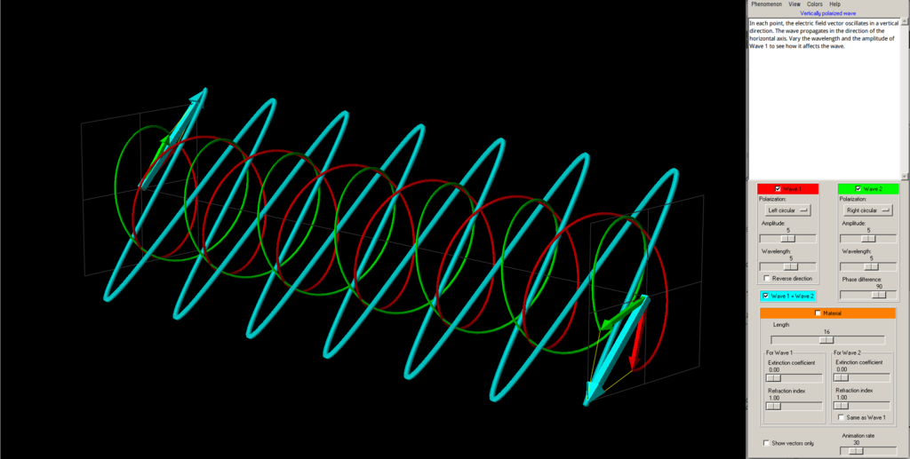
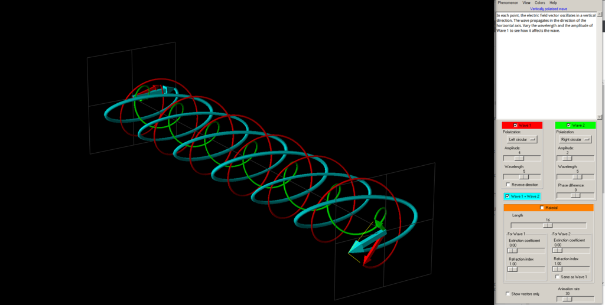
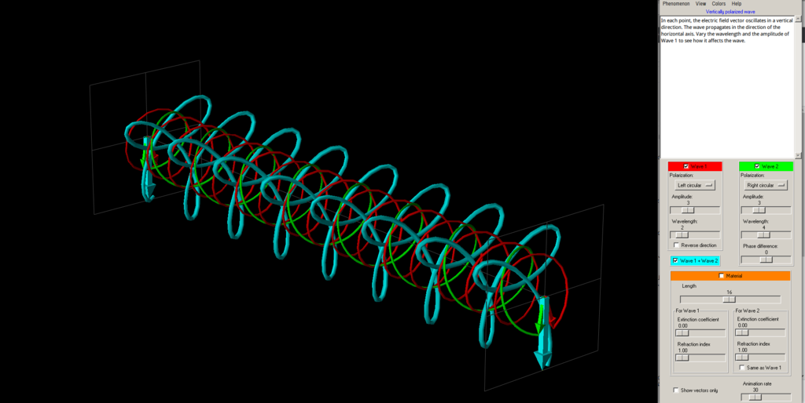
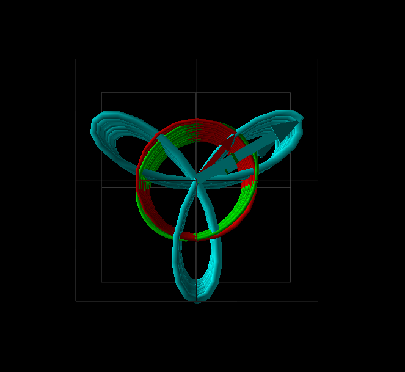
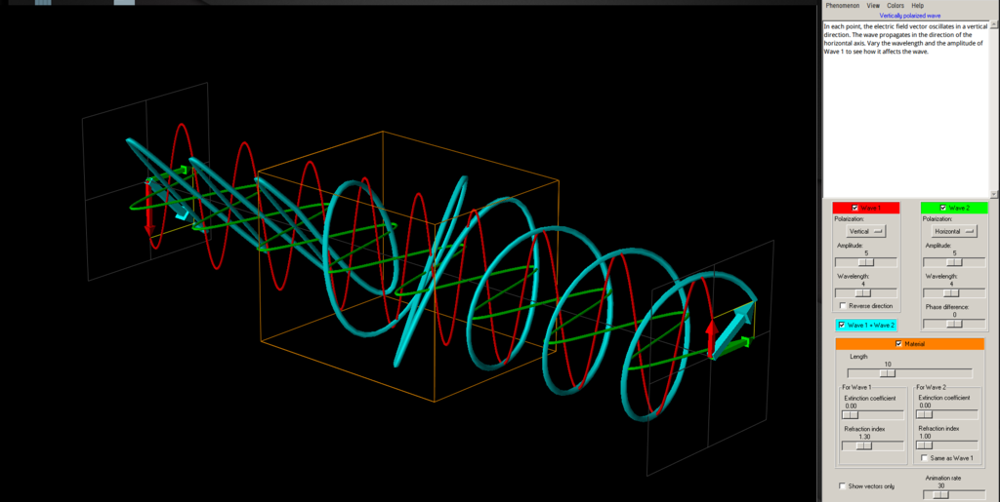

**2019/09/11追記:[ウェブアプリ版](https://emanim.szialab.org/index_ja.html)に移植されてさらに使いやすくなりました！日本語化もされています！**

## 偏光の重ねあわせをイメージする

電磁波について学ぶと、必ず出てくるのが偏光（直線偏光・円偏光）という概念。これらの電場（or 磁場）の動きがどのようなものであるかを直感的に理解することは、電磁気学の大切な基礎です。

[偏光 – Wikipedia](https://ja.wikipedia.org/wiki/%E5%81%8F%E5%85%89)

直線偏光にしろ円偏光にしろ、単一の偏光波をイメージするのは簡単です。一方向にだけ振動したり、ぐるぐる回る電場をイメージすれば良いので。一方、現実世界にあふれる光たちの大半は単一偏光波では無い訳で、それらの重ね合わせを考える必要があります。ところが、**複数の偏光波の重ねあわせた結果をイメージする、という作業は意外なほど難しい**のです。例えば、以下の問に一瞬で答えられますか？

1.  左巻き円偏光と、それと<u>位相が90度ずれただけ</u>の右巻き円偏光の重ね合わせはどんな波？
2.  左巻き円偏光と、それの<u>振幅が2倍になっただけ</u>の右巻き円偏光の重ね合わせはどんな波？
3.  左巻き円偏光と、それの<u>周波数が2倍になっただけ</u>の右巻き円偏光の重ね合わせはどんな波？

いずれも「振幅」「周波数（波長）」「位相」という3つの基礎パラメータのうち、一つを変えただけの単純な重ねあわせパターンですが、少なくとも私には全くイメージできません。まして複数パラメータが変化した場合は手に負えません。

## 電磁波アニメーションツール「EMANIM」

そこで今日は、こういった電磁波の動きをイメージするために大変役立つ教育補助ソフト「**EMANIM**」を紹介します。

[EMANIM](http://emanim.szialab.org/)

EMANIMは、**異なるパラメータ（振幅・周波数・位相）を持つ2つの偏光波（直線 or 円偏光）の重ねあわせ結果をアニメーションで表示してくれるソフト**です（表示するのは電場のみ）。痒いところに手が届く非常に有能なツールなのですが、言及している日本語webページが他に見当らなかったので、本記事で紹介します。

## EMANIMの使い方

**ぶっちゃけ説明するほどの「使い方」は無いです**。シンプルなソフトなので。このページを読むよりも、とりあえず[http://emanim.szialab.org/](http://emanim.szialab.org/)にあるemanim12setup.exeをインストールして触ってみるのがおすすめです。Pythonソースコードも配布されているので、LinuxやMacの方はそれを使ってビルドすればokです（Wineでも動きました）。

とりあえず起動すると、Wave1（赤）という偏光波が表示されています。Wave2（緑）と、「Wave1 + Wave2」（水色）のチェックボックスをONにすることで、2つの偏光波の重ねあわせが水色の波として出力されます。

偏光の種類は「Polarization」から変更可能。直線・円偏光のどちらも使用できます。Wave1とWave2の各パラメータを変更して、重ねあわせ結果がどのように変わるのかを見る、というのが基本的な使い方です。ビュー画面で右クリック＋ドラッグすると、視点をぐりぐりと回転できます。

先ほどの答え合わせをしておきましょう。

1.  左巻き円偏光と、それと<u>位相が90度ずれただけ</u>の右巻き円偏光の重ね合わせ 
2.  左巻き円偏光と、それの<u>振幅が2倍になっただけ</u>の右巻き円偏光の重ね合わせ 
3.  左巻き円偏光と、それの<u>周波数が2倍になっただけ</u>の右巻き円偏光の重ね合わせ 

    前から見た図

    

## 光と物体の相互作用を調べる

EMANIMのもうひとつの優れた機能が、**「電磁波と相互作用する物体を通過する時に、どのように波が変化するか」を可視化できる**というもの。要するに、波長板/位相子といった光学材料が光に与える影響を見られるわけです。物体のパラメータは、<u>透過係数(extinction coefficient)と屈折率（refraction index）が、wave1とwave2独立に設定可能</u>。

例えば、2つの直線偏光のうち一つの位相のみを1/4波長だけシフトさせる「1/4波長板」の挙動を再現すると以下のようになります。**直線偏光が円偏光へと変化する様子**が見て取れますね。

なかなか面白いソフトだと思いませんか？
