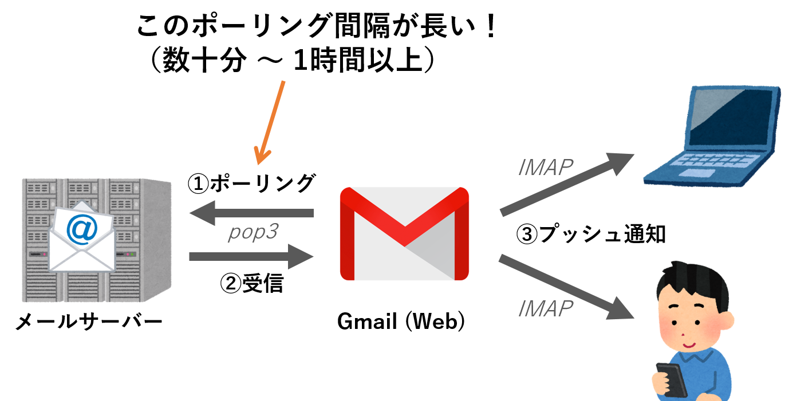
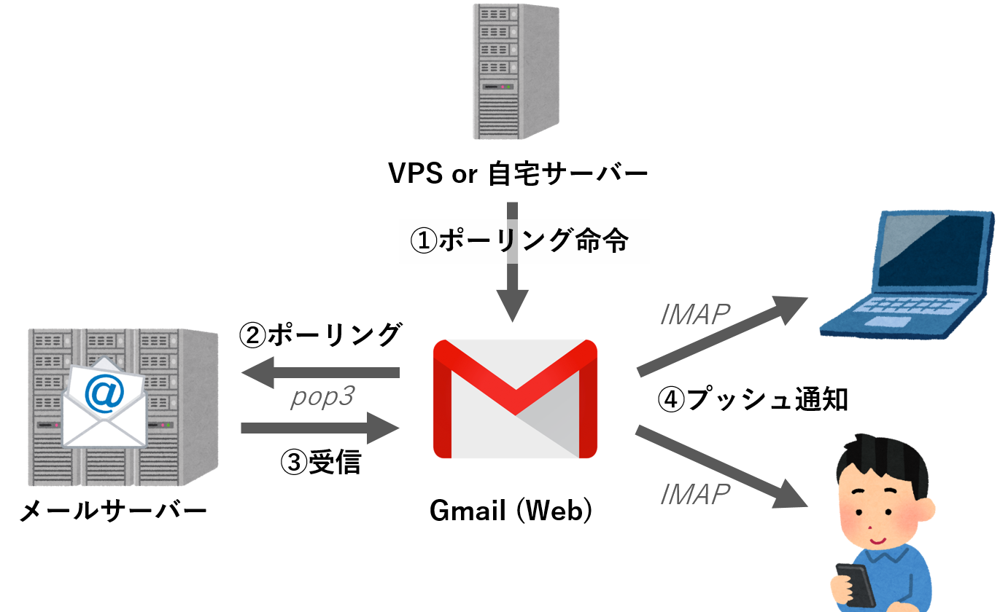

## Web版Gmailをメーラーとして使う


最近は、PCでメーラーソフトを使わず、webブラウザでweb版のメールアプリを使う方が多いですね。Gmailはその筆頭ですが、このweb版Gmail、**pop3メーラーとして使うことで、「gmail.com」以外のアドレスも送受信できる**ことをご存知でしょうか？  
Gmailをメーラーとして使うと

1\. PCやスマートフォン等のあらゆる端末から常に同期された状態でアクセスできる  
2\. Gmailのフィルタ機能・検索機能が使える  
3\. Gmailのプッシュ機能によりスマートフォンにリアルタイムで通知が来る

といった強力なメリットがあります。会社等で支給されるメールアドレスは「webUIがしょぼい」「ストレージが少ない」「プッシュ機能が無い」といった貧弱なものであることも多いので、これらを一括してGmailで管理できるのはかなり有難いですね。設定方法も簡単で、「gmail メーラーとして」などでググると解説記事が沢山引っかかりますし、[Checker Plus for Gmail](https://jasonsavard.com/ja/Checker-Plus-for-Gmail)等のブラウザアドオンを使えばメーラーソフトのように受信通知を受け取ることもできます。私も先人達にならってGmailをメーラーとして愛用していました。

がしかし、使っているうちにだんだんと不満に思う部分が出てきました・・・。

## Gmailのpop3ポーリング間隔が遅い・・・

それは**「Gmailから外部メールサーバーへのpop3ポーリング間隔が長い&不安定」**であることです。  
下図①、Gmailのサーバーから外部メールサーバーへと定期的にpop3ポーリングを行うことでメールを取得するのですが、**この間隔がおおむね数十分、長い時では2時間近く間が空いてしまう**ことがあります。せっかくプッシュによるリアルタイム通知に対応していても、これでは宝の持ち腐れです。



この問題の一般的な解決策として、[Gmail POP3 Checker](https://www.danielslaughter.com/projects/gmail-pop3-checker-for-greasemonkey/)などのChromeアドオンを使う方法があります。しかし、「ブラウザを閉じるとアドオンも終了してしまう」「ポーリング間隔が一定以下に設定できない」といった問題点があり、仕事用のメールを確実に受信したい私としては不満の残るものでした。

## Gmailに定期ポーリング指令を出す

そこで私が試したのが、**「定期的にポーリング命令を出す」**という方法です。VPSでも自宅サーバーでもデスクトップでも何でも構いませんが、とにかく常時稼働しているコンピューターから一定時間ごとにGmailに対してポーリング命令を出すことで、ほぼリアルタイムでメールを受け取ることができます。  

ノートPCやスマートフォン等の端末側は、（ソフトウェアがプッシュ通知の受信に対応していれば）ただ通知を受け取るだけなので、電池消耗を早めないというメリットもあります。



Gmailには各種APIが整備されていますが、（サーバー攻撃に利用されるのを防ぐため？）残念ながらポーリング命令用のAPIはありません。そこで、[Slelnium](https://www.seleniumhq.org/)を使ってダイレクトにブラウザを操作し、設定画面にある「メールを今すぐ確認する」というリンクを一定間隔でクリックさせます。  

Pythonで書いた場合のコードは以下の通りです。

*pop3-checker.py*

```python
# -*- coding: utf_8 -*-
from selenium import webdriver
from selenium.webdriver.common.by import By
from selenium.webdriver.firefox.options import Options
from selenium.webdriver.support.ui import WebDriverWait
from selenium.webdriver.support import expected_conditions
from selenium.common.exceptions import StaleElementReferenceException
import time
from datetime import datetime

#パラメータの設定
POLLING_INTERVAL = 60 #ポーリング間隔（秒）を設定
CONNECTION_RETRY = 9
MAX_WAIT_TIME = 60
ACOUNT_NAME = "hogehoge@gmail.com" #アカウント名を設定
PATHWORD = "hogehoge" #パスワードを設定

#Firefoxの起動
options = Options()
options.add_argument("--headless")
driver = webdriver.Firefox(firefox_options=options)
driver.implicitly_wait(10)

#Googleアカウントページに移動
driver.get("https://accounts.google.com/signin")
print(driver.current_url, flush=True)

#アカウント名を入力
tag = WebDriverWait(driver, MAX_WAIT_TIME).until(expected_conditions.element_to_be_clickable((By.XPATH, """//input[@name='identifier']""")))
tag.clear()
tag.send_keys(ACOUNT_NAME)
tag = WebDriverWait(driver, MAX_WAIT_TIME).until(expected_conditions.element_to_be_clickable((By.XPATH, """//content[contains(.,'次へ')]""")))
tag.click()
print(driver.current_url, flush=True)

#パスワードを入力
tag = WebDriverWait(driver, MAX_WAIT_TIME).until(expected_conditions.element_to_be_clickable((By.XPATH, """//input[@name='password']""")))
tag.clear()
tag.send_keys(PATHWORD)
tag = WebDriverWait(driver, MAX_WAIT_TIME).until(expected_conditions.element_to_be_clickable((By.XPATH, """//content[contains(.,'次へ')]""")))
tag.click()
print(driver.current_url, flush=True)

#Gmailの受信ボックスに移動
driver.get("https://mail.google.com/mail/u/0/#inbox")
time.sleep(15)
print(driver.current_url, flush=True)

#pop3のポーリング
while True:
        for i in range(CONNECTION_RETRY):
                try:
                        driver.get("https://mail.google.com/mail/u/0/#settings/accounts")
                        tag = WebDriverWait(driver, MAX_WAIT_TIME).until(expected_conditions.element_to_be_clickable((By.XPATH, """//span[contains(.,'メールを今すぐ確認する')]""")))
                        tag.click()
                except StaleElementReferenceException as e:
                        print("error:{e} retry: {i}/{max}".format(e=e, i=i, max=CONNECTION_RETRY), flush=True)
                        time.sleep(i*10)
                else:
                        break
        print(datetime.now(), flush=True)
        time.sleep(POLLING_INTERVAL)

#firefoxの終了
driver.quit()
```

**（注: ポーリング間隔はサーバーに負担のかからない範囲で）**

ログインページから直接Gmail設定画面に飛べないので、一度受信ボックスを経由しています。また、ポーリング用のリンクはタグidが毎回変わる仕様になっているので、「メールを今すぐ確認する」という文言で直接指定しています。

あとは、Seleniumとgeckodriverをインストールした状態で

```bash
$ python3 pop3-checker.py
```

とすることで、一定間隔ごとに外部メールサーバーからGmailサーバーへとメールを取り込んでくれます。

## 常時運用

VPS等サーバーで常時運用するには、上記のスクリプトをデーモン化しておくことが望ましいです。デーモン化方法はいくつかありますが、私は[Supervisor](http://supervisord.org/)を気に入っています。例として以下の環境での設定方法について解説します。

-   OS: Ubuntu
-   ユーザー名: hogehoge
-   Python環境: /home/hogehoge/env1にvenvで作成
-   pop3-checker.pyの場所: /home/hogehoge/env1/src/pop3-checker.py

(1) supervisorのインストール

```bash
$ sudo apt install supervisor
```

(2) etc/superviosr/conf.d内にpop3-checker用の設定ファイルを作成

```ini
[program:pop3-checker]
directory=/home/hogehoge/env1/src ;
command=/home/hogehoge/env1/bin/python3 /home/hogehoge/env1/src/pop3-checker.py ;
numprocs=1 ;
autostart=true ;
autorestart=true ;
user=hogehoge ;
redirect_stderr=true ;
stdout_logfile=/var/log/supervisor/pop3-checker.log ;
stdout_logfile_maxbytes=1MB
stdout_logfile_backups=10
```

(3) 設定ファイルの読み込みとsupervisorの起動

```bash
$ sudo supervisorctl reread
$ sudo supervisorctl start
```

これで何かのトラブルでスクリプトが停止しても、自動的に再起動してくれるようになりました。半年ほど[ServersMan@VPS](https://dream.jp/vps/)を使って運用してみていますが、今のところトラブルなく常にほぼリアルタイムでメールを受け取ることができています。軽いスクリプトなので、自宅のデスクトップPCを着けっぱなしにしている方であれば、わざわざサーバーを使うまでも無いかもしれません。
