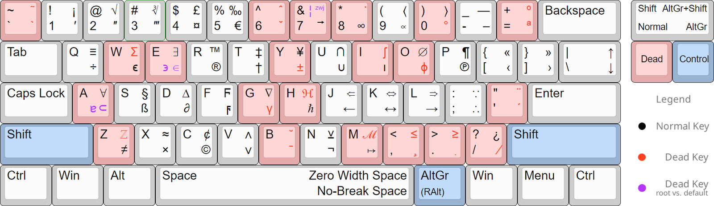

## きっかけ: ギリシャ文字の直接入力

先日、ふと「OSのキーボード設定にギリシャ語加えたらギリシャ文字入力しやすくなるのでは？」と思い立ち、やってみたところ、これが非常に良かった。

Windowsへのインストール手順は下記を参照 [https://www.ctsfw.edu/wp-content/uploads/2016/02/Greek-Unicode-Keyboard-Input-Windows-10.pdf](https://www.ctsfw.edu/wp-content/uploads/2016/02/Greek-Unicode-Keyboard-Input-Windows-10.pdf)

左Alt + 左Shiftで日本語 / ギリシャ語入力を切り替え。 数式をはじめとして、科学的な内容を含む文章ではαだのωだのθだのギリシャ文字をよく使うので、これらの記号を無変換でスムーズに書けるのは嬉しい。

（余談ですが、WindowsのAlt +Unicodeコードポイントで記号入力する機能、なんかOffice 365で使えないのでなんでやねんと思ってたんですが、Win32API使ってるからっぽいんですよね。いやなんでやねん。）

もちろんTeXを使うこともあるのですが、いつでも使える訳ではないですし。せっかくUnicodeが広まった世界になったわけですし、本格的な数式でないなら環境に関わらずパッと記号を出したいところ。

## 現状の課題

さて人間欲が出るもの。ギリシャ文字については前項で解決したのですが、欲しい記号はギリシャ文字だけではありません。°, ², Å, ±, ×あたりもよく使うので、キーボードから直接入力したい。ただ、流石にこれらの記号を含むような言語パックはWindowsデフォルトでは存在しません。

## カスタム論理配列

無いなら作ればよい、ということで自前で論理レイアウト定義ファイルを作ってインストールしている人たちがいます。この記事ではそれらの先人の例を参考にしながら、自分なりのキーボード論理配列を構築したい（随時更新）。

1.  [https://github.com/BelugaHaechi/US-International-Scientific-Keyboard](https://github.com/BelugaHaechi/US-International-Scientific-Keyboard)



*BelugaHaechi’s scientific keyboard layout*

BelugaHaechi氏によるもの。US配列に対して、通常入力と記号入力を１つの論理配列で実現しようというもの。

特徴:

-   Mod keyは2つ。ShiftとAltGr。左上がShifted, 右上がAltGred, 右下がShifted x AltGred.
-   Dead keyによる修飾が豊富
-   ギリシャ文字は少ない

## 作成方法

BelugaHaechi’s scientific keyboard layout では、Microsoft Keyboard Layout Creator (通称MKLC)を使っていた。古いソフトでそれなりにバグいとのことだが、現状これ一択か。source fileと呼ばれる.klcファイルが設定ファイルになるようだ。例えば、標準の日本語キーボードだと.klcファイルの中身は下記のようになる。

```
KBD Layout01    "日本語 - Custom"

COPYRIGHT   "(c) 2025 None"

COMPANY "None"

LOCALENAME  "ja-JP"

LOCALEID    "00000411"

VERSION 1.0

SHIFTSTATE

0   //Column 4
1   //Column 5 : Shft
2   //Column 6 :       Ctrl

LAYOUT      ;an extra '@' at the end is a dead key

//SC    VK_     Cap 0   1   2
//--    ----        ----    ----    ----    ----

02  1       0   1   0021    -1              // DIGIT ONE, EXCLAMATION MARK, 
<none>
03  2       0   2   0022    -1              // DIGIT TWO, QUOTATION MARK, 
<none>
04  3       0   3   0023    -1              // DIGIT THREE, NUMBER SIGN, 
<none>
05  4       0   4   0024    -1              // DIGIT FOUR, DOLLAR SIGN, 
<none>
06  5       0   5   0025    -1              // DIGIT FIVE, PERCENT SIGN, 
<none>
07  6       0   6   0026    -1              // DIGIT SIX, AMPERSAND, 
<none>
08  7       0   7   0027    -1              // DIGIT SEVEN, APOSTROPHE, 
<none>
09  8       0   8   0028    -1              // DIGIT EIGHT, LEFT PARENTHESIS, 
<none>
0a  9       0   9   0029    -1              // DIGIT NINE, RIGHT PARENTHESIS, 
<none>
0b  0       0   0   -1  -1                  // DIGIT ZERO, 
<none>, <none>
0c  OEM_MINUS   0   002d    003d    -1      // HYPHEN-MINUS, EQUALS SIGN, 
<none>
0d  OEM_7       0   005e    007e    -1      // CIRCUMFLEX ACCENT, TILDE, 
<none>
10  Q       1   q   Q   -1                  // LATIN SMALL LETTER Q, LATIN CAPITAL LETTER Q, 
<none>
11  W       1   w   W   -1                  // LATIN SMALL LETTER W, LATIN CAPITAL LETTER W, 
<none>
12  E       1   e   E   -1                  // LATIN SMALL LETTER E, LATIN CAPITAL LETTER E, 
<none>
13  R       1   r   R   -1                  // LATIN SMALL LETTER R, LATIN CAPITAL LETTER R, 
<none>
14  T       1   t   T   -1                  // LATIN SMALL LETTER T, LATIN CAPITAL LETTER T, 
<none>
15  Y       1   y   Y   -1                  // LATIN SMALL LETTER Y, LATIN CAPITAL LETTER Y, 
<none>
16  U       1   u   U   -1                  // LATIN SMALL LETTER U, LATIN CAPITAL LETTER U, 
<none>
17  I       1   i   I   -1                  // LATIN SMALL LETTER I, LATIN CAPITAL LETTER I, 
<none>
18  O       1   o   O   -1                  // LATIN SMALL LETTER O, LATIN CAPITAL LETTER O, 
<none>
19  P       1   p   P   -1                  // LATIN SMALL LETTER P, LATIN CAPITAL LETTER P, 
<none>
1a  OEM_3       0   0040    0060    -1      // COMMERCIAL AT, GRAVE ACCENT, 
<none>
1b  OEM_4       0   005b    007b    001b    // LEFT SQUARE BRACKET, LEFT CURLY BRACKET, ESCAPE
1e  A       1   a   A   -1                  // LATIN SMALL LETTER A, LATIN CAPITAL LETTER A, 
<none>
1f  S       1   s   S   -1                  // LATIN SMALL LETTER S, LATIN CAPITAL LETTER S, 
<none>
20  D       1   d   D   -1                  // LATIN SMALL LETTER D, LATIN CAPITAL LETTER D, 
<none>
21  F       1   f   F   -1                  // LATIN SMALL LETTER F, LATIN CAPITAL LETTER F, 
<none>
22  G       1   g   G   -1                  // LATIN SMALL LETTER G, LATIN CAPITAL LETTER G, 
<none>
23  H       1   h   H   -1                  // LATIN SMALL LETTER H, LATIN CAPITAL LETTER H, 
<none>
24  J       1   j   J   -1                  // LATIN SMALL LETTER J, LATIN CAPITAL LETTER J, 
<none>
25  K       1   k   K   -1                  // LATIN SMALL LETTER K, LATIN CAPITAL LETTER K, 
<none>
26  L       1   l   L   -1                  // LATIN SMALL LETTER L, LATIN CAPITAL LETTER L, 
<none>
27  OEM_PLUS    0   003b    002b    -1      // SEMICOLON, PLUS SIGN, 
<none>
28  OEM_1       0   003a    002a    -1      // COLON, ASTERISK, 
<none>
2b  OEM_6       0   005d    007d    001d    // RIGHT SQUARE BRACKET, RIGHT CURLY BRACKET, INFORMATION SEPARATOR THREE
2c  Z       1   z   Z   -1                  // LATIN SMALL LETTER Z, LATIN CAPITAL LETTER Z, 
<none>
2d  X       1   x   X   -1                  // LATIN SMALL LETTER X, LATIN CAPITAL LETTER X, 
<none>
2e  C       1   c   C   -1                  // LATIN SMALL LETTER C, LATIN CAPITAL LETTER C, 
<none>
2f  V       1   v   V   -1                  // LATIN SMALL LETTER V, LATIN CAPITAL LETTER V, 
<none>
30  B       1   b   B   -1                  // LATIN SMALL LETTER B, LATIN CAPITAL LETTER B, 
<none>
31  N       1   n   N   -1                  // LATIN SMALL LETTER N, LATIN CAPITAL LETTER N, 
<none>
32  M       1   m   M   -1                  // LATIN SMALL LETTER M, LATIN CAPITAL LETTER M, 
<none>
33  OEM_COMMA   0   002c    003c    -1      // COMMA, LESS-THAN SIGN, 
<none>
34  OEM_PERIOD  0   002e    003e    -1      // FULL STOP, GREATER-THAN SIGN, 
<none>
35  OEM_2       0   002f    003f    -1      // SOLIDUS, QUESTION MARK, 
<none>
39  SPACE       0   0020    0020    0020    // SPACE, SPACE, SPACE
73  OEM_102 0   005c    005f    001c        // REVERSE SOLIDUS, LOW LINE, INFORMATION SEPARATOR FOUR
7d  OEM_5       0   005c    007c    001c    // REVERSE SOLIDUS, VERTICAL LINE, INFORMATION SEPARATOR FOUR
53  DECIMAL 0   002e    002e    -1          // FULL STOP, FULL STOP, 

KEYNAME

01  Esc
0e  Backspace
0f  Tab
1c  Enter
1d  Ctrl
2a  Shift
36  "Right Shift"
37  "Num *"
38  Alt
39  Space
3a  "Caps Lock"
3b  F1
3c  F2
3d  F3
3e  F4
3f  F5
40  F6
41  F7
42  F8
43  F9
44  F10
45  Pause
46  "Scroll Lock"
47  "Num 7"
48  "Num 8"
49  "Num 9"
4a  "Num -"
4b  "Num 4"
4c  "Num 5"
4d  "Num 6"
4e  "Num +"
4f  "Num 1"
50  "Num 2"
51  "Num 3"
52  "Num 0"
53  "Num Del"
54  "Sys Req"
57  F11
58  F12
7c  F13
7d  F14
7e  F15
7f  F16
80  F17
81  F18
82  F19
83  F20
84  F21
85  F22
86  F23
87  F24

KEYNAME_EXT

1c  "Num Enter"
1d  "Right Ctrl"
35  "Num /"
37  "Prnt Scrn"
38  "Right Alt"
45  "Num Lock"
46  Break
47  Home
48  Up
49  "Page Up"
4b  Left
4d  Right
4f  End
50  Down
51  "Page Down"
52  Insert
53  Delete
54  
<00>
56  Help
5b  "Left Windows"
5c  "Right Windows"
5d  Application

DESCRIPTIONS

0409    日本語 - Custom
LANGUAGENAMES

0409    Japanese (Japan)
ENDKBD
```

割とシンプルな形式で、おそらくこれを直接弄る方が良いだろう。 上の例だとカラムは6列だが、実際にはMod keyの組み合わせでもっとたくさん定義でき、一例はこんな感じ。

| カラム名 | 内容 |
| --- | --- |
| SC | Scan Code |
| VK\_ | Virtual Key |
| Cap | Capsフラグ？ |
| 0 | 通常 |
| 1 | +Shift |
| 2 | +Ctrl |
| 6 | +Ctrl +Alt |
| 7 | +Shft +Ctrl +Alt |

各カラムにはUnicodeのコードの数字が入っている。

## 資料

-   [https://kbdlayout.info/kbdibm02/virtualkeys](https://kbdlayout.info/kbdibm02/virtualkeys)
-   [https://www.microsoft.com/en-us/download/details.aspx?id=102134](https://www.microsoft.com/en-us/download/details.aspx?id=102134)
-   [https://www.seiai.ed.jp/sys/text/java/utf8table.html](https://www.seiai.ed.jp/sys/text/java/utf8table.html)
-   [https://nixeneko.hatenablog.com/entry/2015/11/24/012250](https://nixeneko.hatenablog.com/entry/2015/11/24/012250)
-   [https://www.reddit.com/r/languagelearning/comments/14myyks/how\_to\_build\_a\_custom\_windows\_keyboard\_layout/](https://www.reddit.com/r/languagelearning/comments/14myyks/how_to_build_a_custom_windows_keyboard_layout/)
