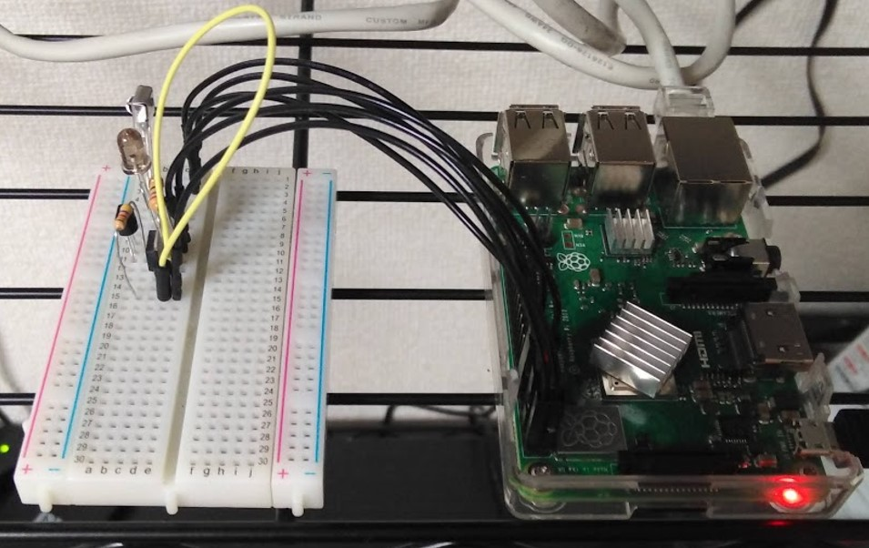
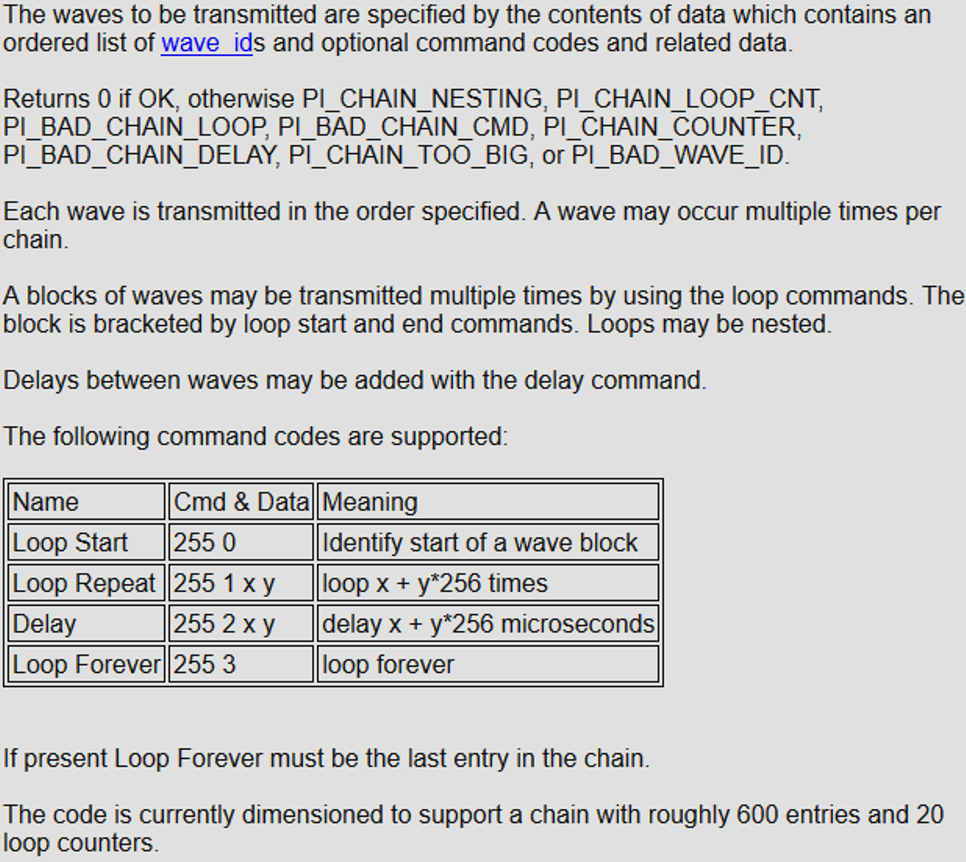

## この記事の結論

1.  「Raspberry pi + pigpio + IR Record and Playback」でリモコン操作しようとして「**pigpio.error: ‘chain is too long’**」エラーが出るのは、**対象のリモコンのコードが長すぎる**せいです。
2.  ↑の chain is too long エラーで困っている人は、**本家IR Record and Playback (irrp.py)の代わりに、私がmodifyした[irrp.py](https://raw.githubusercontent.com/haborite/irrp.py/refs/heads/main/irrp.py)を使うと解決する**と思います。
3.  それでもうまくいかない場合は、[Y.Sakamotoさんの方法](http://freewing.starfree.jp/raspberry_pi/raspberry_pi_gpio_pigpio_ir_remote_control/)を使うと解決すると思います。

## ラズパイでスマートリモコンを作った

家中の家電をタブレット一つで操作したくなり、Raspberry pi 3 B+を使ってスマートリモコンを作りました。作成に当たっては、以下のサイトを参考にしました。先人の知恵に感謝。

-   [赤外線LEDドライブ回路の決定版](https://vintagechips.wordpress.com/2013/10/05/%E8%B5%A4%E5%A4%96%E7%B7%9Aled%E3%83%89%E3%83%A9%E3%82%A4%E3%83%96%E5%9B%9E%E8%B7%AF%E3%81%AE%E6%B1%BA%E5%AE%9A%E7%89%88/)
-   [格安スマートリモコンの作り方 – Qiita](https://qiita.com/takjg/items/e6b8af53421be54b62c9)  
    

リモコンの赤外線信号の記憶・送信については、[IR Record and Playback(irrp.py)](http://abyz.me.uk/rpi/pigpio/code/irrp_py.zip)というスクリプトを使うことで簡単にできます（詳しい使い方は[上記リンク](https://qiita.com/takjg/items/e6b8af53421be54b62c9)参照）。irrp.pyは[pigpio](http://abyz.me.uk/rpi/pigpio/)というライブラリを使って、ラズパイのGPIO信号を制御しています。

例えば、「ルンバの電源ON」というリモコン信号を覚えさせたい場合は、以下のコマンドを実行してから、赤外線受信部位に向かってリモコンのスイッチを押すだけです（GPIOのg18ピンで受信する場合）。

```bash
$ python3 irrp.py -r -g18 -f codes roomba:on --no-confirm --post 130
```

覚えた信号は、この場合”codes”というファイルに記録されます。この信号を送信するときは、以下のコマンドです（g17ピンで送信する場合）。

```bash
$ irrp.py -p -g17 -f codes roomba:on
```

こんな調子で、照明・ルンバ・加湿器と順調に登録していったのですが、**エアコンのリモコン信号を送信しようとした時、トラブルが発生しました。**

## エアコンのリモコン信号が送信できない

リモコンの信号を送信しようとすると、以下のエラーが出てスクリプトが停止してしまったのです。

```bash
Traceback (most recent call last):
File “irrp.py”, line 481, in <module>
pi.wave_chain(wave)
File “/usr/lib/python3/dist-packages/pigpio.py”, line 2475, in wave_chain
self.sl, _PI_CMD_WVCHA, 0, 0, len(data), [data]))
File “/usr/lib/python3/dist-packages/pigpio.py”, line 970, in _u2i
raise error(error_text(v))
pigpio.error: ‘chain is too long’
```

“**Chain is too long**“？ファイルに記録された赤外線コードを確認すると、確かにエアコンのコードだけ異様に長い。irrp.pyでは「赤外線点灯時間（μ秒）, 赤外線消灯時間（μ秒）」のペアをひたすら記録する、という形式になっているのですが、照明用のコードが100エントリー程度なのに対し、**エアコンのコードでは800エントリーを超えています**。\[pigpioのオフィシャルサイト\[(http://abyz.me.uk/rpi/pigpio/python.html)を見ると、「The code is currently dimensioned to support a chain with roughly 600 entries」とのこと。200エントリー以上オーバーしていますね。これが原因です。

## ループ記法を使って赤外線コードを圧縮する

そこで改めてpigpioの公式サイトでwave\_chain()メソッドの仕様を調べました。



どうやら「Loop」という記法があるようですね。連続したパターンの信号を「〇〇をn回連続で繰り返す」という書き方をすることで、エントリー数を削減できるようです。「Loopは20個以内しか使えない」とか「Loopのコード部分だけで6エントリーも消費してしまう」とか色々と使いづらい部分はあるのですが、とにかくこれを使って信号を短縮できないかやってみました。

```python
### Compressing a wave code if the length is more than 600 ###
ENTRY_MAX = 600
LOOP_MAX = 20
if len(wave) > ENTRY_MAX:
    import collections
    def make_ngram(l, n):
        ngrams = list(zip(*(l[i:] for i in range(n))))
        return(collections.Counter(ngrams).most_common())
    def depth_of_tuple(t):
        if isinstance(t, tuple):
            if t == tuple() : return 1
            return 1 + max(depth_of_tuple(item) for item in t)
        else:
            return 0
    def nonloop_decode(wave, i, t):
        wave[i:i+1] = [t[num] for num in range(len(t)-1)]*t[-1]
        return wave
    def loop_decode(wave, i, t):
        repeat_unit = [t[num] for num in range(len(t)-1)]
        code = [255, 0, 255, 1, t[-1], 0]
        code[2:2] = repeat_unit
        wave[i:i+1] = code
        return wave
    #encoding the original wave to the tuple code
    for wl in range(2, len(wave)//2):
        pre_len = 0
        while len(wave) != pre_len:
            pre_len = len(wave)
            ngrams = make_ngram(wave, wl)
            for ngram in ngrams:
                ngram_wave = ngram[0]
                ngram_freq = ngram[1]
                if ngram_freq >= 2:
                    for i in range(len(wave) - len(ngram_wave)):
                        if tuple(wave[i:i+wl]) == ngram_wave:
                            for rn in range(2, ngram_freq):
                                if wave[i:i+(wl*rn)] != list(ngram_wave * rn):
                                    if wl*(rn-2) > 6 or depth_of_tuple(ngram_wave) >= 2 and rn-1 >= 2 :
                                        loop_code = list(ngram_wave) + [rn-1]
                                        wave[i:i+((rn-1)*wl)] = [tuple(loop_code)]
                                    break
    #decoding the tuple-type code into the wave code
    rest_loop_count = LOOP_MAX
    for d in range(depth_of_tuple(tuple(wave))):
        for i,item in enumerate(wave):
            if isinstance(item, tuple):
                if rest_loop_count <= 0:
                    nonloop_decode(wave, i, item)
                elif depth_of_tuple(item) > 1:
                    loop_decode(wave, i, item)
                    rest_loop_count -= 1
    efficiencies = sorted(set([(len(item)-1)*(item[-1]-1) for item in wave if isinstance(item, tuple)]), reverse=True)
    for eff in efficiencies:
        for i,item in enumerate(wave):
            if isinstance(item, tuple):
                if rest_loop_count <= 0:
                    nonloop_decode(wave, i, item)
                elif (len(item)-1)*(item[-1]-1) == eff:
                    loop_decode(wave, i, item)
                    rest_loop_count -= 1
### Compression end ###
```

このスクリプトを、例えばウチのエアコンの「電源OFF」のコードに適用すると、以下の通り。

変換前: 853エントリー

```text
[0, 1, 2, 3, 4, 5, 4, 6, 4, 6, 4, 6, 4, 6, 4, 6, 4, 6, 4, 6, 4, 6, 4, 6, 4, 6, 4, 6, 4, 5, 4, 6, 4, 6, 4, 6, 4, 6, 4, 6, 4, 6, 4, 6, 4, 6, 4, 6, 4, 6, 4, 6, 4, 6, 4, 6, 4, 6, 4, 6, 4, 6, 4, 6, 4, 5, 4, 6, 4, 5, 4, 5, 4, 5, 4, 5, 4, 5, 4, 5, 4, 6, 4, 5, 4, 5, 4, 5, 4, 5, 4, 5, 4, 5, 4, 5, 4, 5, 4, 5, 4, 6, 4, 6, 4, 6, 4, 6, 4, 6, 4, 6, 4, 6, 4, 6, 4, 6, 4, 6, 4, 5, 4, 5, 4, 6, 4, 6, 4, 5, 4, 5, 4, 5, 4, 5, 4, 6, 4, 6, 4, 5, 4, 5, 4, 6, 4, 6, 4, 6, 4, 5, 4, 6, 4, 6, 4, 5, 4, 6, 4, 6, 4, 5, 4, 5, 4, 6, 4, 5, 4, 5, 4, 6, 4, 5, 4, 5, 4, 6, 4, 5, 4, 5, 4, 6, 4, 6, 4, 5, 4, 6, 4, 6, 4, 6, 4, 6, 4, 6, 4, 5, 4, 5, 4, 6, 4, 5, 4, 5, 4, 5, 4, 6, 4, 6, 4, 5, 4, 6, 4, 6, 4, 5, 4, 5, 4, 6, 4, 5, 4, 5, 4, 6, 4, 5, 4, 5, 4, 6, 4, 6, 4, 5, 4, 6, 4, 6, 4, 6, 4, 6, 4, 6, 4, 6, 4, 6, 4, 6, 4, 5, 4, 5, 4, 5, 4, 5, 4, 5, 4, 5, 4, 5, 4, 5, 4, 6, 4, 6, 4, 6, 4, 6, 4, 6, 4, 6, 4, 6, 4, 6, 4, 5, 4, 5, 4, 5, 4, 5, 4, 5, 4, 5, 4, 5, 4, 5, 4, 6, 4, 6, 4, 6, 4, 6, 4, 6, 4, 6, 4, 6, 4, 6, 4, 5, 4, 5, 4, 5, 4, 5, 4, 5, 4, 5, 4, 5, 4, 5, 4, 6, 4, 6, 4, 6, 4, 6, 4, 6, 4, 6, 4, 6, 4, 6, 4, 5, 4, 5, 4, 5, 4, 5, 4, 5, 4, 5, 4, 5, 4, 5, 4, 6, 4, 6, 4, 6, 4, 6, 4, 6, 4, 6, 4, 6, 4, 6, 4, 5, 4, 5, 4, 5, 4, 5, 4, 5, 4, 5, 4, 5, 4, 5, 4, 6, 4, 5, 4, 5, 4, 6, 4, 5, 4, 6, 4, 5, 4, 6, 4, 5, 4, 6, 4, 6, 4, 5, 4, 6, 4, 5, 4, 6, 4, 5, 4, 5, 4, 6, 4, 6, 4, 6, 4, 6, 4, 5, 4, 5, 4, 5, 4, 6, 4, 5, 4, 5, 4, 5, 4, 5, 4, 6, 4, 6, 4, 6, 4, 6, 4, 6, 4, 6, 4, 6, 4, 6, 4, 6, 4, 6, 4, 6, 4, 5, 4, 5, 4, 5, 4, 5, 4, 5, 4, 5, 4, 5, 4, 5, 4, 6, 4, 6, 4, 6, 4, 6, 4, 6, 4, 6, 4, 6, 4, 6, 4, 5, 4, 5, 4, 5, 4, 5, 4, 5, 4, 5, 4, 5, 4, 5, 4, 6, 4, 6, 4, 6, 4, 6, 4, 6, 4, 6, 4, 6, 4, 5, 4, 5, 4, 5, 4, 5, 4, 5, 4, 5, 4, 5, 4, 5, 4, 6, 4, 5, 4, 5, 4, 6, 4, 6, 4, 6, 4, 6, 4, 6, 4, 6, 4, 6, 4, 6, 4, 5, 4, 5, 4, 5, 4, 5, 4, 5, 4, 5, 4, 5, 4, 6, 4, 6, 4, 6, 4, 6, 4, 6, 4, 6, 4, 6, 4, 6, 4, 5, 4, 5, 4, 5, 4, 5, 4, 5, 4, 5, 4, 5, 4, 6, 4, 6, 4, 6, 4, 5, 4, 6, 4, 6, 4, 6, 4, 5, 4, 5, 4, 5, 4, 5, 4, 6, 4, 5, 4, 5, 4, 5, 4, 6, 4, 6, 4, 6, 4, 6, 4, 6, 4, 6, 4, 6, 4, 6, 4, 6, 4, 5, 4, 5, 4, 5, 4, 5, 4, 5, 4, 5, 4, 5, 4, 5, 4, 6, 4, 6, 4, 6, 4, 6, 4, 6, 4, 6, 4, 6, 4, 6, 4, 5, 4, 5, 4, 5, 4, 5, 4, 5, 4, 5, 4, 5, 4, 5, 4, 5, 4, 5, 4, 5, 4, 5, 4, 5, 4, 5, 4, 5, 4, 5, 4, 6, 4, 6, 4, 6, 4, 6, 4, 6, 4, 6, 4, 6, 4, 6, 4, 5, 4, 5, 4, 5, 4, 5, 4, 5, 4, 5, 4, 5, 4, 5, 4, 6, 4, 6, 4, 6, 4, 6, 4, 6, 4, 6, 4, 6, 4, 6, 4, 5, 4, 5, 4, 5, 4, 5, 4, 5, 4, 5, 4, 5, 4, 5, 4, 6, 4, 6, 4, 6, 4, 6, 4, 6, 4, 6, 4, 6, 4, 6, 4, 5, 4, 5, 4, 5, 4, 5, 4, 5, 4, 5, 4, 5, 4, 5, 4, 6, 4, 6, 4, 6, 4, 6, 4, 6, 4, 6, 4, 6, 4, 6, 4]
```

変換後: 471エントリー

```text
[0, 1, 2, 3, 4, 5, 255, 0, 4, 6, 255, 1, 11, 0, 4, 5, 255, 0, 4, 6, 255, 1, 17, 0, 4, 5, 4, 6, 4, 5, 4, 5, 4, 5, 4, 5, 4, 5, 4, 5, 4, 6, 255, 0, 4, 5, 255, 1, 9, 0, 255, 0, 4, 6, 255, 1, 10, 0, 4, 5, 4, 5, 4, 6, 4, 6, 4, 5, 4, 5, 4, 5, 4, 5, 4, 6, 4, 6, 4, 5, 4, 5, 4, 6, 4, 6, 4, 6, 4, 5, 4, 6, 4, 6, 4, 5, 4, 6, 255, 0, 4, 6, 4, 5, 4, 5, 255, 1, 4, 0, 4, 6, 4, 6, 4, 5, 4, 6, 4, 6, 4, 6, 4, 6, 4, 6, 4, 5, 4, 5, 4, 6, 4, 5, 4, 5, 4, 5, 4, 6, 4, 6, 4, 5, 4, 6, 4, 6, 4, 5, 4, 5, 4, 6, 4, 5, 4, 5, 4, 6, 4, 5, 4, 5, 4, 6, 4, 6, 4, 5, 255, 0, 255, 0, 4, 6, 255, 1, 8, 0, 255, 0, 4, 5, 255, 1, 8, 0, 255, 1, 5, 0, 4, 6, 4, 5, 4, 5, 4, 6, 4, 5, 4, 6, 4, 5, 4, 6, 4, 5, 4, 6, 4, 6, 4, 5, 4, 6, 4, 5, 4, 6, 4, 5, 4, 5, 4, 6, 4, 6, 4, 6, 4, 6, 4, 5, 4, 5, 4, 5, 4, 6, 4, 5, 4, 5, 4, 5, 4, 5, 255, 0, 4, 6, 255, 1, 11, 0, 255, 0, 4, 5, 255, 1, 8, 0, 255, 0, 4, 6, 255, 1, 8, 0, 255, 0, 4, 5, 255, 1, 8, 0, 4, 6, 4, 6, 4, 6, 4, 6, 4, 6, 4, 6, 4, 6, 255, 0, 4, 5, 255, 1, 8, 0, 4, 6, 4, 5, 4, 5, 255, 0, 4, 6, 255, 1, 8, 0, 4, 5, 4, 5, 4, 5, 4, 5, 4, 5, 4, 5, 4, 5, 255, 0, 4, 6, 255, 1, 8, 0, 4, 5, 4, 5, 4, 5, 4, 5, 4, 5, 4, 5, 4, 5, 4, 6, 4, 6, 4, 6, 4, 5, 4, 6, 4, 6, 4, 6, 4, 5, 4, 5, 4, 5, 4, 5, 4, 6, 4, 5, 4, 5, 4, 5, 255, 0, 4, 6, 255, 1, 9, 0, 255, 0, 4, 5, 255, 1, 8, 0, 255, 0, 4, 6, 255, 1, 8, 0, 255, 0, 4, 5, 255, 1, 16, 0, 255, 0, 4, 6, 4, 6, 4, 6, 4, 6, 4, 6, 4, 6, 4, 6, 4, 6, 4, 5, 4, 5, 4, 5, 4, 5, 4, 5, 4, 5, 4, 5, 4, 5, 255, 1, 3, 0, 4, 6, 4, 6, 4, 6, 4, 6, 4, 6, 4, 6, 4, 6, 4, 6, 4]
```

**元のコードの6割以下にまで圧縮することに成功**しました。なお、よく見ると最適化はできていません。「長周期ループの検出漏れ」と「多重ループの無条件高評価」が主な問題です。20ループ制限が色々と面倒なんですよね・・・。後でもうちょっと推敲したいところです。

このコードをirrp.pyの481行目（pi.wave\_chain(wave)の直上）に挿入することで、エアコンのように長いリモコンコードでも問題なく送信することができるようになります（挿入後のファイルが↓）。

-   リポジトリ:[https://github.com/haborite/irrp.py](https://github.com/haborite/irrp.py)
-   直リンク: [irrp.py](https://raw.githubusercontent.com/haborite/irrp.py/refs/heads/main/irrp.py)

送信毎に一々圧縮処理をするわけで非効率ですが、タイムラグはせいぜい1秒程度なので、とりあえずこのままにしています。ラグなしで送信したい場合は、圧縮後のコードを直接保存するように書き換えると良いでしょう。

**追記**  
私がwaveコードを「圧縮」するやり方なのに対し、下の記事では「分割」する解決策を示されていますね。  
[http://freewing.starfree.jp/raspberry\_pi/raspberry\_pi\_gpio\_pigpio\_ir\_remote\_control](http://freewing.starfree.jp/raspberry_pi/raspberry_pi_gpio_pigpio_ir_remote_control/)  
圧縮しても長過ぎる場合は「分割」を選んだ方がよさそうです。
