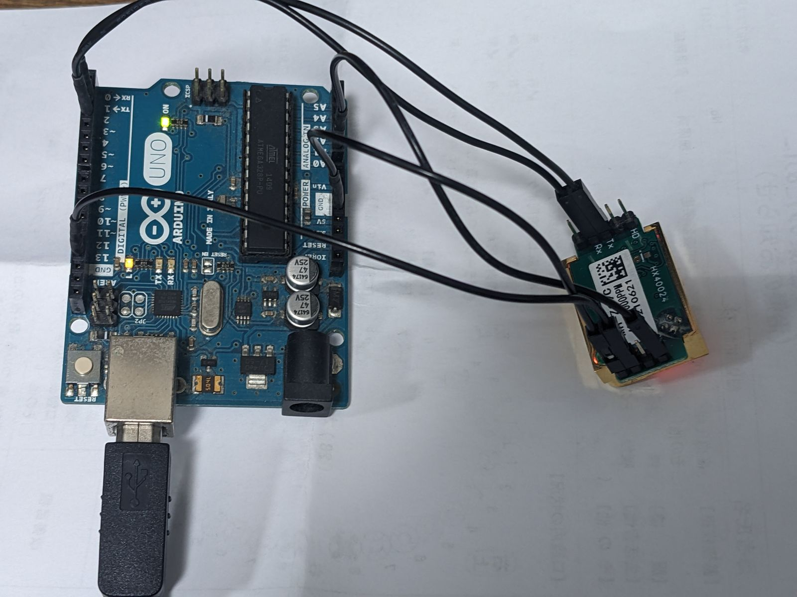

## 概要

NDIR式二酸化炭素センサの定番、MH-Z19C。PWM接続で使用している例が多いが、UART通信にも対応しているので、そちらを使う方が何かと便利。 ただし微妙に躓くポイントがあるのでメモ。

## 構成

-   マイコン: Arduino Uno
-   CO2センサ: MH-Z19C

## 接続



*Wiring of Arduino Uno and MH-Z19C*

| MH-Z19C Pin | Arduino Uno Pin |
| --- | --- |
| VCC | 5V |
| GND | GND |
| TX | RX (Pin 0) |
| RX | TX (Pin 1) |

MH-Z19CのHdピン（Hardware Resetピン）については、キャリブレーション時以外では抵抗でも噛ましてプルアップ（HIGH）にしておくのがベストだが、実用上は未接続（オープン）でも問題ない。

## コード

基本的にはArduinoのSoftwareSerialを使った普通のUART通信。 ポイントはCO2濃度取得コマンドを送信したのちに、受信までに充分な待機時間（20 ms以上）を取ること。 MH-Z19Cの応答時間は結構遅く、自分の環境では

-   10 ms: 常時失敗
-   11 ms: 50％程度の確率で失敗
-   12 ms以上: 常時成功

という結果だった。100 ms程度確保するのが無難だろう。

```cpp
#include <SoftwareSerial.h>

SoftwareSerial mhz19(2, 3);

byte cmd_get_co2[] = {0xFF, 0x01, 0x86, 0x00, 0x00, 0x00, 0x00, 0x00, 0x79};
byte response[9];

void setup() {
  Serial.begin(9600);
  mhz19.begin(9600);
  delay(1000);

  Serial.println("MH-Z19C CO2 sensor test");
}

void loop() {
  requestCO2();
  delay(1000);
}

void requestCO2() {
  Serial.println("Sending CO2 measurement command...");
  mhz19.write(cmd_get_co2, 9);
  delay(100);  // <-- 受信待機時間を充分取ることがポイント！

  int count = 0;
  while (mhz19.available() > 0) {
    byte b = mhz19.read();
    if (count == 0 && b != 0xFF) {
      continue;
    }
    response[count] = b;
    count++;
    if (count >= 9) break;
  }

  if (count == 9) {
    Serial.print("Received data: ");
    for (int i = 0; i < 9; i++) {
      Serial.print(response[i], HEX);
      Serial.print(" ");
    }
    Serial.println();

    if (response[0] == 0xFF && response[1] == 0x86) {
      int high = response[2];
      int low = response[3];
      int ppm = (high << 8) + low;
      Serial.print("CO2: ");
      Serial.print(ppm);
      Serial.println(" ppm");
    } else {
      Serial.println("Invalid response format.");
    }
  } else {
    Serial.print("Error: Expected 9 bytes, received ");
    Serial.print(count);
    Serial.println(" bytes.");
  }
}
```

## 出力例

Arduino IDEのシリアルコンソールでの出力例はこんな感じ。

```text
18:03:01.678 -> Sending CO2 measurement command...
18:03:01.725 -> Received data: FF 86 2 6E 3C 0 0 0 CE 
18:03:01.771 -> CO2: 622 ppm
18:03:02.747 -> Sending CO2 measurement command...
18:03:02.747 -> Received data: FF 86 2 6F 3C 0 0 0 CD 
18:03:02.794 -> CO2: 623 ppm
18:03:03.772 -> Sending CO2 measurement command...
18:03:03.819 -> Received data: FF 86 2 70 3C 0 0 0 CC 
18:03:03.819 -> CO2: 624 ppm
18:03:04.798 -> Sending CO2 measurement command...
18:03:04.845 -> Received data: FF 86 2 6E 3C 0 0 0 CE 
18:03:04.892 -> CO2: 622 ppm
18:03:05.827 -> Sending CO2 measurement command...
18:03:05.873 -> Received data: FF 86 2 6D 3C 0 0 0 CF 
18:03:05.920 -> CO2: 621 ppm
```
