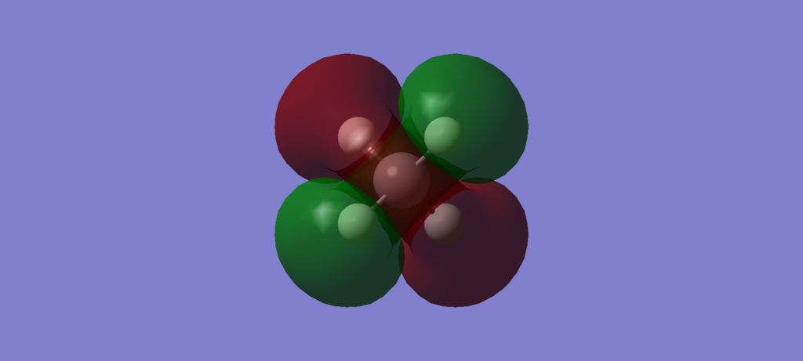
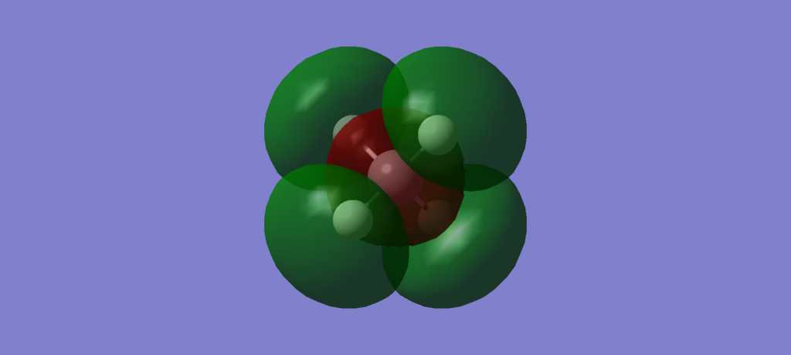
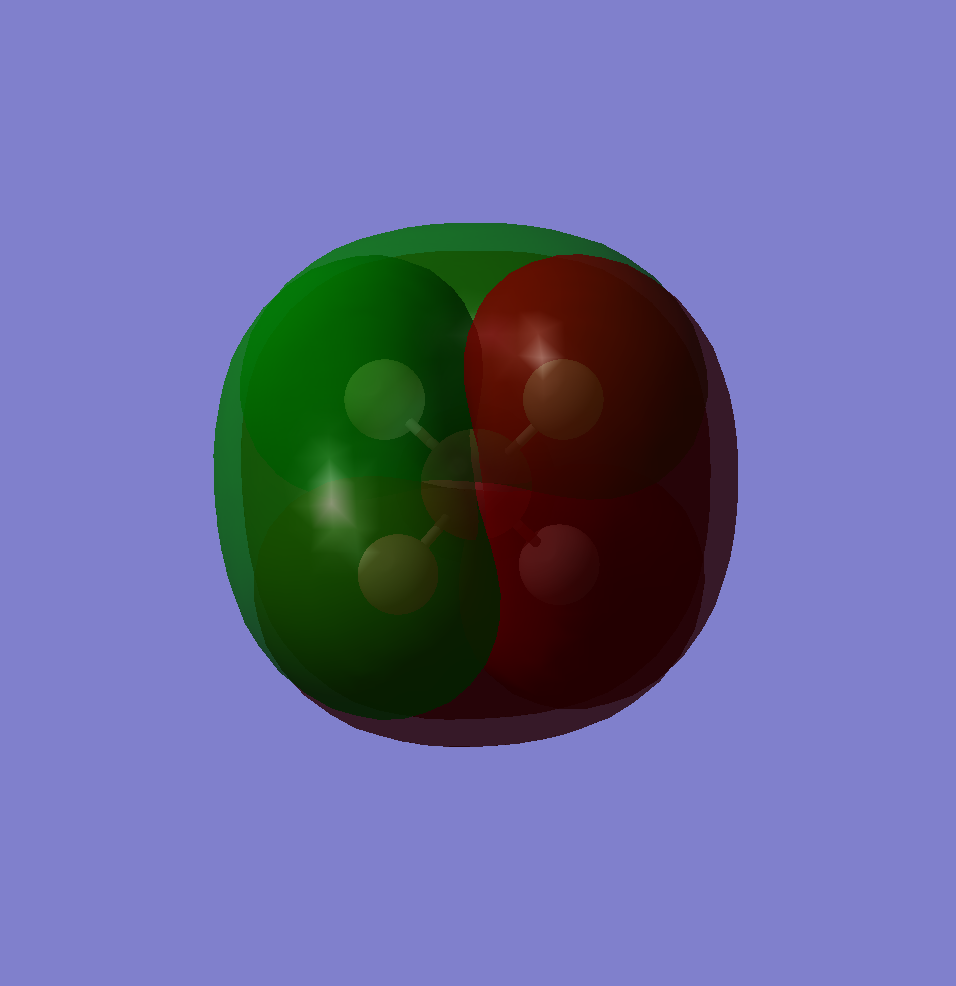

**\[新コーナー\] 今週の分子軌道**（某アニメ風）

密度汎関数理論（DFT）を用いて計算したいろんな分子の分子軌道（MO: Molecular Orbital）を、**特に解説するでもなく**ただひたすら載せるだけの~誰得~コーナーです。一応のポリシーとしては

1.  全分子軌道を乗っける
2.  軌道エネルギーも併せて乗っける
3.  できれば分子軌道係数（Molecular Orbital Coefficient）も乗っける
4.  最後に占有軌道を全部重ねる

みたいな感じです。いつもフロンティア軌道ばっかりちやほやされるので、たまにはその他の膨大な軌道にも思いを馳せてください・・・というのが本音。

今日は第一回目ということで、シンプル・イズ・ザベスト「メタン」の分子軌道をずらずらと並べていきます。~水素分子はシンプルすぎてテンション上がらないから却下。~

**\[メタン\]** 分子式 CH4 モル質量 16.042 g/mol 外観 常温で無色透明の気体 calculated by B3LYP/STO-3G (isovalue = 0.02)

**分子軌道1**: φ1 = 0.99ΦC1s + 0.05ΦC2s 軌道エネルギー: **-272 eV** エネルギー的に**地の底**にある分子軌道。ほぼ**ただの炭素1s軌道**。節0個。 

**分子軌道2**: φ2 = -0.23ΦC1s + 0.63ΦC2s + 4 × 0.18ΦH1s 軌道エネルギー: **\-18 eV** 入ってる電子数: 2 s軌道たちがほどほどに混ざった軌道。C1sの係数はマイナスなので、見えないけど内部に節が一つはあるはず。 

**分子軌道3**: φ3 = 0.58ΦC2pX + 2 × 0.30ΦH1s - 2 × 0.30ΦH1s 軌道エネルギー: **\-10 eV** 入ってる電子数: 2 **縮退その1**。炭素2pと水素1sが、同位相でいい感じに重なった軌道。 

**分子軌道4**: φ4 = 0.58ΦC2pY + 2 × 0.30ΦH1s - 2 × 0.30ΦH1s 軌道エネルギー: **-10 eV** 入ってる電子数: 2 縮退その2。 

**分子軌道5**: φ5 = 0.58ΦC2pZ + 2 × 0.30ΦH1s - 2 × 0.30ΦH1s 軌道エネルギー: **\-10 eV** 入ってる電子数: 2 縮退その3。**こいつら3つがHOMO（最高被占軌道）**。 

**分子軌道6**: φ6 = 1.11ΦC2pX + 2 × 0.63ΦH1s - 2 × 0.63ΦH1s 軌道エネルギー: **+12 eV** 入ってる電子数: 0 **LUMO（最低空軌道）**。HOMOとは逆に、炭素2pと水素1sが逆位相で重なっちゃった軌道。やっぱり３つ縮退している。 

**分子軌道7**: φ7 = 1.11ΦC2pY + 2 × 0.63ΦH1s - 2 × 0.63ΦH1s 軌道エネルギー: **+12 eV** 同上。軌道エネルギーがプラスってことは、電子の気持ちとしては「この軌道に入るぐらいなら真空（0 eV）に飛び出す方がマシ」ということか？ 

**分子軌道8**: φ8 = 1.11ΦC2pZ + 2 × 0.63ΦH1s - 2 × 0.63ΦH1s 軌道エネルギー: **+12 eV** 同上。 

**分子軌道9**: φ9 = -0.26ΦC1s + 1.67ΦC2s + 4 × -0.68ΦH1s 軌道エネルギー: **+13 eV** 最高空軌道（HUMO?）とでもいうべきか。とりあえず節アンド節。 

\[まとめ\] **占有軌道（軌道1～4）を重ね合わせた図** 

今週はここまで！
