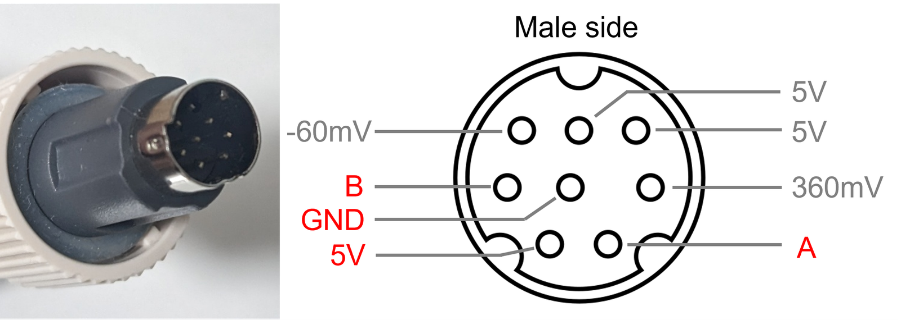
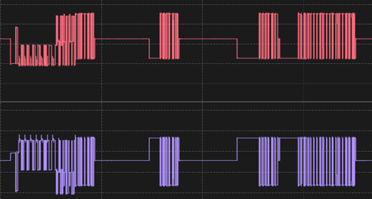
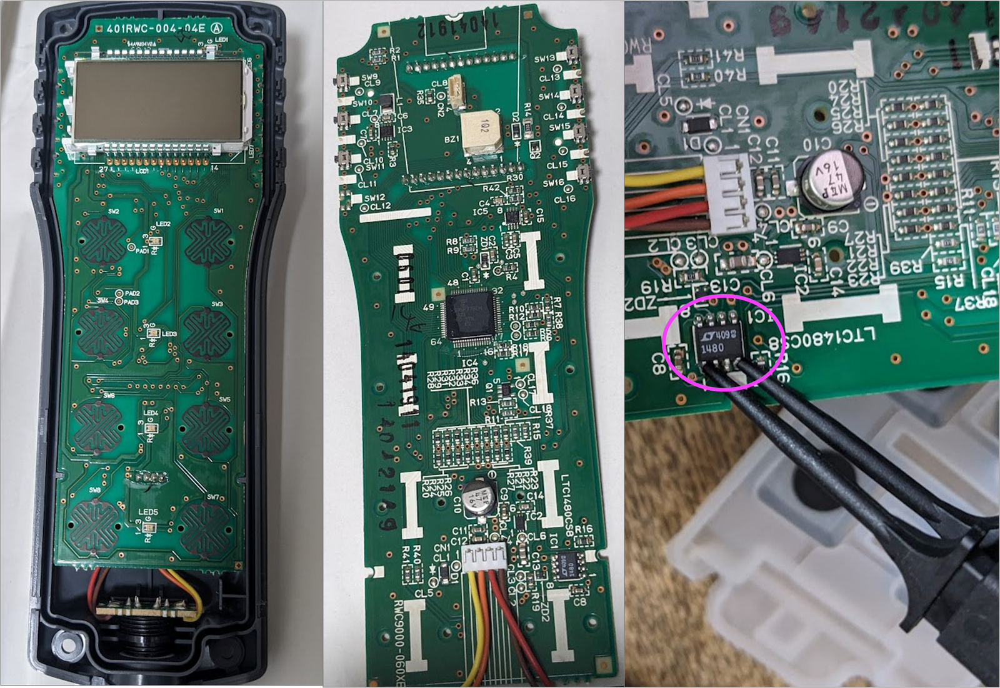
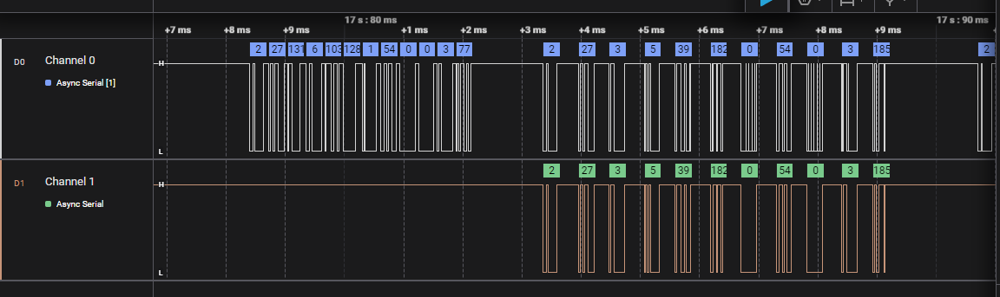
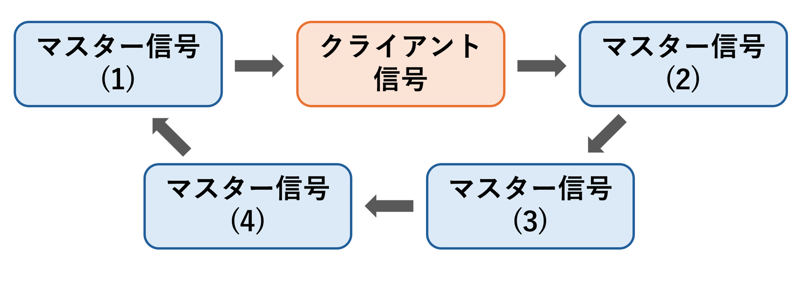
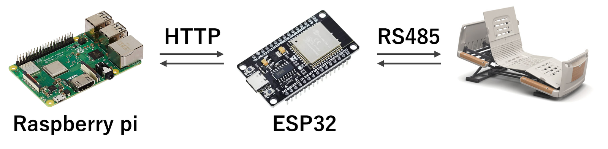
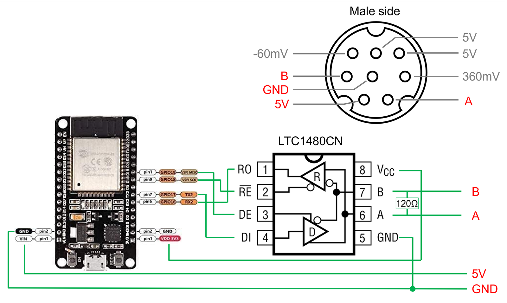
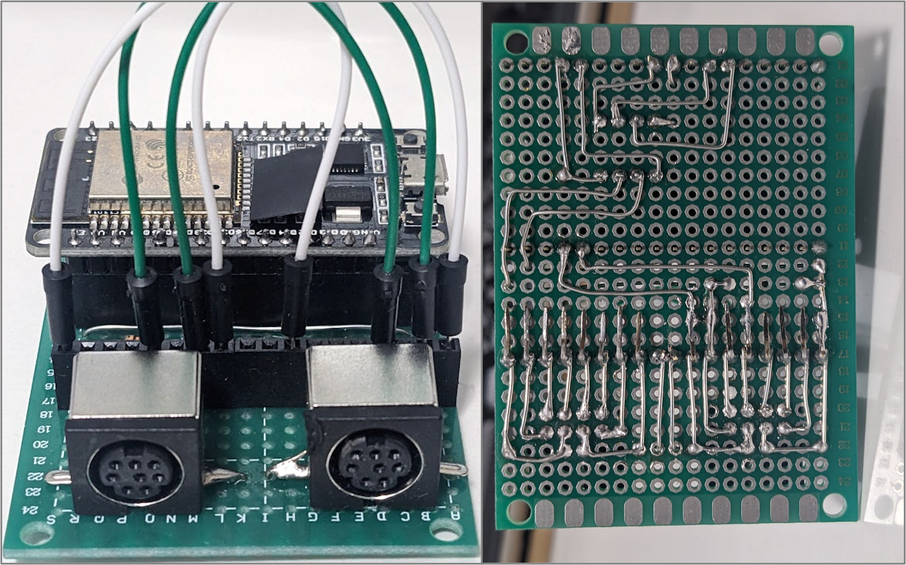

## 概要

**電動ベッドをHTTP通信を介して遠隔・自動で動かせるようにした。** （動画）

## 動機

私は朝が苦手で、目覚まし時計をいくらセットしても無意識に止めてしまうタイプ。起床に失敗するたびに、どうにかして絶対に起きる仕組みが出来ないかと考えていた。そこで着目したのが電動ベッド。**起床時刻になったらベッドを睡眠不能なレベルで動かし続けることで、睡眠を物理的に妨害**できないか、というのが今回の着想。

中でも良さそうだと思ったのが、パラマウントベッドの「楽匠Z」シリーズ。


[パラマウントベッド・楽匠3モーション KQ-7331](https://www.paramount.co.jp/cms/parabed/pdf/rakusho-z.pdf)

電動というか介護用ベッドだが、普通の電動ベッドとは異なり、頭部だけでなく足部の角度、さらにはベッド全体の傾きまで制御できることが特徴。このベッドを使えばいくら私でも確実に起床できるのではないか。本来定価では数十万円する超高級品だが、比較的中古市場で活発に出回っている。今回は美品を8万円程度で手に入れることが出来たので、これを**Raspberry PiやESP32を使って遠隔自動操作する**ためのシステムを作っていく。

## 自動化方法

楽匠Zは本来写真の有線リモコン（HS28C3）を使って操作する。赤外線リモコンの場合、赤外線信号そのもののコピーをする方法論が確立している（例）が、有線リモコンなのでその方法は取れない。機械的にボタンを押す仕組みも考えられるが、手動操作が出来なくなるため不便である。そこで、実際に**有線リモコンとベッド本体の間の通信内容を解析**し、マイコンを用いてリモコン通信をエミュレートすることにした。

## リモコン信号解析

### 電圧・ロジアナ測定

リモコンをベッドへと接続する端子形状はミニdin 8ピンコネクタ（下図）。まずはミニdin 8ピンのメスコネクタ2つとミニdin 8ピンケーブルを使って、電圧や信号をモニタリングするためのテストポイントを作製した。なお、ベッド本体側のミニdin 8ピンの差込口周りに差し込み角度固定用のレールが掘ってあり、クリアランスが厳しい。私が買ったケーブルは差込口周りが太すぎたので、少し削ることで対応した。



テスターを使って電圧チェックしたところ、上手の通り、**実質4 pin（赤字）だけを使ったシリアル通信**であることが判明した。そこで、ロジックアナライザ（Saleae Logic 8）を用いてピンAとピンBの解析をしたところ、下図のとおりお互いに逆位相のデジタル信号ペア、すなわち差動シリアル信号らしき波形が得られた。電圧等の諸条件を考慮して、通信規格は**RS485**だと推測された。



### リモコン分解

Logic 8では差動信号を直接読みとれないので、RS485ドライバで変換後のUART信号を読み取ることにした。そこで、リモコンを分解した。写真が下の通り。背面のネジを全て外した後に、左右に4箇所ほどあるツメを薄いもので外すことで開けることが出来る。今回は使わなかったが、裏面にデバッグ用らしき穴とコネクタがある。



*楽匠Z リモコン 分解図*

予想通り、8pinのうち4pinだけが使用されていた。3.3V駆動のRS485ドライバである**LTC1480**（ピンクの丸で囲った部分）があり、確かにRS485通信を使っていることが分かる。

### UART信号解析

LTC1480のRO端子・DI端子にロジアナのプローブを接続して測定した。**ボーレート = 38400**で末尾に**偶数パリティ**を持つUART通信だと仮定することで、下図の通り**バイト列の読み取りに成功**した（Ch0: RO, Ch1: DI）。



通信プロトコルについて、Modbus等の一般的なプロトコルの可能性を一通り検討したが、該当するものは見つけられなかった。探し方が悪かったのか、あるいは独自プロトコルを使っているのかもしれない。

仕方ないので、人力で信号パターンの解析を行った。下記のように4種類のマスター信号と1種類のスレーブ信号を以下のようにループしているようだ。テキストではなく生のバイト列を使ってやり取りしているようだが、いくつかのバイトは複数の情報の足し合わせで構成されているように見えることから、**正確にはバイトではなくビット単位で管理している**と思われる。



リモコン操作時にやりとりされるバイト列を解析することで、具体的なメッセージの内容を以下の通り推測した。かなり不完全で、特に「意味」の部分は推測の域を出ないが、目的を達成する程度の理解は出来た。動作制御において大事なのはマスター信号(4)とスレーブ信号の2つで、他の信号についてはあまり深く調べていない。

#### マスター信号 (1)

-   通信番号「27」で有線リモコンと接続するための信号と思われる
-   接続状態によってデータ長が変化

##### 1A: 未接続

-   第2バイトの値が129（未接続）
-   総バイト数 = 6, データ長 = 0
-   ハンドシェイクのためのトリガー信号か

| 位置 | 意味 | 値 |
| --- | --- | --- |
| 0 | ヘッダ（STX） | 2 |
| 1 | 通信識別子 | 27 |
| 2 | 接続コマンド | 129（未接続） |
| 3 | データ長 | 0 |
| 4 | ETX | 3 |
| 5 | XORチェックサム | STXを除いて計算 |

##### 1B: 接続開始中

-   第2バイトの値が130（接続開始中）
-   総バイト数 = 22, データ長 = 16
-   ハンドシェイクを司る信号と考えられるが、殆どが未解読

| 位置 | 意味 | 値 |
| --- | --- | --- |
| 0 | ヘッダ（STX） | 2 |
| 1 | 通信識別子 | 27 |
| 2 | 接続コマンド | 130（接続開始中） |
| 3 | データ長 | 16 |
| 4 | 不明 | 75 |
| 5 | 不明 | 30 |
| 6 | 前回動作モードの現在値 | 8ビット整数 |
| 7 | 不明 | 0 |
| 8 | 不明 | 0 |
| 9 | 不明 | 21 |
| 7 | 不明 | 0 |
| 8 | 不明 | 0 |
| 7 | 不明 | 18 |
| 8 | 不明 | 0 |
| 8 | 不明 | 0 |
| 9 | 不明 | 21 |
| 7 | 不明 | 1 |
| 9 | 不明 | 14 |
| 7 | 不明 | 1 |
| 8 | 不明 | 0 |
| 11 | エンドマーク （ETX） | 3 |
| 12 | XORチェックサム | STXを除いて計算 |

##### 1C: 接続確立済

-   第2バイトの値が131（接続確立済）
-   総バイト数 = 12, データ長 = 6
-   リモコンの液晶表示に必要な情報を含んでいる

| 位置 | 意味 | 値 |
| --- | --- | --- |
| 0 | ヘッダ（STX） | 2 |
| 1 | 通信識別子 | 27 |
| 2 | 接続コマンド | 131（接続確立済） |
| 3 | データ長 | 6 |
| 4 | 動作モード | 待機（バックライトOFF）: 0<br>待機（表示OFF）: 32<br>待機（表示ON）: 96<br>頭部up: 98, down: 99<br>足部up: 100, down: 101<br>高さup: 102, down: 103<br>連動up: 104, down: 105 |
| 5 | 不明 | 128 |
| 6 | 不明 | 1 |
| 7 | 動作中モードの現在値 | 8ビット整数 |
| 8 | 不明 | 0 |
| 9 | 不明 | 0 |
| 11 | エンドマーク （ETX） | 3 |
| 12 | XORチェックサム | STXを除いて計算 |

#### スレーブ信号

-   総バイト数 = 11, データ長 = 5
-   マスター信号(1)が終わってからマスター信号(2)が開始されるまでに送信する必要がある
-   接続状態を未接続 –> 接続開始中 –> 接続確立済へと切り替えていく必要がある
-   「設定変更フラグ」を1にすると、その際に指定した「動作速度」がベッド本体に設定される。その際、動作モードが「待機」になっている必要がある

| 位置 | 意味 | 値 |
| --- | --- | --- |
| 0 | ヘッダ（STX） | 2 |
| 1 | 通信識別子 | 27 |
| 2 | 接続コマンド | 未接続: 1<br>接続開始中: 2<br>接続確立済: 3 |
| 3 | データ長 | 5 |
| 4 | 動作モード | 待機: 32<br>頭部up: 34, down: 35<br>足部up: 36, down: 37<br>高さup: 38, down: 39<br>連動up: 40, down: 41<br>メモリモード有効時: +128 |
| 5 | 動作速度 | 頭部低速/高さ低速: 144<br>頭部高速/高さ低速: 176<br>頭部低速/高さ高速: 148<br>頭部高速/高さ高速: 180<br>サイドボタン押下時: +2 |
| 6 | 設定変更フラグ | 設定変更しない: 0<br>設定変更する: 1 |
| 7 | 動作中モードの現在値 | 8ビット整数 |
| 8 | 不明 | 0 |
| 9 | エンドマーク （ETX） | 3 |
| 10 | XORチェックサム | STXを除いて計算 |

#### マスター信号 (2)

-   総バイト数 = 6, データ長 = 0
-   通信番号「26」で接続されるスレーブ機器（未使用）に対するハンドシェイク用か
-   スレーブ信号の有無に関わらず、マスター信号(1)が送信された約10 ms後には送信される

| 位置 | 意味 | 値 |
| --- | --- | --- |
| 0 | ヘッダ（STX） | 2 |
| 1 | 通信識別子 | 26 |
| 2 | 接続コマンド | 129（未接続） |
| 3 | データ長 | 0 |
| 4 | エンドマーク （ETX） | 3 |
| 5 | XORチェックサム | STXを除いて計算 |

#### マスター信号 (3)

-   総バイト数 = 6, データ長 = 0
-   通信番号「2」で接続されるスレーブ機器（未使用）に対するハンドシェイク用か

| 位置 | 意味 | 値 |
| --- | --- | --- |
| 0 | ヘッダ（STX） | 2 |
| 1 | 通信識別子 | 2 |
| 2 | 接続コマンド | 129（未接続） |
| 3 | データ長 | 0 |
| 4 | エンドマーク （ETX） | 3 |
| 5 | XORチェックサム | STXを除いて計算 |

#### マスター信号 (4)

-   総バイト数 = 18, データ長 = 12
-   全スレーブ機器に対する共通信号か
-   ベッドの状態に関する最も豊富な情報を含む信号

| 位置 | 意味 | 値 |
| --- | --- | --- |
| 0 | ヘッダ（STX） | 2 |
| 1 | 通信識別子 | 255 |
| 2 | 通信状態 | 通信中: 241<br>通信終了: 255 |
| 3 | データ長 | 12 |
| 4 | 動作モード | 待機: 0<br>メモリモード: 1<br>頭部up: 2, down: 3<br>足部up: 4, down: 5<br>高さup: 6, 高さdown: 7<br>連動up: 8, 連動down: 9<br>らくらくモードON: +128 |
| 5 | 頭部角度 | 8ビット整数 |
| 6 | 足部角度 | 8ビット整数 |
| 7 | 高さ | 8ビット整数 |
| 8 | 傾き | 8ビット整数 |
| 9 | 不明 | 0 |
| 10 | 頭部動作速度と動作箇所 | 待機: 0<br>頭部: 17<br>足部: 18<br>高さ: 35<br>連動: 20（動作中）or 21（停止中）<br>頭部低速: +0<br>頭部高速: +64<br>高速化対象動作中: +128 |
| 11 | シリンダ状態 | 停止中: 0<br>動作中: 1, 2, 4, 5, 8, 10など<br>動作不能: 16 |
| 12 | 高さ動作速度 | 高速: 24<br>低速: 8 |
| 13 | 不明 | 0 |
| 14 | 動作シリンダ | 停止: 0<br>頭部: 128<br>足部: 160<br>高さ: 192 |
| 15 | 不明 | 2 |
| 16 | エンドマーク （ETX） | 3 |
| 17 | XORチェックサム | STXを除いて計算 |

## 自動化システム作製

### 全体構成

ESP32をRS485クライアント兼HTTPサーバー（HTTP-RS485ブリッジ）、Raspberry pi 3B+をHTTPクライアントとした。ESP32とRaspberry piはwifiで自宅LANに接続する。ESP32とベッドはmini DINケーブルで接続する。



### HTTP-RS485ブリッジ

#### 接続図

ESP32のGPIOとLTC1480CN8を以下のように接続した。Receiver OutputをGPIO16に、Driver InputをGPIO17に、Receiver EnableをGPIO18に、Driver EnableをGPIO19にそれぞれ接続している。Mini DINの5 V電源でESP32を駆動し、ESP32開発ボード内臓の3.3 V降圧回路を利用してLTC1480CN8に給電している。終端抵抗は120 Ω。



-   千石電商: [MJ-373/8B8P ミニDINソケット](https://www.sengoku.co.jp/mod/sgk_cart/detail.php?code=62SA-3PDW)
-   秋月電子: [LTC1480CN8](https://akizukidenshi.com/catalog/g/g116602/) （より廉価な5V駆動でも良いかも）
-   秋月電子: [カーボン抵抗 120Ω](https://akizukidenshi.com/catalog/g/g107804/)
-   ESP32-DevKitC ESP-WROOM-32開発ボード
-   Mini DIN 8ピン オス-オス ケーブル

#### 写真



接続図とは異なり、ミニdinコネクタが２つ付いている。これは有線リモコンも同時接続して手動操作も出来るようにと設計したものだが、楽匠Z自体がリモコンの接続口を2つ持っているので不要（後で気付いた）。上面に生えてるICソケットはテストポイント用なのでこれも動作には不要。背面は無駄に複雑な配線に見えるが、よく見るとマイコンと接続されているのは4本だけ。

#### プログラム

リポジトリ:

```cpp
#include <WiFi.h>
#include <ESPAsyncWebServer.h>
#include <HardwareSerial.h>

//////////////////////////////////////////////////////////////////////////////
// RS485 pin definitions
#define RX_PIN 16 // RX pin
#define TX_PIN 17 // TX pin
#define RE_PIN 18 // Receiver Enable
#define DE_PIN 19 // Driver Enable

//////////////////////////////////////////////////////////////////////////////
// Wi-Fi settings
const char* ssid = "SSID";             // Wi-Fi SSID
const char* password = "PASSWORD";     // Wi-Fi PASSWORD
IPAddress local_ip(192, 168, 100, 3);  // Fixed IP Address
IPAddress gateway(192, 168, 100, 1);   // Gateway IP Address
IPAddress subnet(255, 255, 255, 0);    // Subnet mask

//////////////////////////////////////////////////////////////////////////////

// Tx commands
const uint8_t WAIT        = 32;
const uint8_t HEAD_UP     = 34;
const uint8_t HEAD_DOWN   = 35;
const uint8_t FOOT_UP     = 36;
const uint8_t FOOT_DOWN   = 37;
const uint8_t HEIGHT_UP   = 38;
const uint8_t HEIGHT_DOWN = 39;
const uint8_t MULTI_UP    = 40; // Head up after foot up
const uint8_t MULTI_DOWN  = 41; // Head down and foot down

// Rate commands
const uint8_t HEAD_SLOW_HEIGHT_SLOW = 144;
const uint8_t HEAD_FAST_HEIGHT_SLOW = 176;
const uint8_t HEAD_SLOW_HEIGHT_FAST = 148;
const uint8_t HEAD_FAST_HEIGHT_FAST = 180;

// Connection State
const uint8_t DISCONNECTED = 1;
const uint8_t HANDSHAKING  = 2;
const uint8_t CONNECTED    = 3;

// Set flag
const uint8_t SET_OFF = 0;
const uint8_t SET_ON  = 1;

//////////////////////////////////////////////////////////////////////////////

// Message Receiving State
typedef enum {
  WAIT_FOR_STX,
  CONN_ID,
  CONN_CMD,
  DATA_LENGTH,
  PAYLOAD,
  CHECKSUM,
} MessageState;

// Recieved Message
struct Message {
  MessageState state;     // Message Receiving State
  uint8_t connection_id;  // Connection ID
  uint8_t connection_cmd; // Connection command
  uint8_t data_length;    // Data length
  uint8_t payload[128];   // Received payload data
  uint8_t current_pos;    // Current index position
  uint8_t calcd_checksum; // Checksum calculated by received byte array
  bool is_valid;          // Checksum verification result

  void init() {
    state = WAIT_FOR_STX; 
    connection_id = 0;
    connection_cmd = 0;
    data_length = 0;
    current_pos = 0;
    calcd_checksum = 0;
    is_valid = false;
    memset(payload, 0, sizeof(payload));
  }

  bool updateMessage(uint8_t rb) {  
    switch (this->state) {
      case WAIT_FOR_STX:
        if (rb == 0x02) {
          this->init();
          this->state = CONN_ID;
        }
        return false;
      case CONN_ID:
        this->connection_id = rb;
        this->calcd_checksum ^= rb;
        this->state = CONN_CMD;
        return false;
      case CONN_CMD:
        this->connection_cmd = rb;
        this->calcd_checksum ^= rb;
        this->state = DATA_LENGTH;
        return false;
      case DATA_LENGTH:
        this->data_length = rb;
        this->calcd_checksum ^= rb;
        this->state = PAYLOAD;
        return false;
      case PAYLOAD:
        if (this->current_pos < this->data_length) {
          this->payload[this->current_pos++] = rb;
          this->calcd_checksum ^= rb;
        } else if (rb == 0x03) {
          this->calcd_checksum ^= rb;
          this->state = CHECKSUM;
        } else {
          Serial.println("ERROR: ETX NOT FOUND");
          this->state = WAIT_FOR_STX;
        }
        return false;
      case CHECKSUM:
        this->is_valid = (this->calcd_checksum == rb);
        this->state = WAIT_FOR_STX;
        return true;
    }
  }
};

// Current bed state
struct BedState {
  uint8_t motor_state;
  uint8_t rate;
  uint8_t height;
  uint8_t head;
  uint8_t foot;
  uint8_t tilt;
  uint8_t prev_height;
  uint8_t prev_head;
  uint8_t prev_foot;
  uint8_t prev_tilt;

  uint8_t getRate(uint8_t head_rate_byte, uint8_t height_rate_byte) {
    if ((head_rate_byte & 0x40) != 0) {
      if (height_rate_byte == 24) {
        return HEAD_FAST_HEIGHT_FAST;
      } else {
        return HEAD_FAST_HEIGHT_SLOW;
      }
    } else {
      if (height_rate_byte == 24) {
        return HEAD_SLOW_HEIGHT_FAST;
      } else {
        return HEAD_SLOW_HEIGHT_SLOW;
      }
    }
  }

  void updateState(const uint8_t payload[12]) {
    this->head = payload[1];
    this->foot = payload[2];
    this->height = payload[3];
    this->tilt = payload[4];
    this->rate = this->getRate(payload[6], payload[8]);
    this->motor_state = payload[7];
  }

  void captureState() {
    this->prev_height = this->height;
    this->prev_head = this->head;
    this->prev_foot = this->foot;
    this->prev_tilt = this->tilt;
  }

  bool hasChanged() {
    bool height_moving = (this->height != this->prev_height);
    bool head_moving = (this->head != this->prev_head);
    bool foot_moving = (this->foot != this->prev_foot);
    bool tilt_moving = (this->tilt != this->prev_tilt);
    return (height_moving || head_moving || foot_moving || tilt_moving);
  }

};

// Operation
struct Operation {
  uint8_t mode;
  uint8_t rate;
  uint8_t target_value;
  uint8_t non_move_count;
  bool is_active;

  void init() {
    mode = WAIT; 
    target_value = 0;
    non_move_count = 0;
    rate = HEAD_SLOW_HEIGHT_SLOW;
    is_active = false;
  }

  void setMode(const String& cmd_str) {
    // cmd_str.toUpperCase();
    if (cmd_str == "HEIGHT_UP") {
      this->mode = HEIGHT_UP;
    } else if (cmd_str == "HEIGHT_DOWN") {
      this->mode = HEIGHT_DOWN;
    } else if (cmd_str == "HEAD_UP") {
      this->mode = HEAD_UP;
    } else if (cmd_str == "HEAD_DOWN") {
      this->mode = HEAD_DOWN;
    } else if (cmd_str == "FOOT_UP") {
      this->mode = FOOT_UP;
    } else if (cmd_str == "FOOT_DOWN") {
      this->mode = FOOT_DOWN;
    } else if (cmd_str == "MULTI_UP") {
      this->mode = MULTI_UP;
    } else if (cmd_str == "MULTI_DOWN") {
      this->mode = MULTI_DOWN;
    } else {
      this->mode = 0x00;
    }
  }

  bool hasReachedTarget(BedState bs) {
    switch (this->mode) {
      case FOOT_UP:
        return (bs.foot > this->target_value);
        break;
      case FOOT_DOWN:
        return (bs.foot < this->target_value);
        break;
      case HEAD_UP:
        return (bs.head > this->target_value);
        break;
      case HEAD_DOWN:
        return (bs.head < this->target_value);
        break;
      case HEIGHT_UP:
        return (bs.height > this->target_value);
        break;
      case HEIGHT_DOWN:
        return (bs.height < this->target_value);
        break;
      case MULTI_UP:
        return (bs.tilt > this->target_value);
        break;
      case MULTI_DOWN:
        return (bs.tilt < this->target_value);
        break;
      default:
        return true;
    }
  }

};

//////////////////////////////////////////////////////////////////////////////

// Global variables
HardwareSerial mainSerial(2);
Message msg = {WAIT_FOR_STX, 0, 0, 0, {}, 0, 0, false};
BedState bed_state = {0, HEAD_SLOW_HEIGHT_SLOW, 0, 0, 0, 0, 0, 0, 0, 0};
Operation operation = {WAIT, HEAD_SLOW_HEIGHT_SLOW, 0, 0, false};
AsyncWebServer server(80);
unsigned long enabled_time = 0;

//////////////////////////////////////////////////////////////////////////////

// Print a message in the serial monitor for debugging
void debugPrint() {
  char c_id[4], c_cmd[4], num[4];
  sprintf(c_id, "%03d", msg.connection_id);
  sprintf(c_cmd, "%03d", msg.connection_cmd);
  Serial.print("[" + String(c_id) + "][" + String(c_cmd) + "] ");
  for (uint8_t i = 0; i < msg.data_length; i++) {
    sprintf(num, "%03d", msg.payload[i]);
    Serial.print(num);
    Serial.print(" ");
  }
  Serial.println();
}

// XOR checksum calculation (excluding STX)
uint8_t calcChecksum(const uint8_t* tx_data, size_t data_len) {
  uint8_t checksum = 0x00;
  for (size_t i = 1; i < data_len - 1; ++i) {
    checksum ^= tx_data[i];
  }
  return checksum;
}

// Build and send a command
void sendData(
  uint8_t cmd,
  uint8_t conn_state,
  uint8_t motion_rate,
  uint8_t set_flag,
  uint8_t current_value
) {
  // Build byte array
  uint8_t tx_data[11];
  tx_data[0] = 0x02;                       // STX
  tx_data[1] = 0x1b;                       // Connection ID
  tx_data[2] = conn_state;                 // Connection State
  tx_data[3] = 0x05;                       // Data length
  tx_data[4] = cmd;                        // Tx cmd
  tx_data[5] = motion_rate;                // Motion Rate
  tx_data[6] = set_flag;                   // Set flag
  tx_data[7] = current_value;              // Current Value    
  tx_data[8] = 0x00;                       // Always zero
  tx_data[9] = 0x03;                       // ETX
  tx_data[10] = calcChecksum(tx_data, 11); // XOR checksum

  // Send
  digitalWrite(DE_PIN, HIGH);
  for (int i = 0; i < sizeof(tx_data); i++) {
    mainSerial.write(tx_data[i]);
    ets_delay_us(574);
  }
  digitalWrite(DE_PIN, LOW);

}

// Setup
void setupRS485() {
  pinMode(DE_PIN, OUTPUT);
  pinMode(RE_PIN, OUTPUT);
  digitalWrite(DE_PIN, LOW);
  digitalWrite(RE_PIN, LOW);
  mainSerial.begin(38400, SERIAL_8E1, RX_PIN, TX_PIN);
}

// Main loop
void loopRS485() {

  if (mainSerial.available() == 0) return;
  uint8_t rb = mainSerial.read();
  if (!msg.updateMessage(rb)) return;
  if (!msg.is_valid) return;
  debugPrint();
  if (!operation.is_active) return;

  switch (msg.connection_id) {
    case 2:
      break;
    case 26:
      break;

    case 27:
      ets_delay_us(700); // to avoid signal overlapping
      if (msg.connection_cmd == 129) {
        sendData(WAIT, DISCONNECTED, bed_state.rate, SET_OFF, 0);
        Serial.println("CONNECTING: STATE 0");
        return;
      }
      if (msg.connection_cmd == 130) {
        sendData(WAIT, HANDSHAKING, bed_state.rate, SET_OFF, 0);
        Serial.println("CONNECTING: STATE 1");
        return;
      }
      if (msg.connection_cmd == 131) {
        if (bed_state.rate != operation.rate) {
          if (bed_state.motor_state != 0) {
            sendData(WAIT, CONNECTED, bed_state.rate, SET_OFF, 0);
          } else {
            sendData(WAIT, CONNECTED, operation.rate, SET_ON, 0);
          }
          Serial.println("SETTING: MOTION RATE");
          return;
        }
        if (operation.hasReachedTarget(bed_state)) {
          operation.init();
          Serial.println("FINISHED: REACHED TARGET VALUE");
          return;
        }
        if (bed_state.hasChanged()) {
          operation.non_move_count = 0;
        } else {
          operation.non_move_count += 1;
        }
        if (operation.non_move_count < 80) {
          sendData(operation.mode, CONNECTED, bed_state.rate, SET_OFF, msg.payload[3]);
        } else if (operation.non_move_count < 82) {
          sendData(WAIT, CONNECTED, bed_state.rate, SET_OFF, msg.payload[3]);
        } else if (operation.non_move_count < 160) {
          sendData(operation.mode, CONNECTED, bed_state.rate, SET_OFF, msg.payload[3]);
        } else {
          operation.init();
          Serial.println("FINISHED: MAX NON-MOVING COUNT");
        }
        bed_state.captureState();
      }
      break;

    case 255:
      bed_state.updateState(msg.payload);
      if (bed_state.motor_state > 10) {
        operation.init();
        enabled_time = millis() + 180000;
        Serial.println("ERROR: OVERHEAT DETECTED");
      }
      break;
  }
}

//////////////////////////////////////////////////////////////////////////////

// Setup Wifi and Server
void setupWiFiAndServer() {
  WiFi.config(local_ip, gateway, subnet);
  WiFi.begin(ssid, password);

  while (WiFi.status() != WL_CONNECTED) {
    delay(1000);
    Serial.println("Connecting to WiFi...");
  }
  Serial.println("Connected to WiFi");
  Serial.print("IP Address: ");
  Serial.println(WiFi.localIP());

  // Define POST request handler
  server.on("/move", HTTP_POST, [](AsyncWebServerRequest *request){

    // Reset operation
    operation.init();

    // Get command
    if (!request->hasParam("command", true)) {
      request->send(
        400, "text/plain",
        "Missing parameter: 'command'\n"
      );
      return;
    }
    String cmd_str = request->getParam("command", true)->value();
    operation.setMode(cmd_str);
    if (operation.mode == 0) {
      request->send(
        400, "text/plain",
        "Invalid command: " + cmd_str + "\n"
      );
      return;
    }

    // Get value
    if (!request->hasParam("value", true)) {
      request->send(
        400, "text/plain",
        "Missing parameter: 'value'\n"
      );
      return;
    }
    int value = request->getParam("value", true)->value().toInt();
    operation.target_value = value;
    if (value < 0) {
      request->send(
        400, "text/plain",
        "Invalid value for command: " + cmd_str + "\n"
      );
      return;
    }

    // Get rate
    if (request->hasParam("rate", true)) {
      String rate_str = request->getParam("rate", true)->value();
      rate_str.toUpperCase();
      if (rate_str == "FAST") {
        operation.rate = HEAD_FAST_HEIGHT_FAST;
      } else if (rate_str == "SLOW") {
        operation.rate = HEAD_SLOW_HEIGHT_SLOW;
      }
    }

    // Check overheat
    signed long rest_time = enabled_time - millis();
    if (rest_time > 0) {
      request->send(
        500, "text/plain", 
        "Motors are in overheat. Wait for " + 
        String(rest_time / 1000) + " seconds\n"
      );
      return;
    }

    // Execute the command
    sendData(WAIT, DISCONNECTED, operation.rate, SET_OFF, 0x00);
    operation.is_active = true;

    // Send response
    request->send(
        200, "text/plain",
        "Command executed: " + cmd_str + 
        " with value " + String(value) + "\n"
    );
  });

  server.begin();
}

//////////////////////////////////////////////////////////////////////////////

void setup() {
  Serial.begin(115200);
  setupWiFiAndServer();
  setupRS485();
}

void loop() {
  loopRS485();
}
```

基本的な動作は以下の通り

1.  HTTPクライアントからの命令を受信
2.  マスターとのコネクション開始
3.  コネクションが取れたら、まず速度を設定し、あとは以下のループ
    1.  マスター通信(4)から現在情報取得
    2.  1で設定値に達してしばらく経過したら通信終了
    3.  設定値に達していない場合はクライアント通信で命令継続

設定値に達してからしばらく待つのは、角度が「0」だと伝達されても、実際には少し角度がついているため。また、（詳細は省くが）メモリ機能による動作中断を避けるためでもある。その他、オーバーヒート検出にも対応している。

#### HTTP API

-   POSTのクエリ文字列で命令する単純な方式にした。
-   エンドポイントは「ホスト名/move」
-   command: 動作命令, value: 目標値, rate: 動作速度

| command | value | rate |
| --- | --- | --- |
| HEAD\_UP<br>HEAD\_DOWN<br>FOOT\_UP<br>FOOT\_DOWN<br>HEIGHT\_UP<br>HEIGHT\_DOWN<br>MULTI\_UP<br>MULTI\_DOWN | 任意整数 | FAST<br>SLOW |

-   リクエスト例（足部を高速で角度10まで上昇）

    ```bash
    curl -X POST http://192.168.100.3/move -d "command=FOOT_UP&value=10&rate=Fast"
    ```

### HTTPクライアント

Raspberry pi 3B+を使用。たとえば以下のシェルスクリプトを実行することで冒頭の動画の動きを実現できる。

```
#!/bin/bash

for i in {1..100}
do
  curl -X POST http://192.168.100.3/move -d "command=FOOT_UP&value=10&rate=FAST"
  sleep 10
  curl -X POST http://192.168.100.3/move -d "command=FOOT_DOWN&value=0&rate=FAST"
  sleep 10
done
```

このスクリプトをcronで定時実行することで、今回の目的が達成される。

## 結論

以上のように、電動ベッド「楽匠Z」のリモコン信号を解析し、ESP32を用いた自動制御に成功した。実際に今このシステムを運用していて、とりあえず指定時刻に目が覚めないということは無くなった。動き続ける上に手軽に止める手段が無いので、二度寝防止にも効果的なようだ。ただ一方で、ここまでやってもどうにかして寝続けようとする自分もいるが……。
