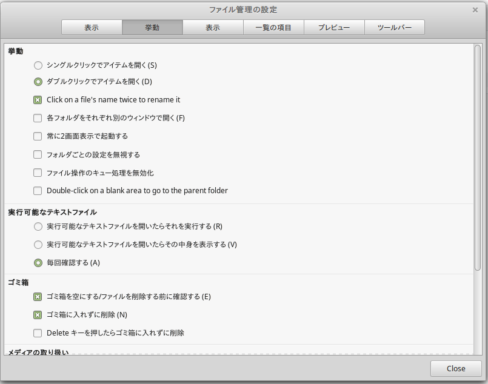

小ネタです。 Linux Mintの公式ファイラー「Nemo」ではファイル名を変更するには、デフォルトでは以下の2つの方法があります。

1.  ファイルアイコンを右クリック → 名前を変更（R）
2.  ファイルアイコンを選択した状態で「F2」

ただ、Windowsも使っている身としては「ファイルを選択」→「ファイル名を左クリック」でもリネームしたくなります。

Nemoでそれを実現するには、メニューバーの「編集」→「設定」→「挙動」から「Click on a file’s name twice to rename it」のチェックボックスをONにすればokです。

