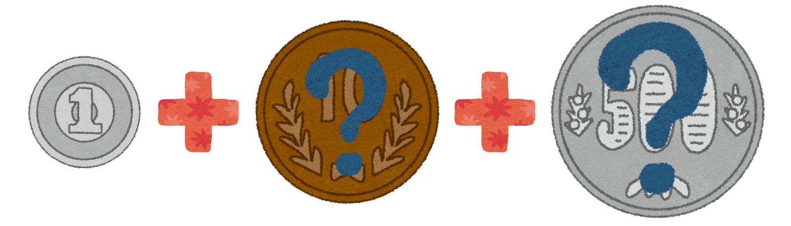
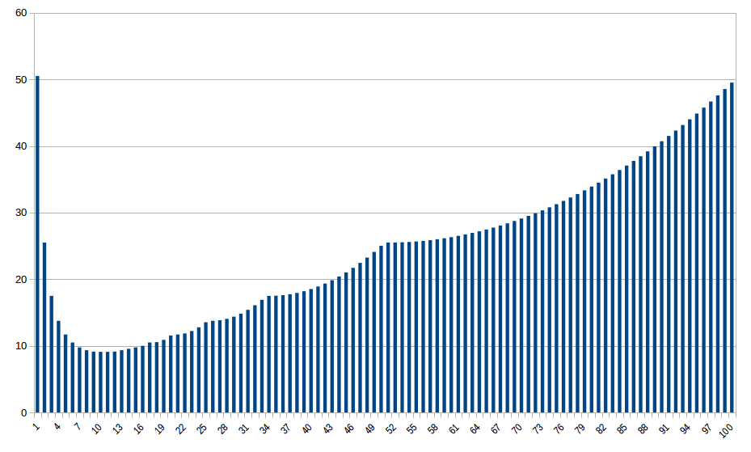
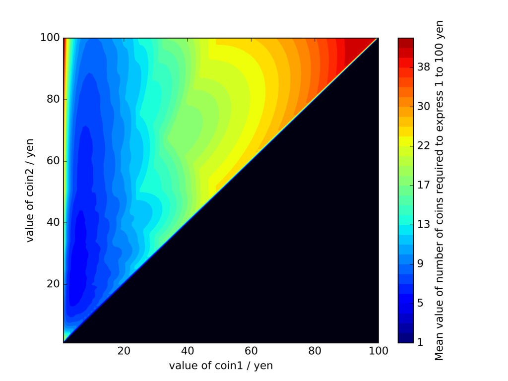
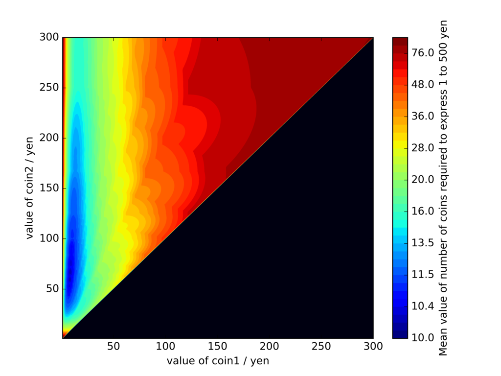

## 導入

[前回](/blog/change-frequency-simulation/)の記事のおまけです。

前の記事では、「財布の中の小銭の量を最小限にする」人達の支払い方に着目したわけですが、そもそも**財布の中身が少なくなるような硬貨の額面**ってどんなものなんでしょうか。言い換えれば、**任意の金額を表現するために必要な硬貨の合計枚数の期待値が最小**となるような貨幣の構成とは、額面がいくらの硬貨で構成されるのでしょうか？



まともに考えると答えづらい問いです。お金の取引というのは、5円チョコ一個の購入から、（現金のやり取りがあるかは別として）何百億円という国家公共工事の予算まで千差万別な訳で、ターゲットとする金額帯によって答えが変わるはずです。現実世界では、使用頻度や計算上の利便性、他通貨とのバランス等を考慮して、貨幣の額面を決めているのでしょう。

## 枚数期待値を考える（硬貨が2種類の場合）

ここでは話をうんと単純化して、まず最初に、**2種類の硬貨で1〜100円の全金額を表す時の枚数期待値**を考えてみることにします。2種類と言いましたが、1〜100円をもれなく表すためには、片方は当然1円玉でないといけないので、もう一種類の貨幣の額面を考えてやればいいだけです。簡単なので、早速結果を示します。



 横軸が（1円玉で無い方の）貨幣の額面、縦軸が（1〜100円までを表すために必要な）硬貨の合計枚数期待値です。額面が10円および11円の時に枚数期待値は最小値（9.1枚）となります。**1円と10円の組み合わせは結構優秀**なんですね。そこから額面が上がると合計枚数期待値は曲線に従って単調増加しますが、ところどころ微妙に不連続になっています。不連続点は51円, 34円, 26円, 21円にあり、要は「整数倍すれば100円となるような数字+1」です。これらの額面に近づくと、100円付近の金額を表す効率が一気に悪くなるために、合計枚数の上昇幅が大きくなる、と理解できます。

## 枚数期待値を考える（硬貨が3種類の場合）

では、**硬貨が3種類になるとどうなるでしょうか**。先ほどと同様、1種類は1円玉に固定されるので、残りの2種類の組み合わせを考えることになります。計算量が一気に増えるので、前回に引き続いてNumPyを使ってコードを書いてみました。

```python
# coding: utf-8
import numpy as np
import matplotlib.pyplot as plt
import matplotlib.colors as clr
import matplotlib.cm as cm

def calctotal(item):
    num_N = (item[2]) // (item[0])
    rem_N = (item[2]) % (item[0])
    num_M = rem_N // (item[1])
    rem_M = rem_N % (item[1])
    num_1 = rem_M
    total = num_N + num_M + num_1
    return total

max_val = 100  #貨幣額面の最大値
max_mon = 100  #表現する金額の最大値
IndexTensol = np.array([np.add(np.unravel_index(i, (max_val,max_val,max_mon)),1) for i in range(max_val*max_val*max_mon)]) #任意の[貨幣1の額面,貨幣2の額面,表現する金額]リストのセット
TotalTensol = np.array([calctotal(item) for item in IndexTensol]).reshape(max_val,max_val,max_mon) #各場合の合計貨幣枚数を格納するテンソル
MeanMatrix = np.mean(TotalTensol,axis=2) #合計金額ごとに合計貨幣枚数の平均値を計算
Triangle = np.tri(max_val) - np.identity(max_val) #右下三角形部分と対角線上が0となるような2次元行列
ResultMatrix = Triangle * MeanMatrix #貨幣1 > 貨幣2となる部分を全て0にして削除

#結果をカラーマップ化
kouka1 = np.arange(1,(max_val+1))
kouka2 = np.arange(1,(max_val+1))
X,Y = np.meshgrid(kouka1,kouka2)
plt.axes(axisbg='#000011')
interval = [1,2,3,4,5,6,7,8,9,10,11,12,13,14,15,16,17,18,19,20,22,24,26,28,30,32,34,36,38,40,60,100]
interval_norm = [1,2,3,4,5,6,7,8,9,10,11,12,13,14,15,16,17,18,19,20,22,24,26,28,30,32,34,36,38,40,60,100,256]
cmap = cm.jet
cmap.set_under('w', alpha=0)
norm = clr.BoundaryNorm(interval_norm,255)
plt.contourf(X,Y,ResultMatrix,interval,cmap=cmap,norm=norm)
plt.colorbar().set_label('Mean value of number of coins required to express 1 to %s yen'%(str(max_mon)))
plt.xlabel('value of coin1 / yen')
plt.ylabel('value of coin2 / yen')
plt.savefig("%s-%s.png"%(str(max_val),str(max_mon)),format = 'png', dpi=600)
plt.show()
```

二次元マッピングにはmatlibplotを用いています。途中、「貨幣額面最大値^2 × 表す金額の最大値」という大きさのndarrayを扱う際に、かなり処理が重くなります。あまり良いコードとは言えませんね・・・。まぁ結果が出たので良しとします。

## 結果（1〜100円を表す場合）

まず先程と同じ、1〜100円を表す場合の結果です。横軸が貨幣1の額面、縦軸が貨幣2の額面を表し、1〜100円を表現するために必要な合計貨幣枚数の期待値をカラーマップで示しました（貨幣2の額面 > 貨幣1の額面となる部分のみ）。



まず貨幣1については、5円〜10円あたりが最適値となっています。一方、貨幣2は15円〜70円あたりが最適値です。見ての通り、**貨幣の合計枚数は、小さい方の貨幣の額面に対してより敏感**であることが分かります。大きい方の貨幣の額面は、結構アバウトでokみたいですね。

## 結果（1〜500円を表す場合）

今度は1〜500円を表す場合です。計算コストの都合上、貨幣の額面は1〜300円を計算しました。最適な貨幣の額面はより高くなるでしょうか？



**意外(?)なことに最適な貨幣額はあまり変わりません**。大きい方の貨幣の最適値が若干高い値にシフトしただけで**、小さい方の貨幣額の最適値は1〜100円を表す場合とほぼ同じです**。 直感に反する結果のように（筆者には）思えましたが、少額貨幣が働く場面の多さを考えると当然の結果と言えるかもしれません。つまり、5円玉や10円玉といった少額貨幣は、たとえ表すべき金額が大きくなったとしても、貨幣の枚数を効率的に減らすということです。貨幣はその額面以下の金額を調整できないので、いくら金額が大きくなっても少額貨幣の効力が保たれるわけですね。
