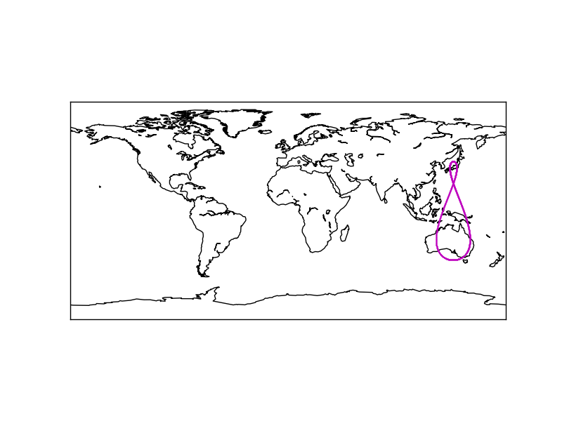

## PyEphem

**PyEphem**は、天文学分野で用いられる、多機能なPythonライブラリです。有名な天体暦プログラムである「XEphem」のアルゴリズムを基にしており、かなり充実した機能が提供されています。

[Welcome! — PyEphem home page](http://rhodesmill.org/pyephem/)

例えば、「任意の軌道要素をもつ天体（恒星・惑星・小惑星・人工衛星・彗星など）の、任意時刻における位置を計算する」といったことがサクッと出来てしまいます。

基本的な使い方は、公式チュートリアルで丁寧に説明されています。  
[PyEphem Quick Reference — PyEphem home page](http://rhodesmill.org/pyephem/quick.html)  
[The PyEphem Tutorial — PyEphem home page](http://rhodesmill.org/pyephem/tutorial.html)

## インストール

pipまたはcondaでインストールできます。

```bash
$ pip install pyephem
```

C++ Build Toolsが要求された場合は、そちらを追加でインストールしてください。

## 人工衛星の位置の取得方法

この記事では、地球周回人工衛星の軌道をシミュレートしてみます。pyEphemでは、対象となる宇宙オブジェクトの軌道情報を、XEphemフォーマットを用いて入力します（[XEphem](http://www.clearskyinstitute.com/xephem/help/xephem.html)）。XEphemフォーマットは、複数の「Field」がカンマで区切られた一行の文字列です（Fied1, Field2, Field3,…）。Field1とField2は以下のような書式で成り立っています。

**Field 1**: オブジェクトの名前  
**Field 2**: オブジェクトが辿る軌道の種類。以下の6種類から選択する。  
f: 固定軌道（fixed）  
e: 太陽中心の楕円軌道  
h: 太陽中心の双曲線軌道  
p: 太陽中心の放物線軌道  
E: 地球中心軌道  
P: プリセットに入っている惑星・衛星

**Field 2でどれを選択するかによって、Field 3以下が表す内容が変わります。**今回は地球中心人工衛星なので、Field 2は「E」を選択します。その場合のField 3以下の内容は下記のとおりです。

**Field 3** Field 4以下のパラメータが観測されたエポック（時刻）。month/day/yearという形で表されるが、dayに小数点を用いることで時刻まで表す。monthを1に固定して、年初からの経過日数をdayで表すと分かりやすい。  
**Field 4** 軌道平面の傾き（度）  
**Field 5** 昇交点の赤経（度, 春分点基準）  
**Field 6** 軌道の離心率 (必ず1未満)  
**Field 7** 近点引数（度）  
**Field 8** 平均近点角(度)  
**Field 9** 平均回転数（周回/日)  
**Field 10** 軌道減衰率（周回/日^2)  
**Field 11** これまでの積算周回数  
**Field 12** 抵抗係数(省略可)

このように書かれたXEPhem形式のパラメータを、readdbメソッドで読み込み、computeメソッドで、任意時刻の位置をシミュレートします。そしてsublatメソッド/sublogメソッドを用いれば、シミュレート結果から緯度・経度情報を取り出すことが出来ます。例えば以下のようなコードになります。

```python
import ephem
orbit_data = "test, E, 1/10.1/2017, 40.8, 158.3, 0.075, 270.5, 347.7, 1.002, 0.000002, 2543"
satellite = ephem.readdb(orbit_data)
satellite.compute(2017/01/15 01:00:00)
latitude = satellite.sublat / ephem.degree
longitude = satellite.sublong / ephem.degree
print(latitude, longitude)
```

また、readdbメソッドの代わりにreadtleメソッドを使えば、2行軌道要素形式（TLE）のパラメータを読み込むことも出来ます。  
[2行軌道要素形式 – Wikipedia](https://ja.wikipedia.org/wiki/2%E8%A1%8C%E8%BB%8C%E9%81%93%E8%A6%81%E7%B4%A0%E5%BD%A2%E5%BC%8F)  
各人工衛星のTLE情報は以下のサイトなどで公開されているので、実在の人工衛星軌道をシミュレートする場合は、こちらを使う方が便利でしょう。  
[LIVE REAL TIME SATELLITE TRACKING AND PREDICTIONS](https://www.n2yo.com/)

## 人工衛星の軌道を図示する

上のように、pyEphemを使えば、任意の時刻における人工衛星の位置（緯度,経度）が簡単に取得できます。この情報をmatlibplotに投げてやることで、人工衛星が通過する軌道を世界地図上に図示します。プロット先の世界地図としては、「Basemap」を使うのが簡単です。試しに、日本の準天頂軌道衛星(QZSS = Quasi-Zenith Satellite System）である「**みちびき**」の軌道を可視化してみました。

```python
# coding: utf-8
# 必要なモジュールのインポート
import numpy as np
import ephem
import time
import matplotlib.pyplot as plt
import matplotlib.cm as cm
from mpl_toolkits.basemap import Basemap
from datetime import datetime as dt
from datetime import timedelta as td

# 人工衛星の軌道要素を入力（書き下し形式）
object_name = "Michibiki"       # 衛星名
epoch_date = "17235.85543054"   # 以下の軌道要素が観測された時刻
inclination = 40.8777           # 軌道平面の傾き（度）
RAofAN = 158.3480               # 昇交点の赤経（度, 春分点基準）
eccentricity = 0.0754024        # 軌道の離心率 (必ず1未満)  　　
arg_perigee = 270.5910          # 近点引数（度）
mean_anomaly = 347.7789         # 平均近点角(度)
mean_motion = 1.00258630        # 平均回転数（周回/日)
decay_rate = 0.00000228         # 軌道減衰率（周回/日^2)
orbit_num = 2543                # これまでの積算周回数

# epoch_dateをXEphem用の形式に変換
year = int(epoch_date[:2])
if (year >= 57):
    year += 1900
else:
    year += 2000
dayno = float(epoch_date[2:])
epoch_date_sl = "1/%s/%s" % (dayno, year)

# epoch_dateから一分ごとの時刻を3600個作成
decimal_time = dt(year, 1, 1) + td(dayno - 1)
time_list = [(decimal_time + td(hours=i/60)).strftime("%Y/%m/%d %H:%M:%S") for i in range(0,3600)]

# 世界地図を描写
m = Basemap()
m.drawcoastlines()

# 一分ごとの人工衛星の位置をプロット
for item in time_list:
    orbit_data = ",".join(map(str, (object_name, "E", epoch_date_sl, inclination, RAofAN, eccentricity, arg_perigee, mean_anomaly, mean_motion, decay_rate, orbit_num)))
    satellite = ephem.readdb(orbit_data)
    satellite.compute('%s' % item)
    latitude = satellite.sublat / ephem.degree
    longitude = satellite.sublong / ephem.degree
    x1,y1 = m(longitude, latitude)
    m.plot(x1, y1, "m.", markersize=1)

# プロット表示
plt.show()
```



無事、準天頂軌道衛星特有の8の字カーブを描くことができました。  
[準天頂衛星システム – Wikipedia](https://ja.wikipedia.org/wiki/%E6%BA%96%E5%A4%A9%E9%A0%82%E8%A1%9B%E6%98%9F%E3%82%B7%E3%82%B9%E3%83%86%E3%83%A0)
