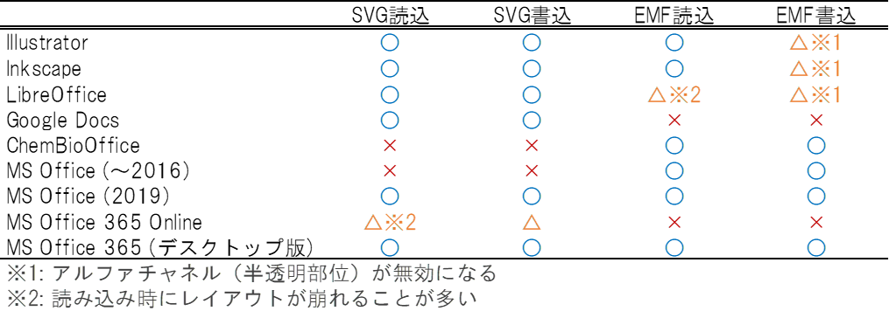
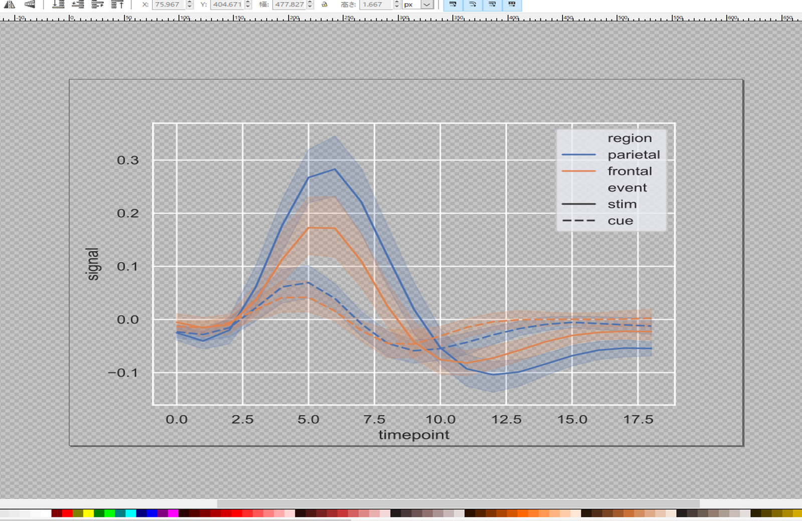
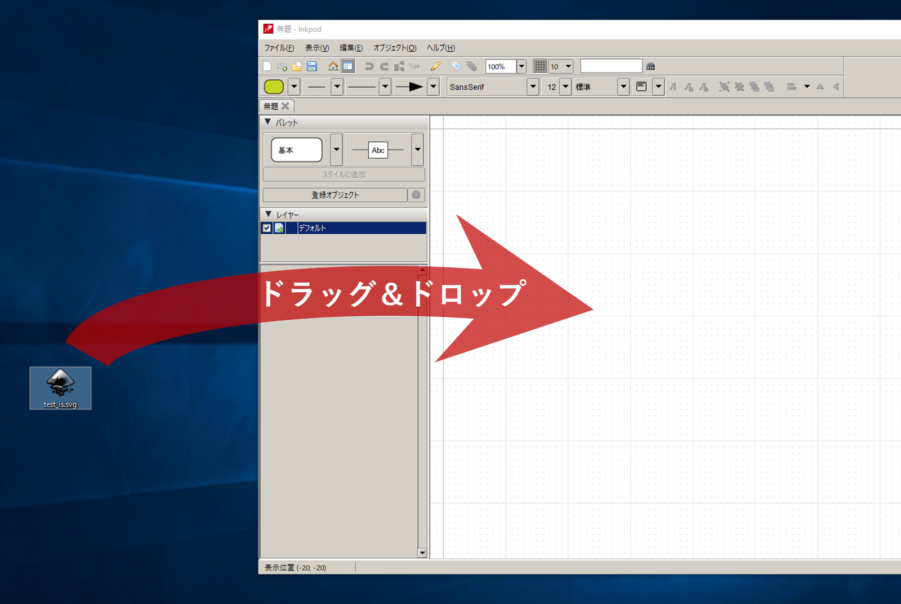
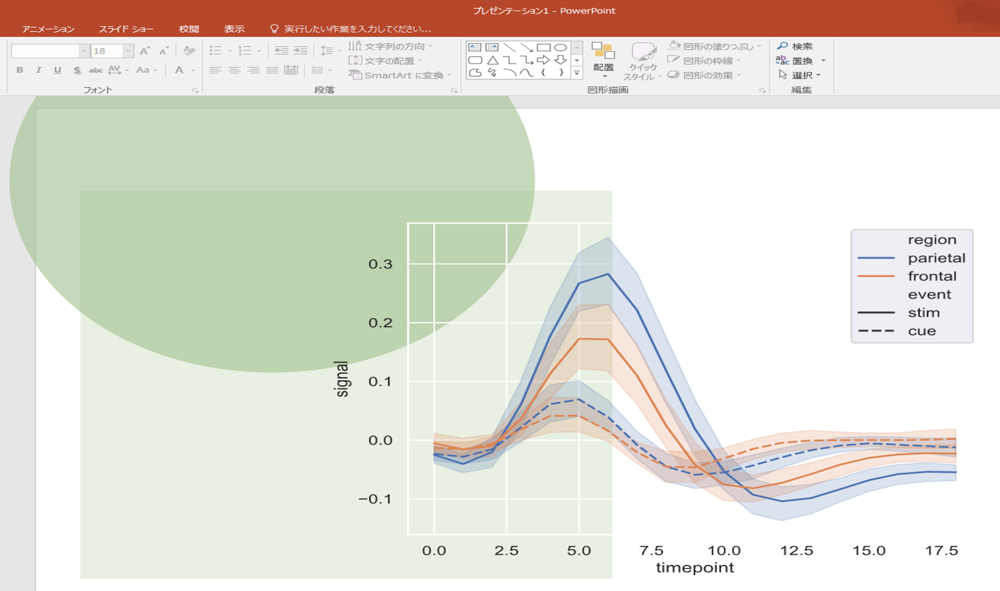

## 背景

IllustratorやInkscape等のドローソフトで描いたイラスト・グラフを、WordやPowerPointにベクタ情報を保ったまま貼りたい！という場面に遭遇することは案外頻繁にあると思います。しかし、主要なドローソフトやグラフ作成ソフトがデフォルトで出力するベクタ形式はSVG(Scalable Vector Graphics)が主流であるのに対し、Microsoft Officeがまともに扱うことができるベクタイメージは、実質的にEMF(Enhanced Metafile)一択です。[^1]　したがって、何らかの方法で**SVGファイルをEMFファイルへと変換**してやる必要があります。

## 問題点

検索したところ、SVG->EMF変換は、[Inkscapeを介した方法](https://maku77.github.io/windows/powerpoint/svg2emf.html)が一般的なようです。[^3]　しかしこの方法には欠点があります。**EMF変換後に半透明部分のアルファチャネルが全て無効になってしまう**のです。古い規格であるEMF（1993年策定）が、もともとアルファチャネルを0（完全不透明）と1（完全透明）しかサポートしていなかったことの名残です。Windows XPのころに規格が改訂されたり[EMF+](https://docs.microsoft.com/en-us/openspecs/windows_protocols/ms-emfplus/5f92c789-64f2-46b5-9ed4-15a9bb0946c6)ってのが出来たりして半透明チャネルもサポートされるようになりましたが、とにかく仕様が複雑なために、ほとんどのソフトでまともに実装されていません。[Inkscapeの開発陣もこの問題は随分前から認識している](https://bugs.launchpad.net/inkscape/+bug/1419686)ようですが、改善される予定はなさそうです。 結果として、有名なソフトは以下のように**「SVG対応しているがEMF対応が微妙」なソフトと「バッチリEMF対応しているがSVGに非対応」なソフトに二分されてしまっている**のが現状です。[^2]　*MS Office 2019ではようやくSVGに対応したらしいので、今後事態は好転に向かうかもしれませんが、まだしばらくは（第三者とのファイルのやりとり等を考えると）EMFを捨てることはできないでしょう。[^4]*

## 解決策

[カラビナシステムズの金指文明博士・中川晋吾博士ら](http://www.carabiner.jp/about.html)によって開発されている**[Inkpod](http://inkpod.carabiner.jp/)というアイデアスケッチエディタ**があります（フリーソフト, 非商用, 非OSS）。元々マインドマップ等を作成するために愛用させて頂いていたのですが、最近このソフトのEMF出力が非常に優秀であることに気付きました。[^5]　半透明有効なEMF出力が可能であり、SVGの入力にも対応しています。この**[Inkpod](http://inkpod.carabiner.jp/)**を介することで、**アルファチャンネルによる半透明化を有効にしたままSVG->EMF変換が可能**となります。以下具体的な手順を紹介します。 

## 手順

1.  Inkpodをインストールします。インストーラー（Win 32bit, Win 64bit, Mac版）は[こちら](http://inkpod.carabiner.jp/download.html)からダウンロードできます。インストーラーに従って、デフォルト設定でインストールすればokです。
2.  SVGファイルを作成・保存します。ここでは[Seabornのlinplotサンプル](https://seaborn.pydata.org/examples/errorband_lineplots.html)を使いました。テキストやストローク等が含まれている場合は、あらかじめInkscape等を使ってすべて「パス」に変換しておくと問題が起こりにくいです。保存形式はデフォルトの「Inkscape SVG」でok。
3.  [Inkpod](http://inkpod.carabiner.jp/)を起動し、.svgファイルをドラッグ&ドロップして開きます。**なぜか「開く」や「インポート」では開けないので注意してください。Inkpod上では半透明部分が見えなくなりますが、.emfにする時にまた見えるようになるので、焦らなくてokです。**  **以下のバグは最新バージョンで修正されたようです。制作者様に感謝。** ~3\. **突然ですが、今お使いのディスプレイのアスペクト比を調べてください。「なぜ？」と思われるかもしれませんが、実はInkpodでEMF出力をする際に、出力ファイルのアスペクト比が「(4/3)/(ディスプレイのアスペクト比)」倍になってしまうからです**（[EMF出力ではよくあるバグらしい](https://social.msdn.microsoft.com/Forums/vstudio/ja-JP/717eb448-4c90-4762-9e4f-40a7498b5e56/emf12364322943826312395123941238712390123751241412358?forum=vcgeneralja)）。**従って、あらかじめ画像のアスペクト比を「(ディスプレイのアスペクト比)/(4/3)」倍にひろげておく必要があります。**オブジェクトを選択した状態で、左ペインの「位置とサイズ」メニューから、「幅」だけを「(ディスプレイのアスペクト比)/(4/3)」倍にしてください。よくあるディスプレイのアスペクト比の場合、次のような倍率になります。 ・4:3ディスプレイ -> 1.00 倍（何もしなくて良い） ・16:9ディスプレイ -> 1.25 倍 ・16:10ディスプレイ -> 1.20 倍~
4.  「ファイル」->「エクスポート」->「選択したオブジェクトを拡張メタファイルにエクスポート」して、EMFファイルを保存します。
5.  MS Officeで開けることを確認。
6.  **EMFファイルをわざわざ書き出さなくても、「Inkpod上でオブジェクトを右クリック」→「画像としてコピー」して、MS Office上で「Ctrl+Alt+V」→「拡張メタファイルを選択」することで、直接コピー&ペーストすることもできます。**

## トラブルシューティング

-   SVGインポート時に、たまに一部の文字が欠けることがある（text部分のtspanタグが多重ネストしていると読み込めないっぽい）。**→ Inkscapeなどであらかじめフォントをアウトライン化しておけばok。**
-   SVGインポート時に、たまにInkscape等で作ったストローク（矢印とか）の大きさがおかしくなる。**→ あらかじめストロークをパスに変換しておけばok。**
-   SVGに要らないタグが沢山入っていると、やたらInkpodが重くなったりクラッシュすることがある。**→　Inkscape上でオブジェクトを全て選択してコピー→新しいファイルに張り付けて保存でok。**あるいは「最適化SVG」として保存してから再度Inkscapeで開いて改めて「Inkscape SVG」として保存しても良いかも。

## その他

-   Inkpodは[Javascriptから呼び出せるAPI](http://inkpod.carabiner.jp/appdev/)が公開されている。うまくやれば、コマンド一発で変換できるかもしれない
-   グラデーションもちゃんと綺麗に出力されます。

[^1]: .wmfもありますが、いくらなんでも古すぎるためMicrosoft的にも使用は非推奨のようです。.epsは最近使えなくなりました。
[^3]: 他には[svg2vector](http://www.vandermeer.de/projects/skb/java/svg2vector/)とか
[^2]: というかぶっちゃけほぼMSOfficeだけがスタンダードに沿っていない・・・。Office365\_onlineはweb志向なのでsvg陣営なのだろうか？
[^4]: COM技術（OLEとか）との相性を考えると当分現役を譲ることはなさそう
[^5]: EMF出力には[FreeHEP](http://freehep.github.io/freehep-vectorgraphics/ReleaseNotes.html)ライブラリを使っているようだが、他のFreeHEP採用ソフトよりも優秀な気がする・・・。そもそもFreeHEP自体が[半透明EMF出力をサポートしていない(?)](http://java.freehep.org/vectorgraphics/freehep-graphicsio-emf/test-output/Windows/JDK-1.6/emf/TestColors.html)ように見えるので、なぜInkpodが半透明に対応できているのかは謎。
