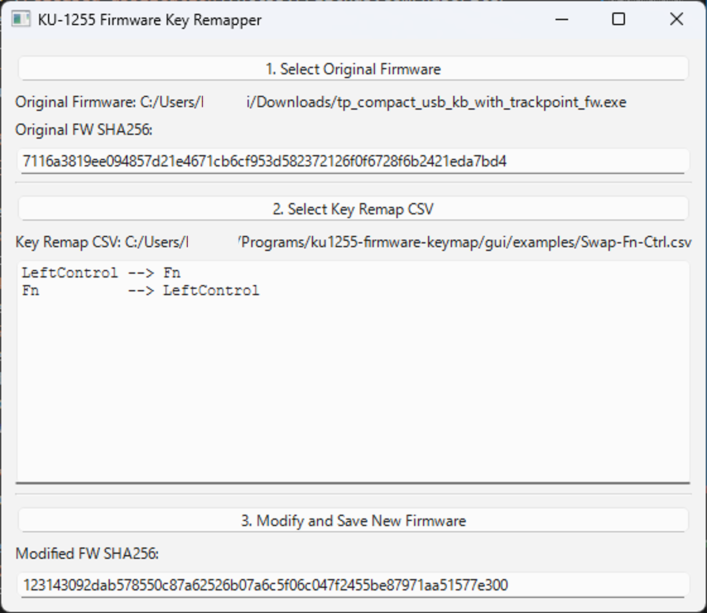

## 概要

-   [ThinkPad有線トラックポイント日本語キーボード0B47208](https://www.lenovo.com/jp/ja/p/accessories-and-software/keyboards-and-mice/keyboards/0b47208)（KU-1255）のFnキーとCtrlキーの入れ替え方法
-   ファームウェアを書き換えることで、キーボード内部でキーを変換する
-   [ファームウェア書き換え用のGUIを作った](https://github.com/haborite/ku1255-firmware-modifier)ので、その簡易解説
-   Bluetooth接続バージョンの後継機[ThinkPad トラックポイント キーボード II](https://www.lenovo.com/jp/ja/p/accessories-and-software/keyboards-and-mice/keyboards/4y40x49522)には適用できないので注意

## 手順

**以下の手順は旧バージョン用（ver 0.5.0以前）。 現行バージョンは以下のQiita記事を参照: [https://qiita.com/plotter/items/4eec54eaf3f8fc5e74a0](https://qiita.com/plotter/items/4eec54eaf3f8fc5e74a0)**

（旧バージョン用の手順）

1.  [Lenovo公式サイト](https://support.lenovo.com/ca/en/solutions/pd026745)から、ファームウェア（`tp_compact_usb_kb_with_trackpoint_fw.exe`）をダウンロード
2.  [GitHubのダウンロードページ](https://github.com/haborite/ku1255-firmware-modifier/releases/latest)から、ファームウェア書き換えツールをダウンロード
3.  2を解凍して、中にある`ku1255-fw-remapper.exe`を起動

*Keymap tool GUI overview*

4.  「**1\. Select Original Firmware**」 をクリックして、1.でダウンロードした公式ファームウェアを指定。”Original SHA256: “の欄に`7116a3819ee094857d21e4671cb6cf953d582372126f0f6728f6b2421eda7bd4`と表示されていることを確認
5.  「**2\. Select Key Remap csv**」をクリックして、3.で解凍したフォルダ内にあるexamplesフォルダの中にある`Swap-Fn-Ctrl.csv`を選択
6.  「**3\. Modify and Save New Firmware**」を押して、変換後のファームウェアに名前を付けて保存。”Modified SHA256: “の欄に`123143092dab578550c87a62526b07a6c5f06c047f2455be87971aa51577e300`と表示されていることを確認
7.  ThinkpadキーボードをUSBに接続
8.  変換後のexeを実行して、ファームウェアを更新する
9.  ThinkpadキーボードをUSBから一度抜き、再度差す

以上の手順でFnと左Ctrlが入れ替わる。

## その他

設定CSVを編集すれば、任意のキーの入れ替え等が可能。私はFn-Ctrl入れ替えの他に

-   変換キーと無変換キーにIME ON / OFFを割り当て（MacOS風）
-   矢印キーと誤打しやすいPageUpとPgDownを無効化

している。詳しくは[GitHubのREADME](https://github.com/haborite/ku1255-firmware-modifier)を参照。

もし質問などあれば、GitHubのissueから質問して頂ければ幸いです（日本語 or 英語、どちらでもok）。
