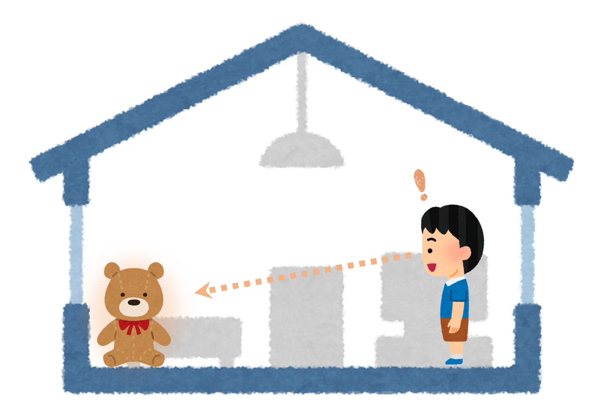
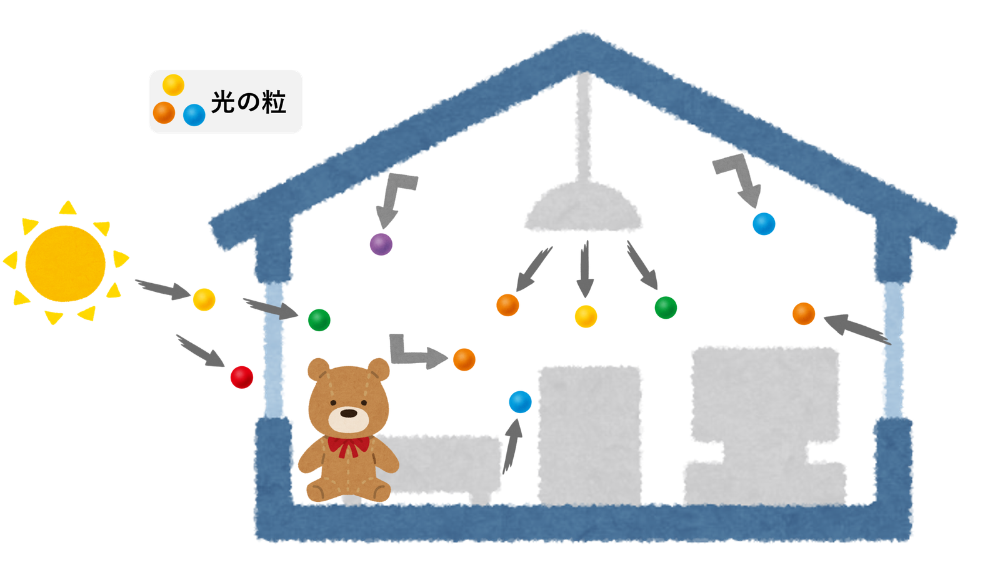

# 見えるとは何だろうか？

目が見えるという事は便利なものです。どんな風に便利なのか？瞼を閉じてみれば分かります。瞼を閉じると、ものが見えません。言いかえると「どこ」に「何」があるのか、手で触れてみなければ分かりません。目が見えると、遠くて手で触れられないもの ― 例えば部屋の隅に置いてあるぬいぐるみ ― が確かにそこにあることが分かります。でも私達は、なぜそんなことが分かるのでしょうか？  その答えを知るためには、部屋の照明を消し、カーテンを閉じてみることです。部屋は真っ暗になり、ぬいぐるみの場所はもう分かりません。照明を消すことで、「見える」ために必要な何かが失われてしまったからです。何が失われたのか？、その答えは「光」です。太陽や照明は、数えきれないほどたくさんの光の粒をまわりに発しています。光の粒はビリヤードの玉のようにまっすぐに飛んで、いろんなものにあたっては反射しています（それから、ビリヤードの玉のようにいろんな色があります）。この世界は、光の粒で溢れているのです。私たちはものにあたって反射してきた光の粒を目で捉えることで、遠くにあるものを「見る」ことができます。 

# どうすればものが「見える」だろうか？

では、私たちの目はどうやってこの光の粒を捕まえているのでしょうか？その仕事を担っているのが、「視覚細胞」です。視覚細胞は、目の奥にびっしりと並んでいる小さな細胞で、光の粒が衝突すると「光が当たったよ！」という情報を電気信号として発信します。この信号を脳に伝えることで、私達は機能を持っています。され、

カメラではこの部品を

# どうすればものが「見える」だろうか？

この光の粒をつかまえれば、ものが「見える」ようになるのでしょうか？ 次のような実験をしてみます。今、部屋の真ん中に光の粒を捕まえる小さな部品（光センサー）を置きます。 この部品は、光の粒があたると「光があたったよ！」という反応を返してくれます。

この部品を置いておけば、ものが見えるようになったでしょうか？光センサーには四方八方から光の粒が飛んできます。部屋が明るければどんどん、暗ければたまに光の粒が光センサーへと入ってきます。 その結果、この光センサーから得られる情報は、「なんか周りが明るいなぁ（or 暗いなぁ）」ということだけです。「どこ」に「何」があるのかはさっぱり分かりません。残念ながら、これではものが見えたとはいえません。

光センサーを沢山並べれば良いのでしょうか？やっぱり残念なことに、これでも見えるようにはなりません。どの光センサーも皆同じように「明るい」「暗い」という結果しか返してくれないので、ちっとも情報が増えないのです。

一体何が悪いのでしょうか？もう一度、私たちが知りたいことを整理してみましょう。 私たちが知りたいのは、「どこ」に「何」があるか？ということ。その情報を、周りを飛び交う光の粒を利用して知りたいわけです。そのためには、「光の粒がどの方向から飛んで来たのか」を知る必要があります。これまでは、上から来た光も横から来た光もまったく区別せずに検出していたため、こういった情報が全部失われていました。

どうすれば、光がどこから飛んできたのか知ることができるでしょうか？一つのやり方は、光センサーを筒の底に取り付けて、それをボールの表面一面に配置してやることです。望遠鏡を沢山並べているようなものです。筒が必要なのは、横や斜めから入ってくる光を遮ってやるためです。こうすると、それぞれの光センサーは、自分の真上から飛んできた光だけに反応するようになります。つまり、光の飛んでくる方向が分かるようになるわけです。すべての光センサーから集まった「明るい」「暗い」という情報を並べてやること、こんな風になります。ぼんやりとですが、ものの形を捉えることができました。まさにこれが「見える」ということです。このような「光が飛んできた方向と明るさ」の情報を「像」と言います。

このやり方は「管状眼」と呼ばれていて、ゴカイのような原始的な生物の目に採用されています。昆虫の持つ「複眼」もこれに似た方法です。トンボの目は球状にびっしりと細かい目のようなものが並んでいますが、まさにあの奥の方にたくさんの光センサーが並んでいるわけです。

もうひとつ、光が飛んでくる方向を知るためのうまいやり方があります。とても小さな穴を用意して、その穴の奥に光センサーを半球状に並べてやるという方法です。この構造では、光センサーに光の粒が届くためには、必ずこの小さな穴を通らなくてはなりません。すると、ある一つの光センサーに到達するための光の方向が、一つに定まってしまいます。よって、この方法でも光の飛んでくる方向が分かるようになります。このやり方は「ピンホール眼」と呼ばれていて、イカやタコの目に採用されています。「管状眼」よりも光センサーをたくさん並べられるので、像の形がより細かい部分まで分かる（解像度が高い）のが長所です。実は、人類が約2000年前に発明した「カメラ」も、初期はこの方法を使っていました。ピンホールカメラといいます。下はピンホールカメラを使って撮影された写真です。ちゃんとものの形を捉えらえていますね。

一方で、ピンホールカメラにも重大な問題があります。最新のスマートフォンやデジタルカメラの写真と比べてみると、ずいぶんボヤっとした、ピントがボケた写真だと思いませんか？ イオンホールカメラには、小さな穴を使うのですが、小さいといっても光の粒にとっては十分大きな穴です。したがって、実ちょっと角度が違っても光が入ってきてしまうのです。そうすると、ある場所から飛んできた光が、本来反応するはずの光センサーの隣のセンサーにも反応してしまうので、像がボヤけてしまうのです。

「それならば穴を小さくすれば良いのでは？」というのは最もな疑問です。実際、ピンホールカメラは穴ができるだけ小さく小さくなるように工夫されていました。しかしところが今度は、穴が小さくなるので、入ってくる光の量がぐっと減ってしまうのです。穴を小さくすればするほで像がどんどん暗くなってしまい、最終的には何も見えなくなってしまいます。実際、ピンホールカメラで撮影するときは、光が十分な数は言って車で数時間ぐらいじっと動かずに、撮影を続ける必要があるのです。これはちょっと困りものですね。

これを解決するためにはどうすれば良いでしょうか？改めてピンホールカメラの構造を見てみると、板に到達したほとんどの光が穴に入ることができず、実にもったいないことが分かります。これらの光をうまく使ってやれば、明るくてボヤけていない、鮮明な像が得られるのではないでしょうか？ そのために生まれた偉大な発明品が「レンズ」です。レンズとは、 そう考えると、私たちの目、あるいはデジタルカメラやスマートフォンは優れたものです。ものを見た瞬間に一瞬でその形がくっきりと分かります。一体何が違うのでしょうか？

そのものを 「どこからその光が来たのか」

でも少し待ってください。
